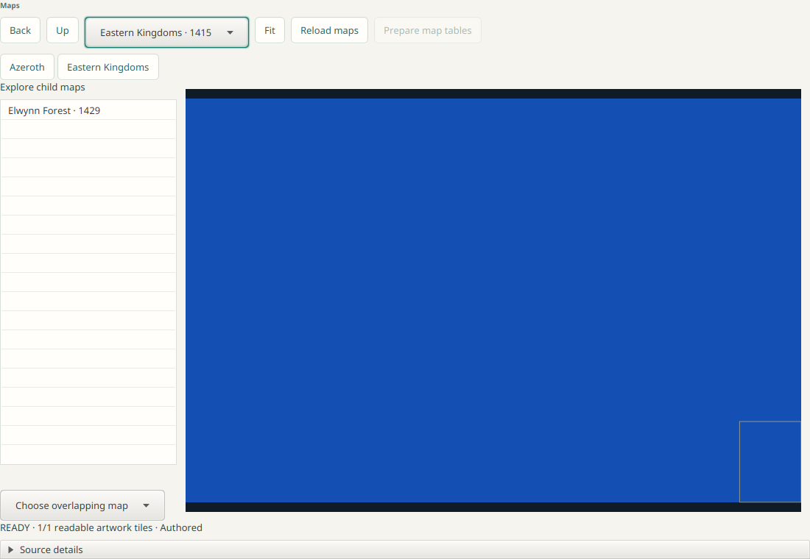

# vimi

**vimi is a desktop app for exploring World of Warcraft game data.** Pick a game
build and vimi downloads that build's files from Blizzard's public content servers
into its own library. You can then browse its items, creatures, talents, NPCs,
quests, maps and dungeons, or fly around the game world in 3D.

It runs on Windows, macOS and Linux. It's an early preview (alpha), and the
desktop packages are published as GitHub prereleases. In the app and its
packages it's called VibeMiner.

- **No game install needed.** vimi never searches for or requires a World of
  Warcraft install. It fetches what it needs and keeps it in its own library.
  The one optional exception: you can import a client hotfix cache
  (`DBCache.bin`) from an install, so hotfixed records show up.
- **Read-only.** It looks at game data; it doesn't connect to game servers or
  change anything.
- **Works offline once downloaded.** Opening a build fetches its metadata, files
  and tables; models, textures and the world load on demand. Choose **Download
  all** for a build and, once it finishes, browsing works without a network
  connection.

## Contents

- [What you can do](#what-you-can-do)
- [Install a preview build](#install-a-preview-build)
- [Quick start](#quick-start)
- [World explorer controls](#world-explorer-controls)
- [Run from source](#run-from-source)
- [Develop and test](#develop-and-test)
- [Project layout](#project-layout)
- [More documentation](#more-documentation)
- [License](#license)

## What you can do

| Screen | What it shows |
| --- | --- |
| **Builds** | Every known game build per edition (Classic Era, Anniversary, Forever and others), with download size and status |
| **Overview** | A summary of the open build: files, tables and how much of it is stored locally |
| **Files** and **Tables** | Raw browsing of the build's files and its data tables (DB2), with search |
| **Items** | Items with filters by class, quality and slot, tooltips, effects and 3D previews |
| **Creatures** and **Mounts** | Creature and mount models with their display variations and idle animations |
| **Races** | Playable races, their class combinations and character appearance |
| **Talents** | Talent trees with tooltips and prerequisites |
| **Professions** | Recipes, reagents, tools and skill levels |
| **NPCs** and **Quests** | NPC and quest catalogues merged from optional community sources |
| **Maps** | Zone maps with quest givers, vendors, trainers and flight masters |
| **Dungeons** | Dungeons and raids with their difficulties, areas and encounters |
| **Compare** | What changed between two builds |
| **World** | A 3D explorer: terrain, water, buildings, city interiors, music and ambience |



*The screenshots in this repository use made-up test data. No game assets are
stored in Git.*

## Install a preview build

Download the latest prerelease from the
[Releases page](https://github.com/aircan80/vimi/releases). Each release has a
package for every platform, and a `SHA256SUMS` file to check the downloads:

| Platform | Installer | Portable |
| --- | --- | --- |
| Windows (x64) | `VibeMiner-<version>-windows-x64.msi` | `...-windows-x64.zip` |
| macOS (Apple silicon) | `VibeMiner-<version>-macos-arm64.dmg` | `...-macos-arm64.zip` |
| macOS (Intel) | `VibeMiner-<version>-macos-x64.dmg` | `...-macos-x64.zip` |
| Linux (x64 or ARM64) | `.deb` or `.rpm` | `.tar.gz` |

The packages include everything they need (Java, JavaFX and SQLite), so you
don't need to install Java. They're unsigned previews: Windows SmartScreen and
macOS Gatekeeper will ask you to confirm the first launch.

Your library is kept separately from the app, so updating or uninstalling keeps
it:

| Platform | Library folder |
| --- | --- |
| Windows | `%LOCALAPPDATA%\vimi` |
| macOS | `~/Library/Application Support/vimi` |
| Linux | `$XDG_DATA_HOME/vimi` (usually `~/.local/share/vimi`) |

Each release's notes are in [docs/releases](docs/releases) and say if a version
changes the library format. See [Prereleases](docs/prereleases.md) for how the
packages are built and checked.

## Quick start

1. Open vimi. It shows the builds it already knows about and checks for new
   builds and data source updates in the background.
2. Click **Refresh builds** at any time to check again.
3. Pick a build, for example the latest **Classic Era** one, and open it. vimi
   downloads its metadata, then prepares files and tables in the background. You
   can watch the progress and start browsing as soon as a screen is ready.
4. Try **Items**: search for `Thunderfury` or type an exact item ID such as
   `19019`.
5. Open **World**, pick **Eastern Kingdoms**, choose a tile near Elwynn Forest
   and click **Open explorer**.

Community data sources (Questie, Polestar, EG Link and the community listfile)
add NPCs, quests and map markers. They are on by default and update at startup
and with **Refresh sources**; turn any of them off in **Data Sources**. See
[Data sources](docs/data-sources.md).

## World explorer controls

Click the view to give it the keyboard.

| Key | Action |
| --- | --- |
| `W` `A` `S` `D` | Move |
| `Space` or `E` | Go up |
| `Q` or `X` | Go down |
| Mouse drag or arrow keys | Look around |
| `Shift` | Move faster |
| Mouse wheel | Move along the view direction (`Shift` + wheel changes speed) |
| `F` | Walk on the ground instead of flying |
| `M` | Map panel |
| `F11` or `Alt` + `Enter` | Full screen |
| `H` (or `Alt` + `Z`, which always works) | Hide the HUD |
| `B` | Bookmarks and travel |
| `I` | Pin the inspect panel (click an object or creature to inspect it) |
| `V` | NPC spawn markers |
| `L` | Tracking |
| `N` | Minimap |
| `T` | Day and night |
| `1` to `5` | Speed presets |
| `F12` | Screenshot |
| `F3` | Developer overlay (press again for the next page) |
| `Esc` | Game menu (settings, bookmarks, back to the map) |

All keys can be changed in **Esc → Controls**. The AZERTY layout preset moves
movement to `Z` `Q` `S` `D` and down to `A` or `X`, and leaves the number-key
speed presets unbound (use `Shift` + wheel).

**View distance** (Near or Far) is on the Display page of the game menu. Some
features are still behind test switches, which are Java system properties. From
source, build the launcher and pass them in `JAVA_OPTS`:

```sh
./gradlew :gui:installDist

# Show creatures in the world
JAVA_OPTS='-Dvimi.world.creatures=true' gui/build/install/vimi-gui-prototype/bin/vimi-gui-prototype

# Use the game's recorded sky and light, pinned to midnight
JAVA_OPTS='-Dvimi.world.sky=recorded -Dvimi.world.sky.time=00:00' gui/build/install/vimi-gui-prototype/bin/vimi-gui-prototype
```

The current list is in the latest
[release notes](docs/releases/v0.1.0-alpha.35.md). More detail on
the explorer is in [World](docs/world.md).

## Run from source

You need a **full Java 25 JDK** (not just a runtime) with `JAVA_HOME` pointing to
it, and the native SQLite library:

| Platform | SQLite library |
| --- | --- |
| Linux | `libsqlite3.so.0` from your package manager (for example `sudo apt install libsqlite3-0`) |
| macOS | `libsqlite3.dylib`, for example from Homebrew (`brew install sqlite`) |
| Windows | `sqlite3.dll` |

Use a SQLite library that matches your JDK's architecture. The Gradle wrapper is
checked in and downloads everything else on first use. To work in IntelliJ IDEA,
open the repository root as a Gradle project and select the Java 25 JDK for both
the project and the Gradle JVM.

```sh
git clone https://github.com/aircan80/vimi.git
cd vimi

# Run the app
./gradlew :gui:run

# Point at a specific SQLite library, or keep test data away from your real library
./gradlew :gui:run -PsqliteLibrary=/opt/homebrew/opt/sqlite/lib/libsqlite3.dylib
./gradlew :gui:run -PdataDirectory=/path/to/test-library

# Try the interface with made-up data: no downloads and no library
./gradlew :gui:run --args='--mock'
```

On Windows, use `gradlew.bat` instead of `./gradlew`.

If you rebuild while the app is running, run a copy instead, so the rebuild
doesn't replace files under it (Linux and macOS):

```sh
./gradlew :gui:installDist
run=$(mktemp -d) && cp -a gui/build/install/vimi-gui-prototype/. "$run/" && "$run/bin/vimi-gui-prototype"
```

See [native SQLite](docs/native-sqlite.md) if SQLite can't be found, and the
[GUI guide](gui/README.md) for more launch options.

## Develop and test

Each module is a Gradle subproject with its own tests. The usual loop is to run
the fast tests of the module you changed, then its full checks:

```sh
./gradlew :concepts-world:test                        # fast unit tests
./gradlew :concepts-world:test --tests '*ExteriorObjectsTest'   # one class
./gradlew :concepts-world:check                       # unit and style checks
./gradlew check                                       # all modules in the root build
```

| You changed | Run |
| --- | --- |
| One module's logic | `:<module>:test` |
| Storage, locking or recovery | Also `:object-store:integrationTest` and `:object-store:crashTest` |
| A shared interface | Also the tests of the modules that use it |
| The GUI | `:gui:check` |
| GPU rendering | `:rendering-bgfx:check` and its `nativeGpu…` proofs, see [rendering-bgfx](rendering-bgfx/README.md) |
| Documentation only | Nothing, unless a documented command changed |

Code style is enforced in `check` for every module except `gui`: four-space
AOSP formatting (Spotless with google-java-format), Checkstyle, and compiler
warnings as errors. To format:

```sh
./gradlew spotlessApply                     # all modules
./gradlew :concepts-world:spotlessApply     # one module
```

Tests never use real game data or your library, and network tests use local fake
servers. CI runs the unit and integration checks on Linux, Windows and macOS; see
[CI](docs/ci.md).

## Project layout

vimi is built in layers. Each layer talks to the ones below it through
interfaces, and most modules ship a fake for tests.

| Layer | Modules | What it does |
| --- | --- | --- |
| Storage | [`object-store`](object-store/README.md), [`generated-store`](generated-store/README.md) | The local library: pack files with a SQLite index, crash-safe |
| 1. Network | [`network-clients`](network-clients/README.md), [`network-activity`](network-activity/README.md) | Blizzard CDN and version services, community definitions |
| 2. Access | [`object-access`](object-access/README.md) | Local first, then CDN, with history |
| 3. Builds | [`builds`](builds/README.md) | Build discovery, opening and downloads |
| 4. Files | [`files`](files/README.md) | A build's files by name or ID, decoding and decryption |
| 5. Formats | [`formats-tables`](formats-tables/README.md), [`formats-assets`](formats-assets/README.md), `formats-world`, `formats-audio` | DB2 tables, BLP images, M2 models, terrain and buildings, audio |
| 6. Concepts | [`concepts-core`](concepts-core/README.md), [`concepts-items`](concepts-items/README.md), [`concepts-creatures`](concepts-creatures/README.md), [`concepts-effects`](concepts-effects/README.md), [`concepts-talents`](concepts-talents/README.md), [`concepts-races`](concepts-races/README.md), [`concepts-comparison`](concepts-comparison/README.md), and `concepts-world`, `concepts-npcs`, `concepts-quests` and more | Game facts built from the formats |
| Rendering | `rendering-models`, `rendering-world`, [`rendering-bgfx`](rendering-bgfx/README.md) | CPU fallback and GPU (Vulkan, Direct3D 11, Metal) renderers |
| 7. App | [`gui`](gui/README.md) | The JavaFX desktop app |

Community sources live in [`questie`](questie/README.md), [`polestar`](polestar/README.md)
and [`eg-link`](eg-link/README.md), and storage accounting in [`accounting`](accounting/README.md). The
[architecture overview](architecture.md) has a diagram of how they fit together.

## More documentation

- [World explorer](docs/world.md) and the [World roadmap](docs/world-experience-roadmap.md)
- [Data sources](docs/data-sources.md), [NPCs and quests](docs/npcs-quests.md), [locations](docs/locations.md)
- [Items](docs/item-attributes.md), [talents](docs/talents.md), [races](docs/races.md), [mounts](docs/mounts.md), [professions](docs/professions.md), [dungeons](docs/dungeons.md), [mount and profession screen design](docs/mounts-professions-design.md)
- [Data flow and privacy](docs/data-flow-inventory.md): every network destination and what is stored locally
- [Security review](docs/security-review.md)
- [Library storage](docs/unified-storage-services.md) and the [disk format](docs/object-store-v1.md)
- [Release notes](docs/releases) and the [roadmap issue](https://github.com/aircan80/vimi/issues/186)

## License

vimi is licensed under the [GNU General Public License v3](LICENSE). World of
Warcraft and its game data belong to Blizzard Entertainment; vimi is an
unofficial tool and is not affiliated with or endorsed by Blizzard.

The app bundles the WoWDBDefs table definitions (revision `b9a63096`, by WoWDBDefs
contributors, CC BY-SA 4.0) and third-party runtime libraries; their notices are
listed in [Bundled runtime notices](docs/third-party-runtime.md) and shown in the
app under **Settings → Bundled data**.
