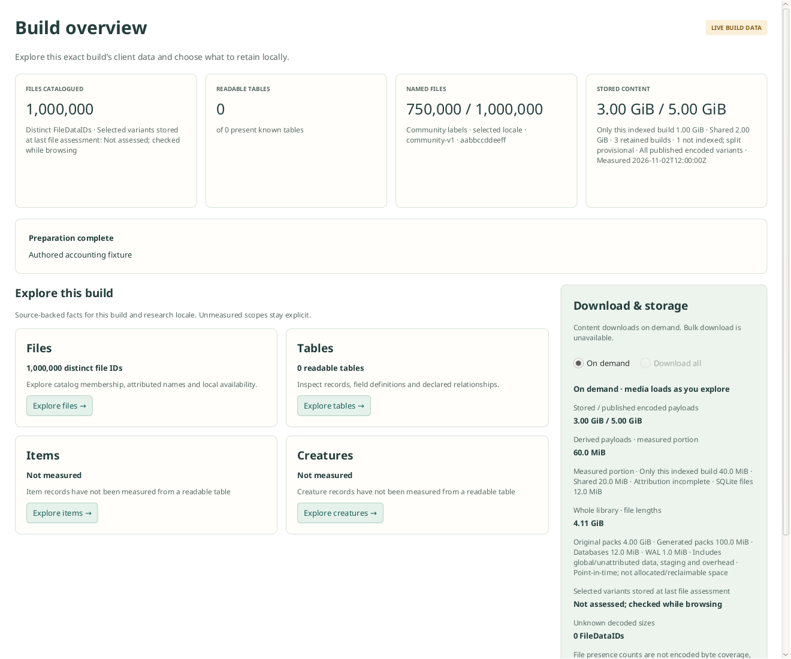

# Storage accounting

The native app uses `UnifiedStorageAccounting` over the shared pack index and
`LibraryCatalog`. Original and derived object ownership is authoritative at
publication and on successful owner-bound cache reads. All saved dependencies are
covered, including image caches, record manifests/segments and provider indexes.
Accounting reads catalog/index metadata; it does not reopen or decode those
artifacts to rediscover their sizes. SQLite query-table bytes are excluded.

Community listfile originals and indexes use a global provider owner. Bundled
schemas/keys are application resources, not stored payloads. Model/appearance
results that exist only in memory or caller-owned outputs are not saved objects.
Questie source archives and its separate relational snapshots remain outside the
pack library's per-build attribution. Future binary provider artifacts must use
immutable owner-bound capabilities just like current producers.

An object's stored byte count is distinct from semantic validity. Unsupported,
stale or corrupt artifacts remain physical bytes until explicitly repaired or
removed by their owning service. Failed inventory replacement keeps the prior
snapshot; unresolved expected inventories keep coverage incomplete. Reporting
never authorizes deletion. Old standalone caches remain included in physical
library measurements, not silently attributed to new build owners. They are
reused/reconciled only with verified ownership; no empty inventory is invented.

Current coverage applies to objects in the shared library. Reference membership
survives workspace closure and restart. Cache hits can change unique/shared
attribution without writing a new object; a read-only SQLite data-version watcher
invalidates GUI figures after committed changes. Original ENCODING membership
still needs a completed inventory before original sharing is definitive.

The module also retains the legacy `UsageIndex` contracts and
`LegacyCatalogOwners` intent importer. The following separate-presence projection
is retained for legacy callers; the native app does not maintain it. See
[the unified service guide](../docs/unified-storage-services.md).

A JavaFX-free application service with a `StorageAccounting` interface and SQLite
`UsageIndex` implementation. It reports resource attribution; it never authorizes
deletion, compaction or garbage collection. Application adapters supply inventories
from the existing build/file/format/concept services, which do not depend on this
component. No object-store pack format changes are needed.

## Measurements and scope

- **Original encoded content:** every published ENCODING variant, across locales.
  Published bytes are declared EN lengths; stored bytes come from local index
  payload lengths. Size discrepancies are reported rather than hidden.
- **Build-only/shared:** full storage/object identity, deduplicated once per
  canonical build, across all of that build's producer snapshots. Region/CDN
  acquisition routes do not create additional build owners. Library membership
  persists independently of active GUI handles. Discovery alone does not retain a
  build; prior preparation receipts and newly prepared builds establish membership.
- **Incomplete originals:** unindexed retained builds prevent a definitive unique
  claim. The UI says "only this indexed build" and marks the split provisional.
- **Derived content:** manifests, alias nodes, layout records and shared segments
  are distinct saved resources. App adapters currently cover file catalogs, table
  inventories/graphs, the community-name generated index (global), and current
  Items SQLite files. Asset caches and other provider dependencies are not fully
  inventoried yet: the GUI explicitly reports a measured portion and incomplete
  attribution. Old/unregistered data stays unclassified; it is never assumed absent.
- **Physical library figures:** point-in-time regular-file lengths under the current
  data directory, categorized as original/generated packs, databases, WAL, SHM,
  staging and other files. These include global/unattributed data and container
  overhead; they are neither filesystem allocated blocks nor reclaimable bytes.
  Database/WAL file measurements remain separate from generated payload totals.
  A scan never checkpoints a database to change its measurement. The root path is
  resolved; symbolic links inside it are excluded and mark the scan incomplete.

A key present in an object index contributes its payload length, without verifying
or reading that payload. Content integrity remains the existing verification
services' responsibility. Archive transfer sizes, decoded-file sizes, bytes sent
over the network and total cache-directory sizes are not substituted for encoded
object payloads. Shared objects count once per build and once in a deduplicated
library resource set, not a fraction allocated arbitrarily to each owner.

## Publication, reconciliation and limits

`retain` declares a producer expected for an owner. `replace` consumes an immutable
producer inventory and atomically replaces that producer's references/receipt.
Cancellation or failure rolls back the partial import and retains the prior
complete generation. Producer artifacts commit independently; missing registrations
are recovered by rereading durable inventories on reopen. A successful preparation
never depends on accounting succeeding.

The SQLite actor has one worker and 64 queued requests. Inventory, presence,
notification and reconciliation pages contain at most 256 resources; storage batch
length APIs cap callers at 4,096 keys. Accounting requests per live GUI context
coalesce to one worker plus one pending latest refresh. SQLite page-cache settings
are 2 MiB targets with FILE temporary storage, not hard process-RSS guarantees.
Reference-index disk space grows with retained inventories; transactions/WAL need
additional working disk space. Source build parsers retain their existing bounds.

In-process commit events update known original keys. Missed events trigger a full
local reconciliation; startup and a five-minute sweep also reconcile presence.
Derived lengths and library file lengths refresh on that sweep; current producer
snapshots are registered after preparation. Build figure snapshots state their
measurement time. Accounting failure retains prior figures with a stale/incomplete
message. Closing a GUI build preserves library membership. Explicit `forget` removes
reporting references only and never deletes payloads.

Community-name coverage merges distinct selected-locale FileDataIDs with one
immutable name snapshot using pages of 256 names. It counts provider labels, not
proof of historical Blizzard filenames. Cached counts require the exact build,
catalog/locale scope and provider content fingerprint. A damaged snapshot never
becomes measured zero; providers without fingerprints are measured without reuse.

The first inventory can be substantial and runs independently of readiness. This
feature does not promise a certified real-corpus throughput or exact delete-build
space prediction. Existing data needs no migration or cache invalidation.

## Checks

```sh
./gradlew :accounting:test                         # fast public input contract
./gradlew :accounting:check                        # quality and real SQLite contracts
./gradlew :files:test --tests '*NameCoverageTest'   # pure metadata merge
./gradlew :gui:overviewPresentationTest :gui:preparationIntegrationTest
./gradlew :gui:overviewAccountingUiTest            # optional, requires a display
```

Supply the normal `-PsqliteLibrary` override when the platform needs it. Dependency
and build-tool locks are committed. Native tests cover sharing/deduplication,
retained membership after restart, incomplete inventories, canceled/failed import
rollback, metadata reconciliation, name-cache fingerprint changes and physical
file classification. GUI integration checks offline preparation/reopen without
extra media downloads or repeat full file-catalog enumeration.

Unified asset/provider accounting: [#64](https://github.com/aircan80/vimi/issues/64).

Authored UI fixture (illustrative values, not a real build measurement):


