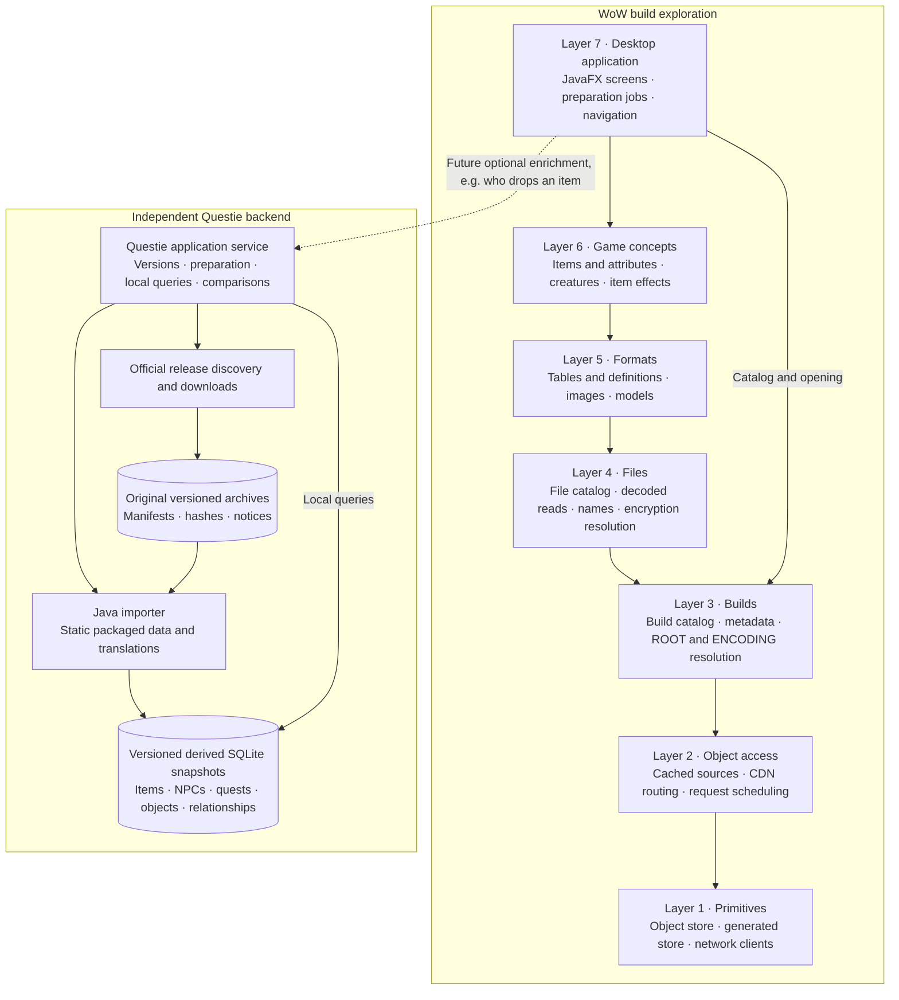

# Architecture overview

Vimi is a local Java application organized into seven layers. The UI calls backend
services; storage, downloads, parsing and game rules stay outside the controls.
Higher layers may call any lower layer through its public interfaces—the diagram
shows the main responsibilities rather than every dependency.

| Layer | Java components | Responsibility |
| --- | --- | --- |
| **1 — Primitives** | `object-store`, `generated-store`, `network-clients` | Durable original/derived storage, SQLite utilities, HTTP and protocol clients. |
| **2 — Object access** | `object-access` | Obtain encoded objects through cached sources, with routing, scheduling and cancellation. |
| **3 — Builds** | `builds` | Discover/list builds, read metadata and resolve file identities using build configurations, ROOT and ENCODING. |
| **4 — Files** | `files` | Expose FileDataIDs, locales, sizes, storage state and decoded file reads. Resolve encryption keys and optional community names. |
| **5 — Formats** | `formats-tables`, `formats-assets` | Read DB2/DBD tables, BLP images and supported M2/SKIN model formats. Persist reusable decoded results. |
| **6 — Game concepts** | `concepts-core`, `concepts-items`, `concepts-creatures`, `concepts-effects` | Join game tables into meaningful entities, attributes and relationships. Own item calculations and indexed grid queries. |
| **7 — Application/UI** | `gui` | Compose services, manage preparation/activity, present pages and request details/media asynchronously. |

## Unified pack library and accounting

Object payloads live in packfiles. One SQLite index/catalog records physical
location, integrity, canonical BUILD/GLOBAL ownership, expected references and
persisted build-list status. The generated-store facade borrows the same engine.
Existing pack-index tables remain compatible with the reused engine, while new
metadata follows `storage_*`, `catalog_*` and `builds_*` ownership conventions.
SQLite has no named schemas inside one file; these prefixes document boundaries.
See [the service guide](docs/unified-storage-services.md).

Each operation captures an immutable owner capability. Payload fsync precedes the
FULL transaction publishing index and ownership together. Accounting joins expected
references directly to physical presence; there is no second presence index to
refresh. Unknown inventories remain provisional, and relational table bytes stay
outside per-build object totals. Original/derived is an accounting category, not a
retention rule. The old `accounting.UsageIndex` remains for legacy compatibility and
read-only intent import, not the new native app's authoritative presence source.

Domain components retain their own query APIs and table ownership. Future item or
Questie relational projections may share the database, but the GUI calls search/
paging services rather than arbitrary SQL. Existing query projections remain
separate until deliberately integrated in phase two.

## Builds-only phase

The native app currently discovers and loads authenticated configuration, ROOT and
ENCODING metadata, exposing the expected object ledger for build-size accounting.
It skips archive indexes, file-catalog preparation, tables, items and research jobs.
Statuses come from `BuildRegistry` tables and survive restart. LOADED describes
metadata opening, not a complete download or research readiness. Inventory indexing
and size refresh run independently of navigation and metadata load completion.

Existing history, saved receipts and canonical owner intent are preserved before
activation. Old stores stay intact and can supply cached CDN bytes read-only.
New metadata contexts keep ownership fixed even when switching builds. See
[the rollout record](docs/unified-storage-rollout.md) for migration and recovery.

## Questie stays independent

Questie downloads and prepares without opening a WoW build. Exact original packages
are retained in its own archive directory; derived SQLite snapshots are versioned
separately. It reuses the existing SQLite abstraction without changing the build
layers or putting Questie archives into the CDN object store.

The future GUI will select a prepared Questie snapshot and call its application
service for extra information, such as an item's reported drop sources. These are
local queries. Download/update jobs remain separate, and results retain their
provider/version identity. Questie enrichment supplements the build's data.

Multiple snapshots can coexist for historical inspection and comparison. The first
import profile represents static corrected packaged data; character-dependent
runtime corrections are not evaluated. Questie GUI integration comes later.
