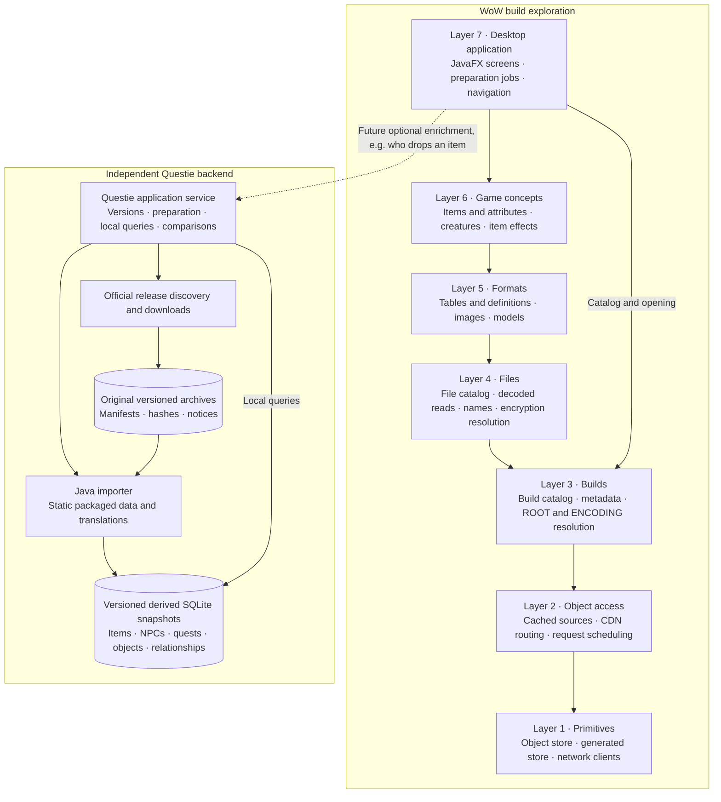

# Architecture overview

Vimi is a local Java application organized into seven layers. The UI calls backend
services; storage, downloads, parsing and game rules stay outside the controls.
Higher layers may call any lower layer through its public interfaces—the diagram
shows the main responsibilities rather than every dependency.

| Layer | Java components | Responsibility |
| --- | --- | --- |
| **1 — Primitives** | `object-store`, `generated-store`, `network-clients` | Durable original/derived storage, SQLite utilities, HTTP and protocol clients. |
| **2 — Object access** | `object-access` | Obtain encoded objects through cached sources, with routing, scheduling and cancellation. |
| **3 — Builds** | `builds` | Discover/list builds, read metadata and resolve file identities using build configurations, ROOT and ENCODING. |
| **4 — Files** | `files` | Expose FileDataIDs, locales, sizes, storage state and decoded file reads. Resolve encryption keys and optional community names. |
| **5 — Formats** | `formats-tables`, `formats-assets` | Read DB2/DBD tables, BLP images and supported M2/SKIN model formats. Persist reusable decoded results. |
| **6 — Game concepts** | `concepts-core`, `concepts-items`, `concepts-creatures`, `concepts-effects` | Join game tables into meaningful entities, attributes and relationships. Own item calculations and indexed grid queries. |
| **7 — Application/UI** | `gui` | Compose services, manage preparation/activity, present pages and request details/media asynchronously. |

## Accounting is an application service

`accounting` exposes a JavaFX-free reporting interface and a rebuildable SQLite
reference projection. The application composes adapters from Builds, Files, Formats
and Concepts; those lower components do not depend on accounting. Canonical retained
build membership persists separately from live GUI contexts. Original/derived
payload attribution, provider/global scope, coverage and whole-library file lengths
remain distinct. Accounting never gates readiness or authorizes deletion. See
[accounting/README.md](accounting/README.md).

## Unified library services

The new SQLite backend and ownership catalog share one library database through
separate components. `storage_*` tables belong to the object backend and `catalog_*`
tables belong to ownership accounting. The generated-store facade borrows that
same backend. These are naming conventions inside SQLite, not database schemas.
See [the service guide](docs/unified-storage-services.md).

Domain components retain their own query APIs and table ownership. The GUI calls
item search/paging services rather than accessing SQLite directly. Existing item
and build query projections remain separate until deliberately integrated. Their
relational bytes are excluded from the new per-object build-size accounting.

The desktop application still uses its existing stores while preservation and
activation work proceeds; new services do not silently migrate or discard data.
[The rollout plan](docs/unified-storage-rollout.md) records the remaining gates.

## Preparation and persistence

Opening a build acquires metadata and opens Overview. Background preparation then
restores or builds the file catalog, bootstraps table keys, prepares known tables
and initializes research lookups. Community filename enrichment runs separately.
Media content is requested on demand.

Original CDN objects and generated data have separate storage roles. Prepared file
catalogs, decoded tables and item-grid indexes persist across runs; reopening checks
whether their identities still match. The matching completed table inventory is
restored without opening every table; each requested table retains its normal
validation and repair path. A saved historical readiness label does not
by itself make a newly opened workspace ready.

## Questie stays independent

Questie downloads and prepares without opening a WoW build. Exact original packages
are retained in its own archive directory; derived SQLite snapshots are versioned
separately. It reuses the existing SQLite abstraction without changing the build
layers or putting Questie archives into the CDN object store.

The future GUI will select a prepared Questie snapshot and call its application
service for extra information, such as an item's reported drop sources. These are
local queries. Download/update jobs remain separate, and results retain their
provider/version identity. Questie enrichment supplements the build's data.

Multiple snapshots can coexist for historical inspection and comparison. The first
import profile represents static corrected packaged data; character-dependent
runtime corrections are not evaluated. Questie GUI integration comes later.
