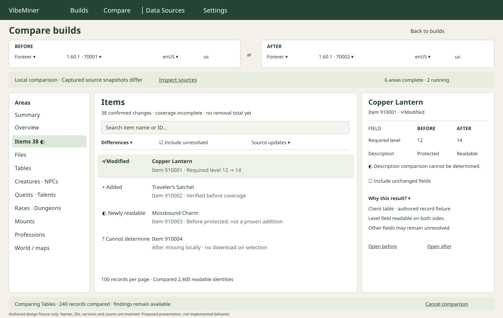

# Build comparison: UI proposal

Design only for #117. This document requires independent domain and architecture
review before implementation. It proposes presentation and behavior, not new
claims about which build relationships can already be resolved.

The mockup uses invented labels, IDs, versions and counts, with no game assets.
Its compressed rail groups are illustration shorthand; the implemented rail must
provide one accessible entry for every current area listed below.

## Purpose and entry

Answer “What changed between these two builds, and how certain are we?” while
keeping unreadable data and external-source updates visibly separate from client
changes. Add global **Compare** beside Builds, before the separator for Data
Sources and Settings. A later **Compare…** row action may prefill an endpoint.
It opens a dedicated comparison workspace; normal navigation follows the user's
close-on-leave build policy. The comparison's own sessions never steal or close
another workspace's borrowed handles.
An ordinary build keeps its existing area tabs; comparison is its own workspace,
not a second hidden mode inside every browser.

Use **Before** and **After** consistently. Neither means older/newer unless the
selected build versions establish that order. A Swap button swaps every endpoint
setting and recomputes the directional labels. Do not infer release chronology
from a lexical version sort. Show product, exact version/build, region and locale
for both endpoints; two rows named “Forever” are never the whole identity.

Each endpoint has a compact Product selector, Build selector and Locale selector.
Default the first endpoint to the initiating build and the second to a relevant
locally prepared build of the same product. Region remains visible and editable
where it identifies a distinct catalogue selection. Do not silently replace beta
with live, choose a different Questie flavor or substitute a locale. A cross-product
or cross-locale selection is allowed to reach a scope review, with a plain warning
about identities or text that may not be comparable. Unsupported areas remain
visible with reasons rather than disappearing.

Selecting endpoints shows available local preparation/coverage first. **Compare
local data** is the explicit start action. Merely opening, searching, filtering,
selecting a row, or displaying an asset reference must not fetch CDN/GitHub data.
Where local preparation is missing, show **Prepare missing data…** as a separate
reviewed action, with its source, scope and download expectation before starting.
This action must not imply Download all. Existing global source refresh may run,
but an active comparison remains pinned to its captured snapshots.

## Desktop composition

At approximately 1360 logical pixels, use a fixed-height endpoint header, a
224 px area rail, a flexible results pane and a 340 px inspection rail. Reuse the
app's cream background, dark green navigation, compact 28–32 px controls and
bordered white content surfaces. The endpoint header can fold to a two-line
summary after a run starts; **Edit selection** reopens it without silently
replacing current results. Pending edits show an explicit **Apply and compare**.

The left rail lists **Summary**, then every current build area: Overview, Files,
Tables, Items, Creatures, NPCs, Quests, Talents, Races, Dungeons, Mounts,
Professions and World. World includes maps, map artwork, terrain inventories and
provider location/pickup observations as separately named subgroups. Keep the
original Creatures and merged NPCs distinct. Counts next to an area describe
resolved changes only; a separate coverage marker indicates unresolved work.
Search/filtering the area rail is unnecessary at this size.

The center has the area title, a short coverage sentence, search, change filters
and a virtualized paged result table. Default to **Differences**, including
unresolved comparisons; excluding uncertainty would conceal the most important
limitation. Offer **All records**, **Added**, **Removed**, **Modified**,
**Readability changed**, **Cannot determine**, **Unchanged**. Provide a separate
**Source updates** toggle/group; do not turn source updates into client changes.
Multiple filters may be selected. Filter controls never start work outside the
selected local comparison scope. Search covers readable labels and explicit IDs;
show the searched scope, not merely “Search” when only one area is searched.

Rows show status text/symbol, name with stable identity, a short concrete change
and per-side availability. Example: “Modified · Copper Lantern · Item 910001 ·
Required level 12 → 14.” A row whose label changed retains both names in its
inspector and searchable text. A local file-data ID must not be presented as a
CDN encoding key. Sort is deterministic; status sorting has a documented order,
then label/identity. Duplicate labels remain separate identities.

The right rail shows the selected identity, the comparison conclusion and a
field-by-field Before/After view. Changed fields appear first; an **Include
unchanged fields** switch expands context. Preserve type, unit, recorded empty
text and source names. Long descriptions can expand a readable side-by-side or
inline text diff, with wrapping and copied plain text retaining Before/After
labels. Lists compare reviewed element identities; otherwise say “Recorded list
changed,” retain both lists and never invent element matching. Show raw record
and relationship evidence under **Why this result?**, including the source row,
field, layout/adaptor profile, coverage and any mapping ambiguity. “Open before”
and “Open after” navigate to the corresponding local build record; lack of a
record is explained rather than opening a different identity.

## Summary and truthful counts

Lead with a sentence such as “38 confirmed changes in 6 compared areas; 3 areas
need more readable data.” All example numbers in this proposal are authored.
Show compact cards **Added**, **Removed**, **Modified**, **Readability changed**
and **Cannot determine**, followed by an area table containing compared record
counts, confirmed changes, unresolved comparisons and source coverage. Keep
unchanged counts available without dominating the first screen.

A numeric zero appears only when the relevant requested scan finished and proved
none within its stated scope. Before completion use “Not compared” or “Compared
240 records · still running,” never a transient zero. For incomplete coverage use
“0 confirmed removals · coverage incomplete,” not “No removals.” Do not sum
partially scanned areas into an apparent full-build total. Record totals and
field-change totals have separate labels; one modified item with five changed
fields is one modified item. Categories must be mutually exclusive at the
record-summary level or their overlap must be explicitly disclosed. Unknown
records whose identity is unavailable cannot be counted as a precise missing
record total. Percentages require an established denominator; otherwise omit.

## Status language and evidence

| Label | Meaning shown to the user |
|---|---|
| Added | Present after; before has sufficient verified coverage of the same identity domain to establish absence. |
| Removed | Present before; after has sufficient verified coverage of the same identity domain to establish absence. |
| Modified | The same verified identity has comparable readable values that differ. Unresolved other fields remain listed. |
| Unchanged | Comparable requested fields match; the scope/coverage caption prevents implying that all hidden data match. |
| Newly readable | Data can now be read; this does not establish that the game added it. |
| No longer readable | Previously readable data is now protected, unavailable or unsupported; this is not removal. |
| Cannot determine | Identity, coverage, interpretation or the requested field is insufficient to decide. |
| Source update | Prepared provider version, mapping, precedence, definitions or key snapshot differs; distinguish this from a client change. |

Readability is an independent per-side fact. A record can have confirmed modified
fields and additional unknown fields. An encrypted section, partial table or
unsupported layout does not suppress other readable records. The UI must not
force a single green/red badge to stand in for all field evidence. “Missing
locally,” “Protected,” “Unsupported layout,” “Not prepared” and “Absent in verified
coverage” are distinct reasons; none is abbreviated to an ambiguous dash.

Freeze selected-build originals, locale, decoding/definition/key profile and
provider snapshot choices for the comparison. Where both endpoints use different
source versions, show a persistent compact **Source snapshots differ** notice
with a comparison panel for actual revision/flavor/locale/mapping identities.
Provider-merged NPC/quest winner changes should identify whether they arose from
client evidence, provider evidence, winner precedence or unknown causes. Do not
claim one cause merely because two version labels differ. Refreshing sources or
settings produces **New source data available · Start a new comparison**; it must
not rewrite existing results in place. Offer a reviewed same-snapshot comparison
only where compatible local snapshots genuinely exist; never fabricate historical
provider data.

## Area-specific useful differences

The following is a presentation checklist, not permission to guess unimplemented
joins or perform raw GUI SQL. A domain adapter must approve stable identities and
comparable fields before an area can report changes.

| Area | Initial useful presentation and limits |
|---|---|
| Overview | Product/build/locale identities, preparation/readability and accounted object bytes by original/derived and shared/unique category. Storage/accounting changes are local-library facts, separate from game content changes; comparison does not download missing objects to fill byte totals. |
| Files | Verified file identities, readable names, content references and known sizes. Content-reference changes differ from name-index changes. Explicit unnamed/unknown rows remain searchable by ID/key where supported. |
| Tables | Table coverage/layouts and verified row/field differences, grouped by table; schema changes separate from row changes. Unknown relationship decoding remains visible. |
| Items | Reviewed item facts, text and use/equip effects; changed text versus newly resolved descriptions are separate. Raw localization tokens do not imply a changed game effect. |
| Creatures | Client Creature record IDs and verified names/fields; this is not the full NPC population. |
| NPCs | Merged NPC identities, names, titles and recorded level pairs; per-field winners and alternatives. Provider roster/readability changes are not automatically spawns added/removed. |
| Quests | Merged quest identities, readable title, recorded levels and explicit relationships; no promise of full client quest text/objectives. Provider changes stay attributable. |
| Talents | Reviewed talent/tree/rank/position/spell identities and readable names/effect text; tree layout and spell-value differences separate. Cross-system Classic/Retail comparison may be unsupported. |
| Races | Race facts, class relationships, racial abilities and reviewed appearance/media references. No player ownership or inferred customization availability. |
| Dungeons | Verified map identities, separate difficulty rows/capacities, entry messages and encounter records. No invented exterior entrances or complete boss/loot changes. |
| Mounts | Mount facts, source spell and individual display/condition links. Variant ordering is deterministic, not a claim about a preferred appearance. |
| Professions | Profession/ability row identities, reviewed result/reagent/tool/skill facts. Quantities, enchantments and unresolved outputs preserve their domain states. |
| World | Map/area facts and supported terrain/artwork reference inventories first; explicit location/pickup relationships keep provider/frame provenance. A changed reference is not proof of a visible geographic change. |

Images, models, audio and terrain need an explicit **Preview from local files**
action. Report asset-reference/known-content differences before rendering. A
missing local asset shows that limitation and optional explicit preparation;
never claim “Model changed” from a display-reference change alone. Where a
reviewed local visual diff exists later, use synchronized views with labeled
camera/lighting/profile, optional split/overlay, a reset and keyboard controls.
Static/rest preview limitations remain visible. No automatic model or audio
playback, all-variant probing, or whole-world visual comparison in the first
comparison stage.

## Progress, interruption and persistence

Local work is explicitly scoped by selected areas; Summary offers **Compare all
local areas** as an intentional broader action. Start with metadata/indexes, then
selected area details and paged records. A nonmodal progress strip names the
current area and completed units only when a denominator is known; otherwise use
an indeterminate indicator and a readable phase. Retain completed findings while
another area runs. Limit result pages, retained inspectors and concurrent detail
work; never preload all asset previews.

**Cancel comparison** stops outstanding comparison work and retains completed
results labeled **Canceled · partial results**. **Pause** is offered only if a
reviewed checkpoint contract actually supports it; cancel is not falsely called
pause. **Resume local comparison** can reuse completed checkpoints only against
the exact same endpoint and source fingerprints. A missing/changed retained
snapshot explains why **Start new comparison** is required. Resuming never
silently downloads or recomputes against updated data. Until durable checkpoint
support is implemented, say “Completed results retained for this session,” not
“Resume after restart.” Closing a build or deleting local source data must follow
the workspace owner's lifecycle contract; a comparison does not retain a hidden
unbounded lock or attempt to reopen deleted data behind the user's back.

Loading an inspector uses an inline indicator while list selection and navigation
remain active. Changing selection cancels stale detail work; changing endpoints
cannot let an old result replace the new selection. Per-area errors retain other
areas and offer a bounded **Retry area** using the same captured inputs. Hide or
leave comparison preserves only the supported session/checkpoint state and shows
how to return; shutdown cancels/drains owned work.

## Responsive and accessible behavior

At 1120 px collapse the inspector into an explicit **Details** drawer, preserving
list width and source coverage. At 900 px the endpoint selectors become stacked
Before/After groups and the area rail becomes a labeled keyboard-operable area
selector. At 720 px use a single results column and full-width details route with
**Back to results** restoring selection, scroll and focus. Avoid simultaneous
horizontal and vertical scrolling of the overall workspace; a wide field table
may scroll horizontally within its own labeled region. Keep primary actions
visible without pinning large panels over results.

Use textual status labels plus distinct symbols: + Added, − Removed, ≠ Modified,
◐ Readability changed and ? Cannot determine. Green, warm red, amber and muted
blue may reinforce meaning but are never the only cue; use text contrast at least
4.5:1 and clear focus outlines. Before/After headings stay attached to values in
a drawer or stacked layout. Tabs, filters, swap, cancel, result paging and source
expansion are keyboard accessible. Announce completion/error and throttled phase
changes to accessibility APIs; do not announce every row or progress tick. Do not
move focus automatically on background completion. Support copyable IDs and text,
wrapping at enlarged font sizes and reduced-motion/static preview behavior.

## Delivery and review gate

1. Review comparison identities, provenance and absence/readability semantics
   independently with WoW/domain and architecture reviewers; record explicit
   approval before implementation. A mockup alone is not approval.
2. Build authored UI fixtures for complete, partial, protected, source-changed,
   same-build/different-locale and unsupported cross-product cases. Validate
   counts, filtering, keyboard flow, narrow layouts, cancel/stale results and no
   acquisition on browse. Approve the chosen first area scope explicitly.
3. Deliver endpoint selection, local coverage Summary and reviewed metadata/row
   adapters incrementally, with evidence drilldown before visual previews.
4. Add durable resume and optional local media comparison only after their
   contracts, resource budgets and honest limitations receive independent review.

Open design decisions for the joint review: initial supported cross-product
pairs; when absence evidence is conclusive per area; locale fallback policy;
retention/checkpoint quota and deletion behavior; whether comparison opens in the
same shell or a returnable workspace slot. These do not require interrupting the
user before the proposal can be reviewed.
