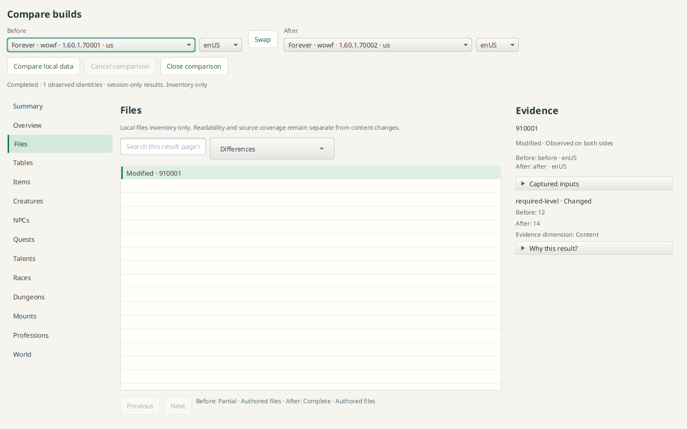
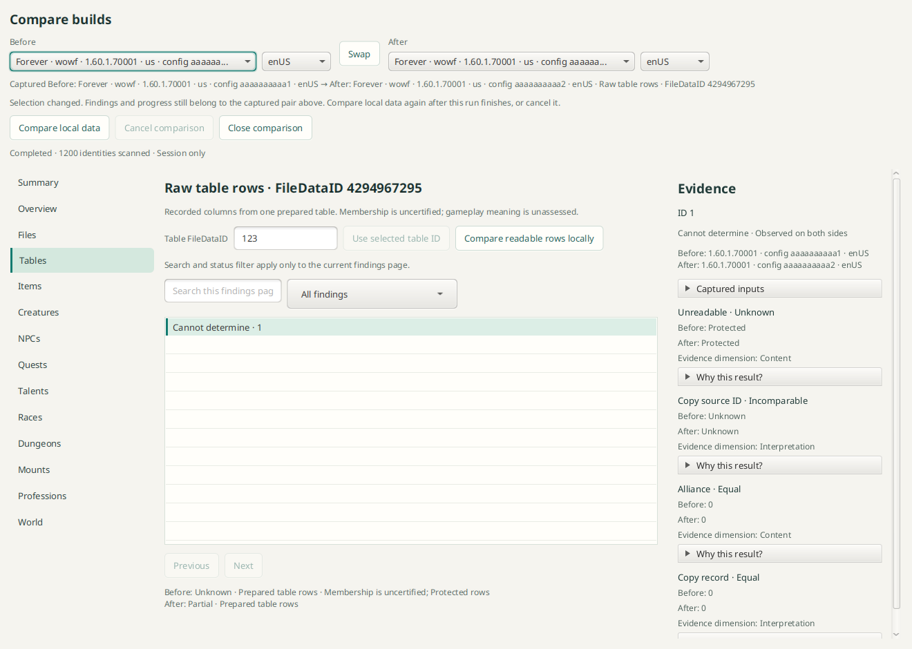

# Comparison inventory view

`CompareView` is an authored standalone UI for the independently approved
Foundation/inventory scope recorded in [review.md](review.md). Composition supplies
an enabled-product-filtered build catalogue, explicit locales, a controller and a
close callback. The view opens no repository, database, downloader or build job.

`Controller.start(Request, Cancellation)` is called only by **Compare local data**.
Requests contain exact `BuildInfo` endpoints, locales and Files/Tables area. The
controller returns a live session facade exposing canonical `ComparisonTypes`
descriptors, progress and result pages plus cancellation/asynchronous close.
Composition owns dedicated local-only input contexts and source capture policy.
It must drain canceled openings and any sessions it owns on navigation/shutdown.
The view cancels its opening token, disposes stale returned sessions and cancels/
closes accepted sessions; it never touches the separately browsed build.

All current areas are present. Only Files and Tables request work; other areas
say Not implemented. The first release compares selected-locale file metadata
and frozen table inventory, not arbitrary table rows or semantic concepts. No
schema-complete claim is made. Summary retains session/area/coverage context and
has no fabricated full-build change totals. The default scan stages findings only: known-equal records are omitted, while
changed, membership-only, unknown and incomparable observations remain. Scanned
identity progress is not a finding count. Search and status filters explicitly
apply to the current findings page; pagination follows the findings continuation.
There is no All records or Unchanged listing in this initial slice. Unknown states,
observed-only membership, field evidence dimensions and per-side completeness
remain visible. The source inspector exposes the captured descriptor dependencies.

Before/After selectors reject product/locale mismatch locally. Each choice shows
a distinguishing config prefix, expanding beyond ten characters when local
choices share that prefix; full identity/config remain available in tooltips.
An immutable Captured Before → After header identifies the actual running/result
pair. Editing or swapping selectors preserves that header and shows a pending
selection banner until an explicit new comparison captures the new pair.
Running jobs cannot be replaced accidentally by selector/area changes. Opening the view,
changing selectors, swapping, selecting areas/results and resizing never start a
comparison or acquisition. A replacement run cancels and drains its accepted old
session before opening another. At narrow widths the inspector becomes a Details
route with Back to results; the area rail becomes a labeled selector. Endpoint
controls wrap. Closing stops progress polling and is idempotent.

The authored `CompareUiTest` verifies explicit start, unsupported-area labeling,
locale rejection, distinguishing same-version configs, captured-pair preservation
on running/completed edits and Swap, partial coverage reasons, failed-page Retry,
variable-length cursor history, responsive details and stale-opening cleanup.
Search and status filtering are both visibly current-page scoped. Failed page
loads preserve current findings and restore navigation while offering Retry.
It exports `gui/build/ui-review/comparison-authored.png`; all fixtures are invented
and contain no game assets. Run the display-required authored checks with `./gradlew :gui:compareUiTest`.
Coordinator and forbidden-network native fixtures are included in `:gui:check`. This document does not claim durable results,
resume, export, media comparison or full #117 completion.

## Selected prepared table rows

Tables includes a FileDataID input and explicit **Compare readable rows locally**
action. A selected inventory finding can prefill the ID without starting work.
The standard Compare local data action returns to inventory mode. Captured mode
and table identity remain bound to the result while selectors/input are edited.

Raw rows require matching endpoint schemas and compare recorded verified cells.
They do not claim gameplay changes or certified table membership. Numeric IDs are
readable in the list; full canonical identities remain in tooltips/accessibility.
Unresolved/changed fields precede equal fields. Human coverage captions retain
all issue reasons, while exact scope fingerprints remain in evidence/tooltips.

The image uses invented data, including a deliberate pending edit to demonstrate
that the captured result is not relabeled. It contains no game assets or local data.
