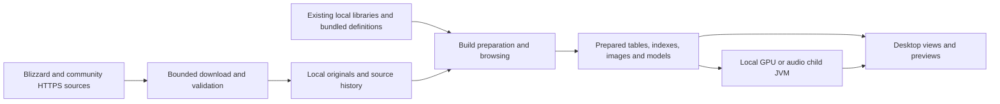

# Data sources, storage and privacy inventory

Reviewed 2026-11-04 against main `dc7c5a4`. This includes merged, unreleased World
streaming code; the latest published desktop package at review time is alpha.20.
This is a static source inventory, not a packet capture or an exhaustive inventory
of OS/JVM/graphics-driver accesses. See the [security review](security-review.md)
for findings, trust boundaries and recommended work. No private user files,
credentials or live service responses were inspected for this document.

## How data moves

The desktop app reads previously acquired objects first. Depending on the action,
source policy and missing data, it can fetch metadata or asset bytes, validate and
retain the originals, then generate indexes, decoded previews and other derived
content. Local/offline access exists in backend APIs; a MANUAL update schedule in
Data Sources is not a global offline switch.

The network-activity indicator reports local transfer counters. It is not an
analytics service. No application upload, external analytics SDK or automatic
crash-report uploader was found in the reviewed production flows; this does not
exclude OS reporting, native-library behavior or a future feature.

## Runtime network destinations

Templates below describe code-generated URLs, not arbitrary URLs accepted from a
text field. Remote operators can observe the IP address, request time, route,
requested product/build/table/content identifiers and request headers. HTTPS
protects transport; it does not hide requests from those operators.

| Destination / URL template | Reads and purpose | Trigger / policy |
| --- | --- | --- |
| `https://{region}.version.battle.net/v2/summary` and `/products/{product}/{versions,cdns,bgdl}` | Advertised products, builds and official CDN routes. Region is restricted to `us`, `eu`, `kr`, `tw`; product strings are validated. | Builds source refresh. Initial Builds view calls the local-history path; clicking refresh requests upstream observations. |
| `https://{official-host}/{cdn-path}/{config,data}/{key[0:2]}/{key[2:4]}/{key}` and index `.index` variants | Build/CDN configuration, ENCODING/ROOT/install/download metadata, archive indexes and encoded game files; range requests can fetch archive slices. | Opening/preparing a build, uncached file/asset previews, and the explicit background Download all policy. Existing verified objects can satisfy requests locally. |
| `https://api.github.com/repos/wowdev/wow-listfile/releases/latest`; `https://github.com/wowdev/wow-listfile/releases/download/{tag}/community-listfile-withcapitals.csv` | Community mappings from file IDs to names. Release downloads can redirect only to admitted GitHub asset hosts. | Listfile source synchronization and enabled filename preparation. |
| `https://api.github.com/repos/wowdev/WoWDBDefs/commits?path=definitions/{table}.dbd&sha=master&per_page=1`; `https://raw.githubusercontent.com/wowdev/WoWDBDefs/{commit}/definitions/{table}.dbd` | Supplemental table schemas, when the selected source policy permits them. Table names and commit hashes are constrained. | Definition source/table preparation when required; bundled pinned schemas are local resources and do not themselves require a fetch. |
| `https://raw.githubusercontent.com/wowdev/TACTKeys/master/WoW.txt` | Public community game-content decryption keys. These are content keys, not a user's Blizzard password or login token. | Enabled by default with DAILY checks, including a due check shortly after application startup; also coordinated with preparation. |
| `https://api.github.com/repos/Questie/QuestieDB/releases/{latest,tags/{tag}}`; admitted GitHub release ZIP assets | Questie baked data and release/source/license metadata. The source repository uses its own JDK HTTP transport and redirect validation. | Source check/download/preparation and chosen dataset flavor; controlled by the Questie source policy. |
| `https://api.github.com/repos/JIVESCORP/eg-link-output-wowf/git/ref/heads/main`; `https://raw.githubusercontent.com/JIVESCORP/eg-link-output-wowf/{commit}/data/...` | EG-link dataset index and validated publication paths. | Enabled source synchronization/preparation; automatic dataset selection can depend on the selected build. |
| `https://api.github.com/repos/fitzforge/polestar/git/ref/heads/next`; `https://raw.githubusercontent.com/fitzforge/polestar/{commit}/forever-db/...` | Polestar index/datapackage, JSONL datasets, schemas and notices from an admitted path set. | Enabled source synchronization/preparation and applicable Forever build mapping. |

Official CDN hosts are restricted to `level3.blizzard.com`,
`level3.ssl.blizzard.com`, or the admitted `{2–8 lowercase letters}.cdn.blizzard.com` pattern.
Listfile release redirects admit `release-assets.githubusercontent.com` and
`objects.githubusercontent.com`. This is not a general-purpose web browser.

Evidence: [SourceUrls](../network-clients/src/main/java/com/vibeminer/network/SourceUrls.java),
[CdnRoute](../network-clients/src/main/java/com/vibeminer/network/CdnRoute.java),
[NetworkClients](../network-clients/src/main/java/com/vibeminer/network/NetworkClients.java),
[QuestieSourceRepository](../questie/src/main/java/com/vibeminer/questie/sources/QuestieSourceRepository.java),
[BackendBuildService](../gui/src/main/java/com/vimi/gui/BackendBuildService.java) `load`,
and [VimiApp](../gui/src/main/java/com/vimi/gui/VimiApp.java) `loadBuilds`.

### Requests and automatic behavior

- The normal shared transport uses `User-Agent: VibeMiner/0.1`,
  `Accept-Encoding: identity`, and request-specific range/cache headers. Its URL
  builders use HTTPS and retain standard certificate/hostname validation. It
  disables automatic redirects/retries; individual source adapters handle permitted
  redirects explicitly. Questie has a separate implementation.
- No Blizzard-account login, password or application API token is required by the
  reviewed public-data download paths. The inventory does not establish what an
  enterprise proxy, OS network configuration or hosting provider logs.
- All six community source categories default to enabled. TACT key updates default
  to DAILY; the others default to MANUAL source-update scheduling. A timer checks
  due work after startup, then periodically. Disabling a source changes its use and
  cancels associated work; it does not erase already retained data.
- Build preparation and asset browsing can download missing data even when an
  external source's periodic checks are MANUAL. Product visibility settings do not
  delete builds or implement a firewall. Download all has separate persisted
  background policies.
- Signed release-asset redirect query strings can be temporary bearer capabilities.
  Do not share raw URLs, nested exception logs or HTTP diagnostics without review.

Evidence: [HttpEngine](../network-clients/src/main/java/com/vibeminer/network/HttpEngine.java),
[NetworkOptions](../network-clients/src/main/java/com/vibeminer/network/NetworkOptions.java),
[DataSourcesService](../gui/src/main/java/com/vimi/gui/DataSourcesService.java)
`policy` / `checkDue`, [NativePreparationWork](../gui/src/main/java/com/vimi/gui/NativePreparationWork.java)
`withSourcePolicies`, and [BuildDownloads](../gui/src/main/java/com/vimi/gui/BuildDownloads.java).

## Persistent filesystem locations

`<data>` below is the actual application data root. Defaults use lowercase `vimi`.
The JVM property `-Dvimi.dataDirectory=/chosen/path` overrides the root.

| Platform | Default `<data>` |
| --- | --- |
| Linux | `$XDG_DATA_HOME/vimi`, otherwise `~/.local/share/vimi` |
| macOS | `~/Library/Application Support/vimi` |
| Windows | `%LOCALAPPDATA%/vimi`, otherwise `~/AppData/Local/vimi` |

[BuildApplication.defaultDataDirectory](../gui/src/main/java/com/vimi/gui/BuildApplication.java)
is authoritative. Custom roots, their parents, backups and synchronization software
are part of the local trust boundary.

| Location | What the app reads / stores | Lifetime / privacy consequence |
| --- | --- | --- |
| `<data>/library/objects.sqlite3` | Unified library index, ownership and build metadata; saved preparation receipts, product/source settings, background-download policy and saved World camera bookmarks (`world_bookmarks*`: names, map IDs/names and coordinates) and World explorer controls (`world_controls*`: look sensitivity, invert-Y) use this database. SQLite sidecar/journal files can exist while in use. | Persistent. Can reveal selected products/builds/locales, source use and preparation/download history. |
| `<data>/library/packs/pack-*.vmp` | Acquired originals and generated objects (including decoded voice PCM) through owner-bound library views; retained content/provenance can be shared across builds. | Persistent content cache. It is not encrypted by an application storage key. Content decryption is distinct from storage encryption. |
| `<data>/library/staging/` and library lock files | Store transaction/recovery staging and exclusive-writer coordination. | Operational state; do not delete or manipulate a live library. Crash recovery and retained originals need separate handling. |
| `<data>/client-hotfix/` | Explicitly selected local DBCache.bin imports, immutable private copies, scope manifests and writer lock. Cache records can include content decryption keys. The original is read-only; its path is not retained in the manifest. Only when the user ticks "Check on Refresh sources", `watches/<scope>.watch` records that original's absolute path plus its last verified size, modification time and filesystem file identity. | Persistent local copies, not uploaded by this feature. Disable removes the active association and any watch but retains imported files. Copies and watch records are not encrypted at rest; private directory/file permissions protect access. Refresh sources (manual and startup) rereads only watched originals: a changed same-build cache is fully verified, imported as a new immutable copy and bound for the next open, while open workspaces keep their loaded snapshot until reopened. Missing, unreadable, malformed or other-build originals keep the existing import. When a watched original now declares a build that this library has prepared to Tables ready (same product and locale, one unambiguous match), Refresh sources asks "Client updated to build N. Apply this cache to build N?"; applying verifies and imports it for that build and moves the watch there, while the earlier build keeps its import. Declining changes nothing and is not asked again in that session. If a move could not remove the earlier build's watch, it writes a private `watches/<scope>.superseded` marker naming the exact watch it moved to; the next Refresh sources removes only that marked watch, and only while its target watch still exists, reporting "leftover check removed" (a failed removal is reported as a failure). Unmarked watches are never removed, and the leftover build's import is never touched. Unticking, a plain reimport or Use base data deletes the watch. Watched paths never enter manifests, logs or status text. No automatic scan of installed clients. |
| `<data>/catalog.sqlite` | Local advertised/observed build catalog. | Persistent browsing/build history rather than an account login database. |
| `<data>/derived/grids/` | Compact prepared browser grids/derived indexes. | Persistent, reconstructible derived content; still may reveal the builds/tables inspected. |
| `<data>/derived/comparison-work/` | Session comparison/sort/item temporary runs such as `comparison-*`, `results*.tmp`, `run-*.tmp`, `candidates-*.tmp`. | Session work; startup cleans only recognized stale owned shapes under exclusive library ownership without traversing symlinks. Abrupt termination can leave residue. |
| `<data>/questie/sources/` | Repository marker/lock, release metadata/validators, `sources-v1`, `releases-v1`, bounded ZIP archives, notices and acquisition staging. | Retained source snapshots and release URLs/metadata for provenance and offline use. |
| `<data>/questie/derived/` | Prepared Questie SQLite datasets. | Persistent derived records and dataset/locale choices. |
| `<data>/polestar/` and `<data>/eg-link/` | `catalog.json`, original source snapshots under `sources/`, manifests/notices and prepared SQLite data under `derived/`; download/preparation staging. | Persistent third-party data and provenance. Disable/update settings do not imply deletion. |
| Legacy `<data>/objects/`, `<data>/generated/`, `<data>/accounting.sqlite` | Migration can read/import prior stores and ownership records. | Old data may coexist with the unified library. Migration is not a promise that all old bytes have been erased. |
| User-specified library/import/CLI paths | Explicit backend/command-line workflows can read existing libraries, local fixture/model files or write requested outputs. | Caller-selected access. Developer fixtures and live source helpers are not automatic desktop scanning of the user's home or installed WoW directory. |

Evidence: [BuildApplication.open](../gui/src/main/java/com/vimi/gui/BuildApplication.java),
[ObjectStore](../object-store/src/main/java/com/vibeminer/store/ObjectStore.java),
[PackLibraryMigration](../gui/src/main/java/com/vimi/gui/PackLibraryMigration.java),
[SettingsPreferences](../gui/src/main/java/com/vimi/gui/SettingsPreferences.java),
[SourcePreferences](../gui/src/main/java/com/vimi/gui/SourcePreferences.java),
[PreparationHistory](../gui/src/main/java/com/vimi/gui/PreparationHistory.java),
[ComparisonTemporaryFiles](../gui/src/main/java/com/vimi/gui/ComparisonTemporaryFiles.java),
[QuestieRepository](../questie/src/main/java/com/vibeminer/questie/QuestieRepository.java),
[PolestarRepository](../polestar/src/main/java/com/vibeminer/polestar/PolestarRepository.java),
and [EgLinkRepository](../eg-link/src/main/java/com/vibeminer/eglink/EgLinkRepository.java).

## Temporary, executable and diagnostic access

- GPU previews use random directories under the configured temporary parent or
  `java.io.tmpdir`. Cold model/terrain files include `scene.vgpu`, `terrain.vatx`
  and `frames.vgpu`. Persistent World sessions use `world-v2-*` directories with
  `session.wss`, mapped `frames.wsf`, tile `tile-*.wst` and commit `commit-*.wsc`
  inputs. These contain game-derived geometry/textures, local session identifiers
  and rendered pixels. Normal cleanup waits for process/mapping/file retirement;
  crashes or failed cleanup can leave files. Nonces/checksums provide session
  correlation and integrity, not confidentiality.
- GPU and Vorbis preview helpers launch the executable under `java.home` through
  argument lists. GPU file paths/classpaths appear in child arguments. Audio uses
  pipes for encoded input and decoded PCM rather than an audio temporary file.
  `RaceVoices` can cache decoded PCM as a generated library object for later playback;
  closing the preview does not erase that derivative. World explorer music/ambience
  (off by default) streams original Vorbis/MPEG bytes from memory through an
  `AudioStreamDecoder` child pipe to the audio line and persists no PCM derivative; a
  single-file ambience loop retains at most 16 MiB of decoded PCM in memory (transient
  peak higher while it is built) until the area changes or the channel stops. Child JVMs inherit user privileges and environment; they
  are not OS sandboxes.
- Runtime reads also include packaged JARs, pinned bundled definitions, shaders,
  native libraries, JRE configuration and OS fonts/drivers/audio resources. Native
  loading and OS-specific caches are not fully enumerable from Java source alone.
- Application diagnostics use Java logging/standard streams in reviewed paths.
  This review did not establish one guaranteed persistent app-log directory or a
  complete OS crash-report location list. JVM/native crashes and desktop launchers
  can retain paths, arguments or memory outside `<data>`. Review diagnostic output
  before sharing it; deleting the library does not necessarily delete those reports.
- World failure records (`com.vimi.gui.World`, `WorldStreamTransport`) contain
  bounded exception messages, code locations, helper pid/exit status and a
  sanitized 40-line helper stderr tail. URL query strings and user-info, absolute
  local paths, this machine's user and host names, and control characters are
  redacted; no payload bytes or keys are recorded. See
  [world-diagnostics-checkpoint.md](world-diagnostics-checkpoint.md).

Evidence: [GpuPreviewService](../gui/src/main/java/com/vimi/gui/GpuPreviewService.java),
[WorldStreamPreparedFiles](../rendering-bgfx/src/main/java/com/vibeminer/rendering/bgfx/WorldStreamPreparedFiles.java),
[WorldStreamTransport](../rendering-bgfx/src/main/java/com/vibeminer/rendering/bgfx/WorldStreamTransport.java),
[VoiceDecoder](../formats-audio/src/main/java/com/vibeminer/formats/audio/VoiceDecoder.java),
[AudioStreamDecoder](../formats-audio/src/main/java/com/vibeminer/formats/audio/AudioStreamDecoder.java),
[WorldAudioPlayback](../gui/src/main/java/com/vimi/gui/WorldAudioPlayback.java),
and [RaceVoices](../concepts-races/src/main/java/com/vibeminer/concepts/races/RaceVoices.java)
`decode` / generated PCM read and write.

## Retention, deletion and sharing

Uninstall intentionally preserves the user library. Hiding products, disabling a
source or canceling a download is not a purge. Closing a build releases workspace
resources; it does not imply erasing retained original bytes. Compaction and
ownership/reclaimability are distinct from guaranteed full deletion. See
[storage behavior](unified-storage-services.md), [product settings](product-settings.md)
and [prerelease policy](prereleases.md).

Backups or shared data directories can disclose acquired content, historical
builds, source URLs and local settings. Use OS file permissions and disk/backup
encryption for confidentiality. There is no application-level encrypted-library
or secure-erasure guarantee in this reviewed baseline. Do not manually remove
SQLite/packs/staging while the app or a helper owns them. A complete privacy purge
must account for the chosen data root, legacy locations, temporary residues,
exports, backups and OS/JVM reports, rather than only uninstalling the program.

## Build/release traffic and candidate features

Gradle/Maven, JDK/OpenJFX/LWJGL/native tool downloads, CI OS package managers,
GitHub release uploads and developer C# NuGet/reference-checkout access are build
and distribution activities. They are separate from normal desktop content
requests. Provenance URLs inside bundled definition or runtime manifests are not,
by themselves, evidence that the installed app downloads executable dependencies
at startup. See the [security review](security-review.md) for supply-chain gaps.

Unreleased next-feature branches add global-instance file ownership, liquid source
qualification and character customization. They are outside the baseline review;
update this inventory and review their new file/parser/native boundaries before
release. The existing minimap is a local rendering of acquired map artwork and
camera metadata; it is not a separate map-provider or location-telemetry service.
