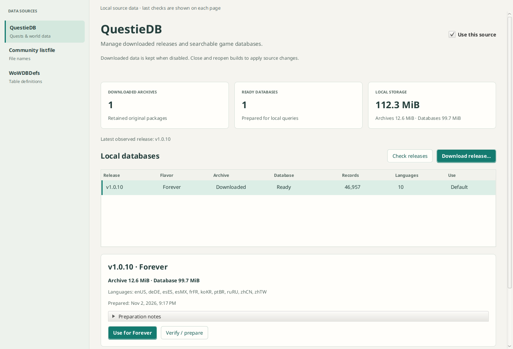

# External data sources

Data Sources manages QuestieDB, the community listfile and bundled WoWDBDefs.
Blizzard CDN acquisition remains in Builds. Native screens use cached typed service
snapshots; persistence, provider calls and inventory work run off the JavaFX thread.
The earlier illustrative source figures have been replaced with local measurements.

## Settings and retained data

Versioned `sources_*` tables in the shared library database persist source enablement,
manual/startup/daily policies, successful check times, per-flavor Questie defaults,
and canonical per-build flavor overrides. Disabling keeps completed downloads and
prepared data. It cancels active source acquisition and prevents new source jobs.
Explicitly close and reopen a build to change its captured provider policy.

A listfile update checks the release and prepares the index; its automatic policy
therefore says **Automatic listfile updates**. Questie automatic checks discover
releases without downloading or activating them. Defaults are manual. Native build filename enrichment reads the installed local
listfile; updates are performed by this page or the selected automatic policy,
so opening a build does not bypass the manual setting. Failed daily
checks do not spin in an automatic retry loop. Bundled definitions update with the
application; there is no fabricated runtime definition updater.

Open workspaces retain their table-definition policy. Disabled definitions produce
an explicit issue and a separate preparation identity; an enabled-definition cache
cannot silently restore into a disabled workspace. Metadata and Files still work.
Filename acquisitions are canceled when the listfile is disabled; already-bound
workspace data and completed provider objects are retained.

## QuestieDB

The page lists retained archives and prepared databases by source identity and
flavor. It exposes observed release checks, named-release/flavor downloads,
preparation/reuse, safe cancellation and default selection for each flavor.
Local files are not downloaded merely by opening the screen. No deletion is offered.

Archive bytes and prepared SQLite file lengths are separate provider-local figures,
excluded from per-build object attribution. Entity counts, locales and diagnostics
come from completed prepared metadata. Unreadable data is reported, not deleted or
silently interpreted as a clean empty library. Default selection opens and validates
the prepared database before saving its identity.

Build Overview offers **Automatic**, **None**, or a flavor override. `wowf` maps
directly to Forever; reviewed Classic progression channels use their version family
for Vanilla/TBC/Wrath/Cata/Mists, with reviewed 1.60 builds mapping to Forever.
Unknown channels and Retail receive no guessed Classic mapping. The selected flavor
resolves its configured default prepared database; changing mapping performs no
implicit download. Exact client-build compatibility is not claimed. These management
and mapping controls do not yet add Questie item-source results to the Items browser.

## Other providers

The listfile page shows actual installed tag, timestamps, indexed name count,
preparation state and original/derived catalog payload totals. Payload totals cover
retained provider objects, not just the active snapshot. Per-build filename coverage
stays in the build Overview. Definitions show the pinned revision, provider table
count, upstream source and license; provider count is not readable-table coverage.

## Validation

```sh
./gradlew :gui:dataSourcesTest :gui:settingsServiceTest
./gradlew :gui:check :questie:check
```

Offline checks cover persisted enablement/update policies, conservative flavor
mapping and overrides, unavailable local data, read-only future-schema refusal,
product filtering, and enabled/disabled workspace cache isolation. A separate live
smoke test in temporary storage checked official releases, downloaded Forever
v1.0.10, prepared 46,957 records with 10 locales, and selected/resolved its default
through `wowf`. It did not alter the user's application library.

Source page rendered from an isolated live-test library (not the user library):


