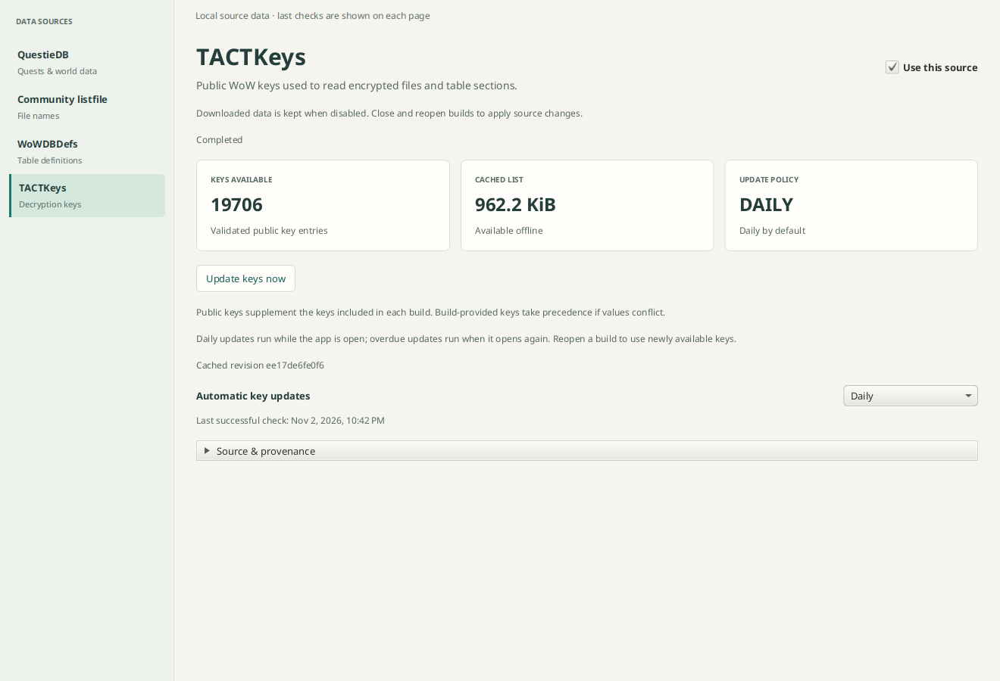
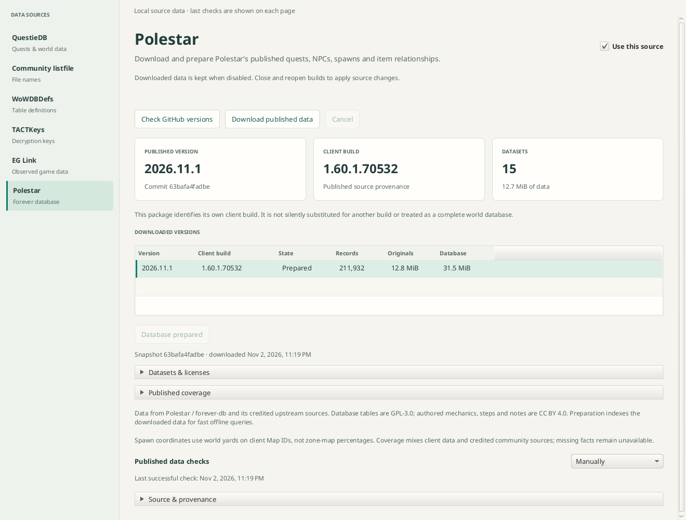

# External data sources

Data Sources manages QuestieDB, the community listfile, bundled WoWDBDefs, and
public wowdev/TACTKeys, EG Link and Polestar forever-db.
Blizzard CDN acquisition remains in Builds. Native screens use cached typed service
snapshots; persistence, provider calls and inventory work run off the JavaFX thread.
The earlier illustrative source figures have been replaced with local measurements.

## Settings and retained data

Versioned `sources_*` tables in the shared library database persist source enablement,
manual/startup/daily policies, successful check times, per-flavor Questie defaults,
and canonical per-build flavor overrides. Disabling keeps completed downloads and
prepared data. It cancels active source acquisition and prevents new source jobs.
Explicitly close and reopen a build to change its captured provider policy.

All enabled providers update at startup and from **Refresh sources** in Builds.
The global action checks revisions, downloads changed data and prepares or reuses
local data concurrently. Source-page **Additional scheduled updates** controls
optional checks between global refreshes; older Manual/Startup values remain
compatible and do not disable startup refresh. TACTKeys additionally defaults to a
daily check. See [Source refresh](source-refresh.md) for progress, cancellation and
per-provider scope. Individual check/download/prepare buttons remain available.
Failed daily attempts do not spin in an automatic retry loop. Bundled definitions
update with the application; there is no fabricated runtime definition updater.

Open workspaces retain their table-definition policy. Disabled definitions produce
an explicit issue and a separate preparation identity; an enabled-definition cache
cannot silently restore into a disabled workspace. Metadata and Files still work.
Filename acquisitions are canceled when the listfile is disabled; already-bound
workspace data and completed provider objects are retained.

## QuestieDB

The page lists retained archives and prepared databases by source identity and
flavor. It exposes observed release checks, named-release/flavor downloads,
preparation/reuse, safe cancellation and default selection for each flavor.
Local files are not downloaded merely by opening the screen. No deletion is offered.

Archive bytes and prepared SQLite file lengths are separate provider-local figures,
excluded from per-build object attribution. Entity counts, locales and diagnostics
come from completed prepared metadata. Unreadable data is reported, not deleted or
silently interpreted as a clean empty library. Default selection opens and validates
the prepared database before saving its identity.

Build Overview offers **Automatic**, **None**, or a flavor override. `wowf` maps
directly to Forever; reviewed Classic progression channels use their version family
for Vanilla/TBC/Wrath/Cata/Mists, with reviewed 1.60 builds mapping to Forever.
Unknown channels and Retail receive no guessed Classic mapping. The selected flavor
resolves its configured default prepared database; changing mapping performs no
implicit download. Exact client-build compatibility is not claimed. These management
and mapping controls do not yet add Questie item-source results to the Items browser.

## TACTKeys

The public source is [wowdev/TACTKeys](https://github.com/wowdev/TACTKeys), fetched
from its fixed `master/WoW.txt` URL through the bounded network component. The page
shows enablement, manual/startup/daily policy, update now, key count, cached bytes,
last successful check and the cached revision. It is enabled and daily by default,
including existing installations that have no preference for this new provider.

Enabled TACTKeys participates in startup and global refresh; optional daily updates
run while the app is open. Build preparation waits for an applicable shared update
so its first table pass can use the keys. Disabled policy prevents acquisition;
no extra checks means build opening alone does not bypass the configured schedule. A local
validated copy remains available offline; invalid or failed updates retain the last
valid set. Requests are canceled on disable/shutdown and accepted work is drained.
The original list is attributed to the global TACTKeys provider in the unified store;
source preferences publish its active object pointer only after storage succeeds.

Public keys supplement each build's TactKey/TactKeyLookup keys. A conflict keeps the
build-provided value and reports the key name. Effective per-key fingerprints feed
the decoded-table identity; a stable aggregate fingerprint covers prepared table
inventories and item catalogs. New key values therefore invalidate affected prepared
data on the next build preparation. Existing workspaces keep their key snapshot;
close and reopen a build to apply an update. Public keys can only recover records
actually present in encrypted data; they cannot supply absent spell IDs.

The parser accepts the documented two hex fields and future trailing columns,
rejects conflicting duplicate names or malformed/empty lists, and bounds input to
4 MiB and 65,536 unique keys. It never displays or logs raw key values.



## Other providers

The listfile page shows actual installed tag, timestamps, indexed name count,
preparation state and original/derived catalog payload totals. Payload totals cover
retained provider objects, not just the active snapshot. Per-build filename coverage
stays in the build Overview. Definitions show the pinned revision, provider table
count, upstream source and license; provider count is not readable-table coverage.

## Polestar / forever-db

The Polestar page checks the GitHub publication, downloads its published JSONL
package, and explicitly prepares a provider-local SQLite database. It lists retained
source versions, exact source client builds, original/database byte counts and record
counts. Selected versions expose per-table licenses and published coverage. The
source is enabled by default, with manual periodic metadata checks like Questie;
the application can invoke its separate full sync operation for startup or a global
Refresh Sources action. Checking, downloading and preparing remain available as
individual controls.

All acquisition stays on GitHub: the fixed `fitzforge/polestar` branch reference is
resolved, then files beneath `forever-db/` are fetched at that immutable commit.
Redirects and arbitrary manifest URLs/paths are refused. Each published resource's
byte count, SHA256, declared license, reviewed schema and row count are checked.
Incomplete downloads/preparations are not published. Cached source data remains
queryable offline, failed checks preserve the last catalog, and invalid derived
indexes can be prepared again from retained originals. Disabling cancels active work
and retains complete snapshots.

The reviewed publication is `2026.11.1`, client `1.60.1.70532`: source provenance,
not a claim that it matches another build or that every fact was observed in Forever.
No automatic source substitution, build mapping or NPC browser is added here.
The package credits client, community, legacy and corrected sources; coverage and
missing fields stay explicit. Coordinates are world yards on client Map IDs, not
zone-map percentages. There is no declared localization matrix.

The package declares GPL-3.0-only for database tables and CC BY 4.0 for its authored
mechanics/steps/notes. Every original snapshot retains `NOTICE.md`, both license
texts, schemas, index and package manifest. Results retain table license, source ID
and client-build provenance. See [component details](../polestar/README.md) and
[upstream review](../polestar/UPSTREAM.md).

An isolated live test validated and prepared all 15 resources: 211,932 records,
including 13,239 NPCs. It did not modify the user's application library.



## Validation

```sh
./gradlew :network-clients:check :files:check :gui:dataSourcesTest :gui:settingsServiceTest
./gradlew :gui:check :questie:check
```

Offline checks cover persisted enablement/update policies, conservative flavor
mapping and overrides, unavailable local data, read-only future-schema refusal,
product filtering, enabled/disabled workspace cache isolation, daily TACT key reuse,
restart/offline recovery, malformed update retention and disabled/manual behavior.
An isolated live TACTKeys check loaded 19,706 keys from 985,300 bytes without modifying
the application library. A separate live
smoke test in temporary storage checked official releases, downloaded Forever
v1.0.10, prepared 46,957 records with 10 locales, and selected/resolved its default
through `wowf`. It did not alter the user's application library.

Source page rendered from an isolated live-test library (not the user library):


EG Link uses GitHub-only commit-pinned product/build snapshots with separate download
and processing controls; see [EG Link workflow](eg-link.md). Global refresh runs its
full sync; no extra scheduled checks are enabled by default. It does not silently
substitute beta/older data for a requested build.
