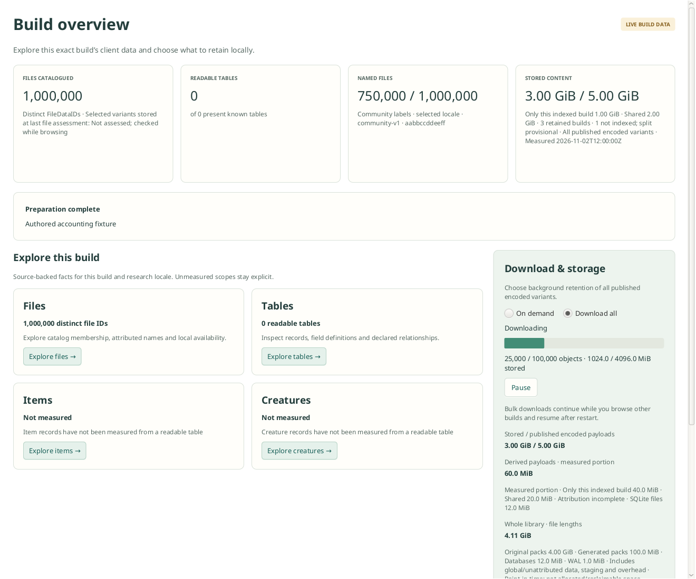

# Download all

The native build Overview offers **On demand** and **Download all**. Bulk scope is
all distinct encoded keys published in the build's authenticated ENCODING data,
across locales and variants. It is not an installed-game file selection or a
request to decode every file or generate every derived artifact.

The application persists policy and the acquisition route in versioned
`builds_download_*` tables in the shared library database. One background build
runs at a time; additional enabled builds queue. Each job owns an independent
build opener and immutable BUILD storage capability, so changing or closing the
visible research workspace does not stop its download. Existing objects are
reused and their published inventory belongs to the selected build.

**Pause** persists a paused policy and cancels current transfer work. **Resume**
checks physical presence again before requesting missing objects. **On demand**
turns bulk intent off and cancels its current work. These actions retain stored
objects. **Retry** repeats the missing-content check after an incomplete or failed
run. Network, disk-space and storage failures stop the run for explicit retry;
there is no unbounded automatic retry loop.

Active, queued and paused policies survive application restart. Active downloads
resume when the app next starts, without needing to open their build. Completed
outcomes persist. The app must be running; there is no separate operating-system
background service. Progress is live in memory; it is reconstructed from physical
presence when resuming rather than checkpointed for every payload.

The existing `DownloadAllJobs` engine bounds scans and fetch batches, uses
background acquisition priority, verifies stored payloads, and checks free space
including a 1 GiB reserve. The application scheduler allows one active job and up
to 1,024 persisted build policies, with at most 64 outstanding policy commands.
GUI controls read cached snapshots and submit asynchronous commands; they do not
read SQLite or wait for network work.

Run deterministic validation with:

```sh
./gradlew :gui:downloadPolicyTest :gui:nativeDownloadTest
```

These cover durable intent before execution, queue isolation, pause/resume,
stale-completion protection, shutdown/restart, explicit retry, future schema
refusal, and real authenticated offline acquisition with shared ownership and no
duplicate payload writes. The GUI `check` task includes both harnesses.

The following scene uses authored progress and temporary fixture storage:



Regenerate it on a machine with a display using
`./gradlew :gui:overviewAccountingUiTest --args=--download-fixture`; the image is
written to the system temporary directory as `vimi-download-overview.png`.
