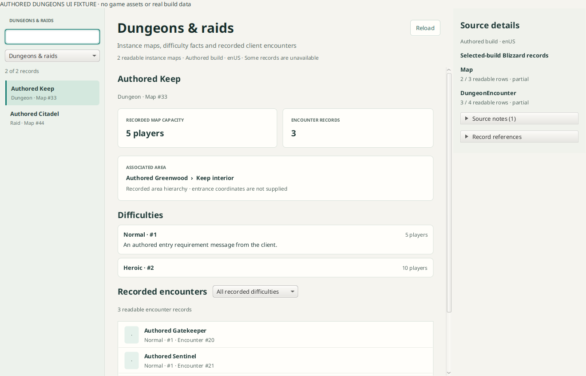

# Dungeons and raids

The dungeon component projects selected-build `Map` records whose verified
`InstanceType` is 1 (party instance) or 2 (raid). The browser has a searchable
left list, selected-instance details in the center and a compact source rail.
It retains readable `PARTIAL` rows and identifies records by map ID rather than
matching localized names.



The screenshot uses invented names, messages and source records. It contains no
game assets or local-library data.

## Available facts

- Instance name/type and recorded `Map.MaxPlayers` capacity.
- The exact `Map.AreaTableID → AreaTable.ID` association and bounded parent-area
  chain. This may identify an interior area; it is not an exterior entrance.
  Corpse/graveyard coordinates are never relabeled as entrance coordinates.
- Separate `MapDifficulty` records, difficulty names, per-record capacities and
  literal client entry messages. Different difficulties are never collapsed into
  one capacity or inferred from a name such as “20 Player”.
- Readable `DungeonEncounter` records joined by the verified map relationship,
  retaining their IDs, difficulty and order. These are client encounter records,
  not a claim about a complete NPC/boss or loot roster.
- Map faction briefings and journal descriptions when recorded, preserving the
  source field and record identity. Missing descriptions do not hide the map.
- Queue records only where `LFGDungeons.MapID` explicitly matches the selected
  map. Legacy direct level bounds remain queue facts, not universal entry rules.

Modern `ContentTuning` bounds have version-dependent scaling semantics and are
not interpreted as numeric entry requirements in this first stage. Literal
`MapDifficulty.Message_lang` text remains useful without inventing those rules.
No name-based queue join or entrance-coordinate inference is used.

## Boundaries and lifecycle

`:concepts-dungeons` exposes `BuildDungeons` over borrowed `BuildTables` only. A
bounded private worker loads metadata lazily; successful frozen table snapshots
are retained for that service instance. Optional tables and individual fields
report independent outcomes. Exact field names, physical columns and foreign-key
relationships must be verified before use; unrelated raw fields do not block
readable verified fields.

The GUI receives the component through a supplier/revision boundary. Search,
instance-type and encounter-difficulty filters operate locally. Optional selected
encounter icons use the existing bounded `AsyncIconRequests` adapter and build
asset service; missing icons preserve names and IDs. Selection/build changes
cancel obsolete requests and suppress stale callbacks. Closing drains the
component without closing its borrowed tables. No provider SQL, direct network
client or separate cache directory is introduced.

Catalogue/table bounds: 10,000 maps, 50,000 map-difficulty or encounter rows,
20,000 queue rows, 10,000 journal rows, 1,000 difficulty labels and 16 associated
area ancestors. Each overview retains at most 256 difficulty records, 128 queue
records, 2,048 encounter records and 64 text blocks, with an explicit source note
when a group exceeds its bound. The source rail lists at most 128 encounter
references; retained encounters remain in the virtualized list. Cycles and
nonadvancing cursors are rejected or reported.

## Workspace integration

The workspace constructs `new DungeonsService(tables)` without reading tables,
publishes its `BuildDungeons` handle atomically with the prepared generation and
drains it before retiring the borrowed table handle. Canceled preparation keeps
the previous published handle.
The standalone view constructor accepts handle/revision suppliers, a build-locale
context string and an optional icon-fetch function. The Dungeons menu becomes available when tables are ready. Workspace revision
changes invalidate the view, and leaving the build cancels outstanding requests.

## GPU interior view

Selecting an instance offers **View interior (GPU)**. It opens a separate window rendering the
map's qualified single global WMO through the application GPU owner, with free-flight controls.
The starting camera frames the native bounds for inspection only: it is not an entrance, spawn or
floor. Instances outside the qualified profile show a bounded reason. Onyxia's Lair (map 249) is
the actually proven example. Doodads, liquids, lighting, NPCs and navigation are not drawn yet.
See [world-global-interior-viewer-checkpoint.md](world-global-interior-viewer-checkpoint.md).

## Verification

```sh
./gradlew :concepts-dungeons:check :gui:check
# Requires a working JavaFX display:
./gradlew :gui:dungeonsUiTest
```

The component tests cover party/raid classification, distinct difficulty
capacities, queue facts, exact encounter joins/order, bounded cyclic area
hierarchies, partial/missing relations, invalid foreign keys, cancellation and
borrowed lifetimes. The authored FX harness checks search/filtering, associated
area presentation, resizing and stale callbacks after closure.

A separate read-only Forever `1.60.1.70707` proof used actual physical DB2 headers
and matching prepared row counts: `Map` had 73/81 readable rows, yielding 50
readable party/raid map records. Deadmines map 36 resolved three difficulty rows
and eight encounter records. Molten Core map 409 resolved three difficulty rows,
eleven encounter records and associated interior area 2717. Source `Map` and
`MapDifficulty` capacities were preserved independently. The published LFG
Deadmines/Molten Core rows had map ID 0, so their names did not establish a join.
No application-library writes were made; scratch acquisition stayed in a
temporary proof library. These examples establish the projection, not complete
coverage of every build or every instance.

Primary schema references:
[Map](https://github.com/wowdev/WoWDBDefs/blob/b9a63096cdd99b26967f17f9515377ae62cadfd7/definitions/Map.dbd),
[MapDifficulty](https://github.com/wowdev/WoWDBDefs/blob/b9a63096cdd99b26967f17f9515377ae62cadfd7/definitions/MapDifficulty.dbd),
[DungeonEncounter](https://github.com/wowdev/WoWDBDefs/blob/b9a63096cdd99b26967f17f9515377ae62cadfd7/definitions/DungeonEncounter.dbd),
[AreaTable](https://github.com/wowdev/WoWDBDefs/blob/b9a63096cdd99b26967f17f9515377ae62cadfd7/definitions/AreaTable.dbd),
[LFGDungeons](https://github.com/wowdev/WoWDBDefs/blob/b9a63096cdd99b26967f17f9515377ae62cadfd7/definitions/LFGDungeons.dbd),
[JournalInstance](https://github.com/wowdev/WoWDBDefs/blob/b9a63096cdd99b26967f17f9515377ae62cadfd7/definitions/JournalInstance.dbd).
