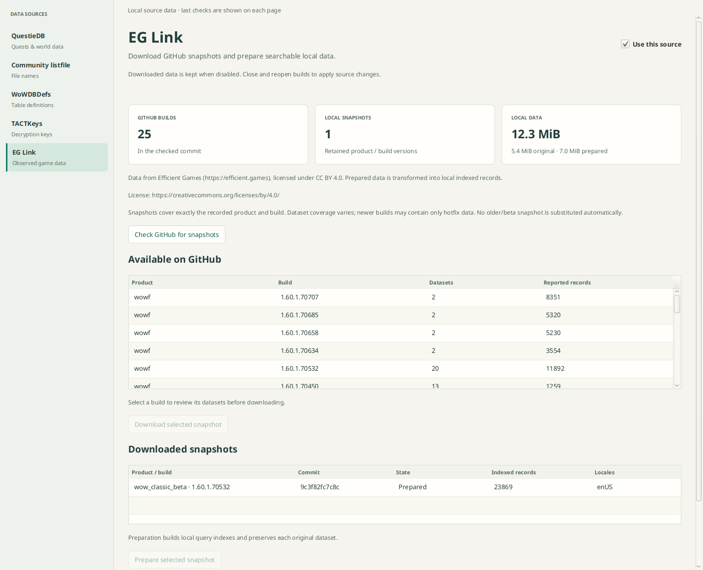

# EG Link data source

EG Link is managed from Data Sources alongside Questie. Enablement and
additional scheduled updates are persisted in the shared source settings. The
default is enabled with no extra scheduled checks. Startup and **Refresh sources**
perform the complete sync: check, download selected revisions, and prepare or reuse
the local database. The individual Check button remains discovery-only; Download
and Prepare remain available separately. See [Source refresh](source-refresh.md).
Disabling retains completed local data and cancels active source work.

The source is [JIVESCORP/eg-link-output-wowf](https://github.com/JIVESCORP/eg-link-output-wowf).
All acquisition uses GitHub: a fixed `api.github.com` branch reference and immutable
commit URLs at `raw.githubusercontent.com`. Redirects are refused. No Efficient
Games API, alternate host, general URL input or Everloot endpoint is used.

## Provenance and coverage

Data from Efficient Games (https://efficient.games), licensed under
[CC BY 4.0](https://creativecommons.org/licenses/by/4.0/). Prepared data is transformed
into local indexed records. Each source retains the exact commit, product, client
build, datasets, locales, collection dates and declared record/source counts.
Original files retain upstream metadata and attribution. The upstream license covers
its compilation/structure/observations; Blizzard retains ownership of game content.

Coverage is observed, incomplete and version-specific. At the reviewed commit
`9c3f82fc7c8ce60760e933db529fd629c2f682d7`, the manifest advertises 25 snapshots across
`wowf` and `wow_classic_beta`. `wowf 1.60.1.70707` advertises only hotfix and item-hotfix
data. Earlier beta snapshots include NPC interactions, creature details, vendors,
trainers, loot and talent scans. The application never silently substitutes an older
or beta snapshot for an exact product/build. The dataset list is shown before download.

## Bundled NPC display history

A bundled history of NPC displays ships with the application (see
[Data sources](data-sources.md#bundled-eg-link-npc-display-history)): per NPC, the
displays of the newest `wowf` build that recorded it in the upstream repository's
recent commits, with that build, commit and collection date. It is regenerated by
hand before a release with `scripts/release/eg_link_history.py` and needs no
download.

## Retention

Snapshots are keyed by commit, product and build. A sync downloads the latest
advertised build of each product and every installed build that is still
advertised; a build whose declared datasets (records, sources and collection dates)
match a prepared snapshot already held is reused without a download, so a commit
that leaves a build alone costs one index request. Each product then keeps
`EgLinkRepository.RETAINED_SNAPSHOTS` (10) snapshots: first the newest commit of
each build, newest build first, then older commits of a build, most recently
downloaded first. The rest are deleted with their prepared databases. Earlier
builds therefore outlast repeated commits of the latest one, and the NPCs page can
still find an NPC only an older build recorded.

Before this, every downloaded commit was kept (up to 1,024 snapshots) and each
upstream commit downloaded every installed build again.

## Local storage and queries

Original files and a checksummed source manifest live under provider-local
`eg-link/sources/<source-id>`. Processing creates an immutable-version query database
at `eg-link/derived/<source-id>.sqlite`. These provider-local bytes are displayed
separately from build object-store accounting. Indexes store bounded records by
source/dataset/collection/ID with normalized JSON and an optional searchable name.
They do not claim every indexed row is an NPC. Upstream reported record counts and
actual indexed record counts are displayed separately because collections vary.

The typed repository offers source inventory, lookup and paged name search. This
change establishes ingestion/query foundations; it does not merge NPC catalogs or
make the existing client Creature screen a complete world directory. A future NPC
component can consume exact source versions without GUI access to SQL.

## Validation

`./gradlew :eg-link:check :network-clients:check :gui:check`

Offline contracts cover commit/path restrictions, redirects, malformed/duplicate JSON,
provenance, schema/license refusal, staged download cancellation, prior-catalog
retention, source damage, canceled index rebuild, bounded query results and offline
restart. Managed-service checks cover check→download→prepare, enablement and local
inventory restoration without source requests. CI runs component tests/checks on
Linux, Windows and macOS.

A separate live smoke check used temporary storage: beta 1.60.1.70532 downloaded 23
datasets (5,617,661 original bytes), prepared 23,869 indexed records, and returned the
verified creature 416 name **Imp** through the typed lookup. It did not modify the
application library.

