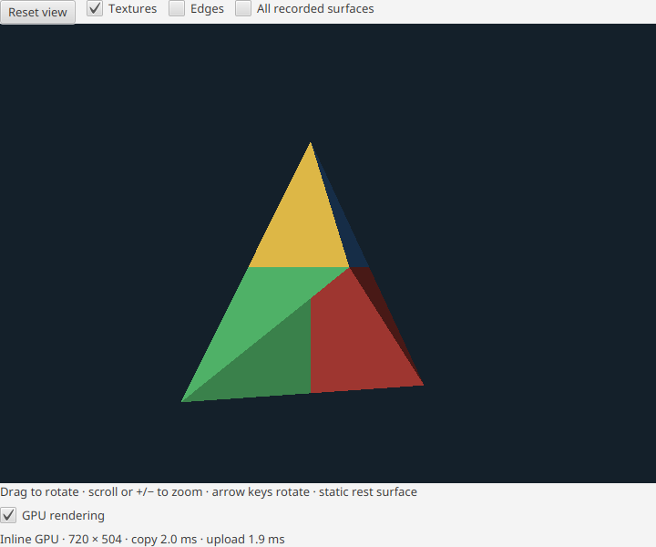

# Inline GPU preview review — 2026-11-03

The user selected an inline viewport. The implemented path is offscreen bgfx
rasterization in an isolated child, bounded GPU readback and mapped transport,
then a bulk JavaFX image upload. It includes copies. No universal speedup or
Metal/Direct3D hardware qualification is claimed.

## Independent review

Architecture approved the root native pipeline and the independent shared-frame
protocol at pre-rebase revisions `5a046f7`/`e635ad5`, excluding its own GUI work.
Review covered ready-frame buffer lifetimes, resize/drain, capability gates,
origin conversion, bounded publication and independent parent watchdog.

Domain independently approved GUI/service and root pipeline at
`2f19c4cbf75246ff7be7ef3d9875ea98cfe23ed1`, excluding its own scene, camera and
frame-file work. Two blockers found during review were fixed: completion could
reinsert an older frame over a newer one, and a queued frame could restore GPU
readiness after terminal failure. Deterministic handoff and authored JavaFX
failure-order regressions cover both corrections. The independently reviewed changes cover
scene/camera, frame protocol, service/view and the delivery corrections.

## Local evidence

- Full `check assemble :gui:installDist` passed after delivery corrections,
  using Java 25 and the system SQLite library.
- Real Linux Intel Vulkan sidecar proof passed controls, texture changes, resize,
  latest-request coalescing, static-frame suppression, orientation and CLOSE.
- Sixteen authored native material/depth/visibility cases passed.
- Real JavaFX/Vulkan authored proof passed camera image changes, one-child
  ownership, hide/show cleanup/restart and failure fallback after the corrections.
- CI helper tests: 28 passed; release helper tests: 6 passed.

One sidecar run measured 324.7 ms cold startup, 30.65/39.09 ms warm p50/p95
request-to-copied-frame latency and 31.17 sampled frames/s at 960×720. A real
720×504 JavaFX run after correction measured 860 ms cold startup, approximately
2.6 ms copy/1.8 ms upload and 33–72 ms camera response including test polling.
These authored-fixture observations are not a live-build benchmark.

Hosted platform checks and packaged-runtime proof are separate integration gates.
The native runtime probe does not initialize a GPU; it verifies JNI linkage,
compiled backends and all eight packaged shader hashes.

## Integration

PR #138 fast-forward merged at `c311203`. Hosted PR checks passed:
unit `41671034080`, integration `41671034205`, compatibility `41671034043`
and shader compilation `41671034114`. The bounded packaged-native probe and its
failure/timeout/output-limit tests also pass locally. A frozen Linux distribution
at `.local/apps/gpu-c311203` passes the native/shader smoke test.

Local jpackage was blocked by the system JDK's modified-security-file integrity
check; no bypass was used. Hosted packaging is the app-image acceptance gate.
