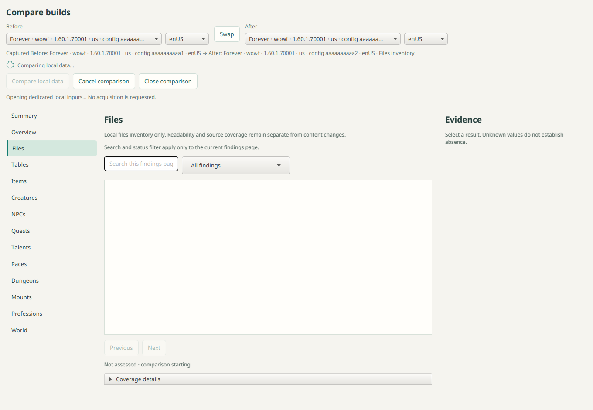
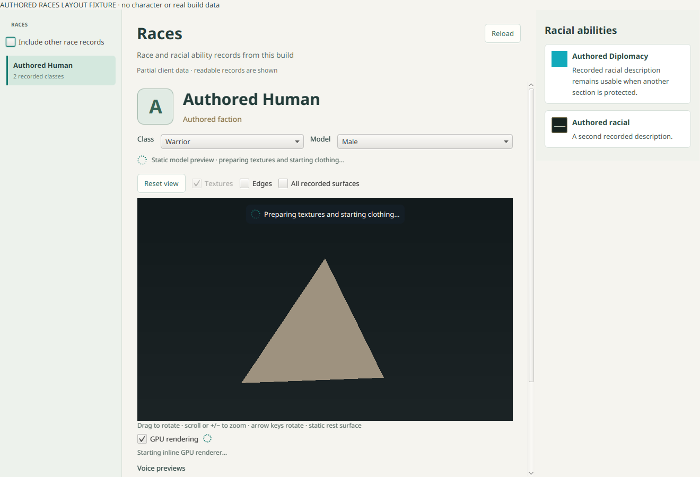

# GUI activity integration review — 2026-11-03

Implementation source checkpoint: `8c3ed4c`, based on main `f1b5413`.
The user authorized separate agents and continued loading/responsiveness work.
The World explorer remains CPU rendered; this slice moves preparation off FX.

## Independent scopes

- Domain approved root comparison/save/drain/accounting changes at `2108d05`.
  The later preference-row change `e4aca97` removes duplicate saving text only.
- Domain approved World/maps at original `8fbea64` (integrated `9afe572`),
  including source identity/revision retirement and bounded off-FX preparation.
- Architecture approved Talents/Professions through original `98dd64f`
  (integrated `7ea696b`) after reviewing and independently rerunning both fixtures.
- Domain approved media/audio through `12892e8`: bounded device admission/close,
  actual start feedback, background icon conversion and retirement guards.
- Domain approved the additional Races retirement correction at original
  `8c0f987` (integrated `8c3ed4c`), including generation-first guards and
  asynchronous GPU/audio cleanup.
- Root reviewed agent-authored production changes and fixtures. No author
  supplied the independent approval for their own implementation.

Review corrected external-source results that could leave spinners attached,
older selection callbacks that could retire newer activity, pending recipe
details canceled by More paging, and pending-icon target retention. A Talents
fixture's fixed timing assumption was replaced with bounded condition waits.

## Local verification

At the source checkpoint, Java 25 and system SQLite passed:

```sh
./gradlew check assemble :gui:installDist \
  :gui:racesUiTest :gui:talentsUiTest :gui:professionsUiTest \
  :gui:compareUiTest :gui:worldUiTest :gui:locationMapUiTest \
  :gui:mountsUiTest :gui:dungeonsUiTest \
  -PsqliteLibrary=/lib64/libsqlite3.so.0
```

UI tasks used the current user's local Xwayland display. Fixtures use authored
data; the voice test uses gated fake audio lines. The default check includes
`voicePlaybackTest`. The final run completed 460 tasks successfully.



See [audit](gui-loading-audit.md) for exact implemented areas and limits.
App drain/accounting and saving indicators have source review/component checks,
without new dedicated delayed FX fixtures. Native device behavior and live-build
latency remain unqualified. Hosted platform checks gate merge; all five packaged
GUI/runtime checks gate alpha.12 publication.

## Race appearance handoff follow-up

The neutral geometry frame no longer ends the visible appearance phase. The
viewport owns a separate texture/composition badge, while RaceModelPanel tracks
its header activity until the target appearance frame is accepted. CPU and GPU
paths retain existing generation, source, owner and current-display-policy guards.
Unavailable composition/rendering and close retire the phase explicitly. Textures
OFF accepts the target appearance under the requested display policy.

Root reviewed39e4e3d and independently ran integrated GUI/unit/fake-GPU/World
navigation checks plus Races FX. Authored delayed-result tests cover neutral model
visibility, pending feedback, accepted-frame handoff, obsolete target retirement,
provider failure and workspace close. This screenshot contains authored geometry
and fixture rows only.


