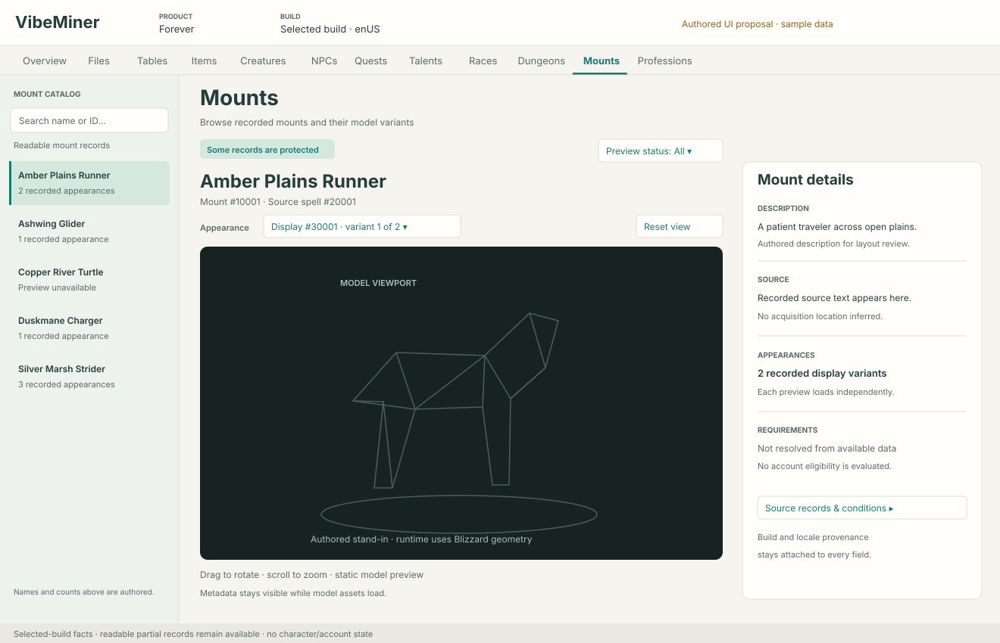
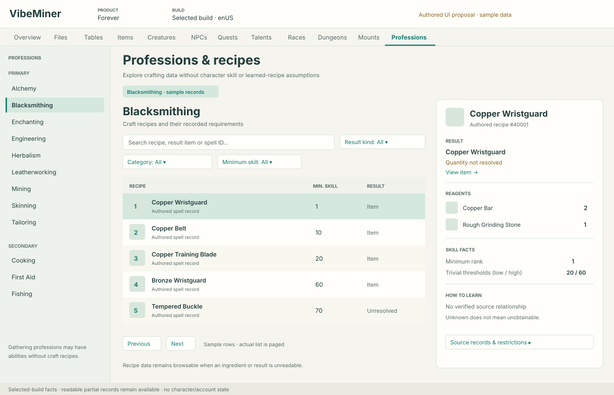

# Mounts and Professions browser design

UI proposal for [Mounts #111](https://github.com/aircan80/vimi/issues/111) and
[Professions/Recipes #112](https://github.com/aircan80/vimi/issues/112), reviewed
by a UI specialist and checked by the WoW data specialist against selected-build
findings. These are proposed
screens, not implemented application features.

The authored SVGs contain invented names, IDs, counts and recipe values. Their
model silhouette is an authored placeholder, not Blizzard geometry. They include
no game assets or local-library information.

## Shared presentation

Retain the existing cream/green styling, build header, horizontal build areas,
left navigation and compact inspection panels. A selection should expose useful
text immediately, then fill icons/models and related records asynchronously.
Unknown values are labeled; known-empty values remain distinguishable. A protected
section does not disable readable rows or related information.

The new areas increase the width of the build navigation. Preserve all existing
areas; use a horizontally scrollable strip with keyboard access at narrow widths,
without shrinking labels or introducing a second navigation row. At approximately
1320 logical pixels, show the three-column composition. Below about 1150 pixels,
keep the left list and main content, with an explicit Details button opening the
inspector as an accessible drawer. Never squeeze the model into a narrow sliver.

## Mounts

Use a 236 px searchable mount list, a flexible central model canvas, and a
316 px details rail. The selected mount's name and source spell remain above the
canvas; source descriptions and provenance stay out of the model viewport.

| Area | Primary contents |
|---|---|
| Left list | Name, optional icon, recorded variant count or preview status; search by name, mount ID or source spell ID |
| Center | Name; mount/source-spell identities; display variant selector; actual model; reset view; rotate/zoom hints |
| Right details | Description, source text, recorded variants, resolved requirements when available; expandable source records/conditions |

Load one selected variant at a time, with no speculative download of all mount
assets. Preserve each variant row's identity and use stable deterministic ordering;
the table does not establish a preferred client appearance. Prefer a variant
already known to be resolved, otherwise request the first variant only. Do not
probe every variant merely to find a preview. Changing variants cancels obsolete work.
An unavailable variant does not hide other variants. Keep model and texture
readiness separate; accurately label a static/rest preview until animation exists.

Initial filters are search and known preview status (All / Not checked /
Preview resolved / Preview unavailable). Unrequested models are “Not checked”,
not “Unavailable”; filtering never initiates asset downloads. Do not expose Ground/Flying/Aquatic or speed filters until a
reviewed relationship resolves those properties. Do not expose Owned, Collected,
Usable, Missing or Favorites as if character/account data were present.

Use the selected-build route:

`Mount.ID → MountXDisplay.MountID → CreatureDisplayInfo.ID → CreatureModelData.ID → M2`

The current Forever layout has no direct display column in `Mount`;
`MountXDisplay.MountID` is a decoded noninline relationship. Preserve each display
row's condition and provenance. Older layouts require a separate reviewed adapter.
A mounted spell's creature entry is not a display ID and is insufficient without
an NPC appearance mapping. See [Mount](https://github.com/wowdev/WoWDBDefs/blob/master/definitions/Mount.dbd)
and [MountXDisplay](https://github.com/wowdev/WoWDBDefs/blob/master/definitions/MountXDisplay.dbd).

## Professions and recipes

Use a 236 px profession sidebar, a flexible recipe list and a 358 px scrollable
detail rail. Group professions by recorded primary/secondary categories. Gathering
professions remain visible even when they have no direct craft recipes.

| Area | Primary contents |
|---|---|
| Left list | Profession name/icon and readable recipe or ability count; category grouping |
| Center | Profession name/description; search; category, minimum rank and result-kind filters; paged recipe rows |
| Recipe row | Icon/name, minimum skill rank, result kind; output item name when resolved |
| Right details | Result, reagent rows with quantities, tools, skill facts, how-to-learn evidence, restrictions and source records |

Search covers recipe name, result item name/ID, spell ID and ability-row ID. Keep
the ability-row identity: two rows for the same spell can carry different
restrictions. Make duplicate names distinguishable using rank or identity rather
than silently merging them. Keep enchants in the list even when no inventory
item is produced. Result kinds are Item, Enchantment, Random/scripted, Other and
Unresolved. An unresolved result is inspectable, not filtered out by default.

For item results, the result card uses an item link and optional quantity.
Enchantment results show their effect/name without inventing an output item.
Show a quantity only
when resolved by the reviewed adapter; otherwise show “Quantity not resolved”.
Reagents have their own independent readiness. Preserve original slot evidence;
combine duplicate ingredients only in the visible summary. Missing item names
still show item IDs and known quantities. Tools are a separate section. Never
turn missing reagent rows into “No reagents” without a conclusive source outcome.

The initial skill presentation shows minimum rank and the recorded low/high
trivial thresholds. Color progression can follow a reviewed per-version adapter;
it must not look personalized to a player's current skill. Acquisition method is
not a trainer/vendor/drop relationship. Show “No verified source relationship”
when evidence is absent, with provider/build details available in the inspector.

Use `SkillLine → SkillLineAbility → Spell` for the catalogue, `SpellReagents`
for reagent slots, `SpellTotems` for tools, and reviewed `SpellEffect` semantics
for outputs. Forever uses `EffectBasePointsF`; do not apply legacy quantity
“base points + 1”. Random/scripted crafting and enchantments need distinct
result states. Retail quality/optional-reagent systems require a separate adapter.
See [SkillLineAbility](https://github.com/wowdev/WoWDBDefs/blob/master/definitions/SkillLineAbility.dbd),
[SpellReagents](https://github.com/wowdev/WoWDBDefs/blob/master/definitions/SpellReagents.dbd)
and [SpellEffect](https://github.com/wowdev/WoWDBDefs/blob/master/definitions/SpellEffect.dbd).

## Loading and incomplete data

| Situation | Presentation |
|---|---|
| Initial catalogue preparation | Small inline progress with a readable status; other build areas remain usable |
| Partial table | Show readable entries; compact coverage message with expandable source diagnostics |
| Icon unavailable | Neutral icon placeholder; name/ID and selection still work |
| Model loading | Spinner inside the model canvas; mount details stay available |
| Model unsupported/protected | Specific inline reason and Retry; preserve variant selection and metadata |
| No matches | Clear filters action; preserve selected details until selection changes |
| No readable rows | Explain unavailable/absent/protected source outcome, not “this build has no mounts/recipes” |
| Gathering profession without crafts | “No craft recipes in the readable records”; keep profession abilities accessible |
| Build/locale changed or closed | Cancel owned work; discard stale results; restore focus sensibly |

Use standard keyboard list/table selection, explicit labels, visible focus and
textual state markers in addition to color. Model rotation should have keyboard
controls or equivalent buttons; Reset view is always reachable without a mouse.

## Delivery stages

1. **Mount catalogue and preview:** new component contract, build-local records,
   variants, source details, real static model rendering through existing asset
   and renderer boundaries, cancellation/caching, authored UI fixture and one
   selected-build proof. Do not defer rendering: it is part of the user's request.
2. **Profession catalogue and recipe facts:** typed profession/ability contract,
   names/icons, categories, search, direct result and reagent facts, tools,
   thresholds, visible unresolved results and provider provenance.
3. **Enrichment:** reviewed vendor/trainer/drop relationships, result linking,
   further mount conditions/capabilities, and richer supported animations.
4. **Retail expansion:** qualities, optional reagents, currencies and profession
   traits under adapters that accurately represent that product's systems.

Both components should have their own focused unit/contract tests. UI checks
should cover selection during delayed media, partial rows, missing icon/model,
keyboard navigation, resizing and build closure. Reuse the existing generated
object-store cache boundary for media; provider-specific database layouts remain
private. App acquisition stays on Blizzard services/CDN and GitHub.
