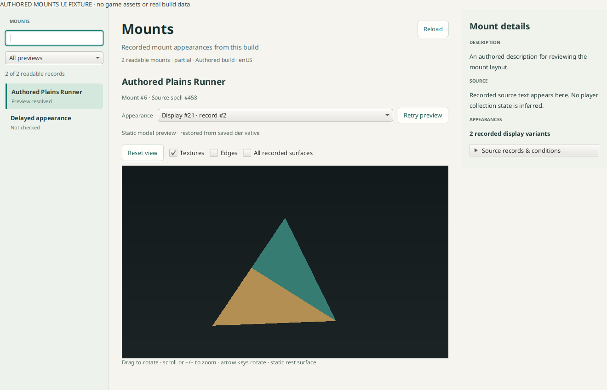

# Build-local mounts

The Mounts browser projects readable selected-build client records into a
searchable sidebar, selected-variant model canvas and compact details rail.
Names, description/source text, source-spell IDs and raw source/condition facts
remain usable independently of model assets. It does not inspect an account or
claim collection ownership, current usability, mount speed or server availability.



The screenshot contains an authored tetrahedron and invented names/text. No game
assets or local-library content are committed.

## Component boundaries

- `:concepts-mounts` owns mount catalogue/variant projection, bounded metadata
  requests and mount-to-display validation. It borrows build tables/files and
  the generated store; closing drains its work without closing borrowed inputs.
- `:concepts-models` owns reusable `CreatureDisplayInfo` static preview requests,
  verified table projection and content-bound derivative caching. NPC or other
  consumers can use a display ID without importing player-race policy.
- `:formats-assets` supplies validated M2/rest-draw/BLP readers and existing
  combiner/static-opacity proofs. Strict rig/material APIs are unchanged.
- `:rendering-models` owns immutable mesh/UV/normal/texture values, codec and CPU
  rendering. `ModelPreviewView` displays those values, with mouse and keyboard
  rotation/zoom controls.

The current mapping is:

`Mount.ID → MountXDisplay.MountID → CreatureDisplayInfo.ID → CreatureModelData.ID → M2 FileDataID`

`MountXDisplay.MountID` may be a noninline relationship. The projection consumes
its decoded named column and requires verified foreign keys. A legacy direct
`Mount.CreatureDisplayInfoID` is used only when that exact relationship is
present and verified. Source-spell IDs are never mistaken for mount or display
IDs. Variants retain their row IDs and conditions and use deterministic row-ID
ordering, without claiming a preferred client appearance.

The component accepts readable `READY` and `PARTIAL` rows. Unsupported fields,
missing relationships and protected sections are reported individually. A failed
model does not discard the mount or other variants. Only the selected variant's
assets are requested; catalogue search and known-preview-state filters perform
no asset acquisition. “Not checked” is distinct from “Preview unavailable”.

## Static preview scope

The preview renders actual native rest positions, source normals and UVs. Its
reviewed simple diffuse profile accepts one UV0 texture stage, opaque/alpha-key
materials and proven full opacity, using existing M2 combiner admission. An
absent coordinate lookup uses the combiner's implicit UV0 convention; a present
lookup must agree. Texture type 0 uses an exact TXID, while types 11–13 use the
selected display's first three texture variations. No guessed filename joins.

Animation, particles, runtime equipment/customization, full game lighting and
other shaders are not evaluated. Unsupported bindings retain neutral surfaces.
Nontrivial geoset visibility remains explicitly unresolved; player-race
default-selection rules are not applied to creatures. The default mount view
shows only section ordinals with qualified material/texture bindings, independently
of native geoset IDs. The status reports supported/total material sections.
**All recorded surfaces** exposes unresolved sections as raw diagnostic geometry;
this does not claim their game appearance is reproduced.
The browser keeps these limitations and source references in the details panel.

Metadata requests and model preparation have separate bounded workers. Changing
selection cancels obsolete requests, and workspace generations suppress stale
callbacks. Keyboard arrows rotate, plus/minus zoom and Home resets the model.

Generated previews bind the build/locale, display/model/file identities, reader
and material/decoder revisions, and current texture references. A cached payload
contains bounded geometry/appearance data plus source receipts. Restore checks
the current model, main SKIN and every retained texture content key before
publishing; corrupt or mismatched derivatives are rebuilt. Generated-cache
failure preserves the original assets and usable preview.

## Validation

Focused commands:

```sh
./gradlew :concepts-models:check :concepts-mounts:check :gui:check
./gradlew :gui:mountsUiTest
```

The UI check is opt-in because it needs a display. It uses authored data and
covers readable partial records, lazy variants, source-spell search, resizing,
stale selection and borrowed-handle lifetime. Its screenshot is written to
`gui/build/ui-review/mounts-authored.png`.

A separate read-only source proof used Forever `1.60.1.70707`: 141 readable mount
records and 216 readable display links. Brown Horse mount 6 joins link 1,
display 2404, model 216 and M2 FileDataID 125614. The actual preview contains
673 vertices and 930 triangles, with three surfaces textured from two BLPs.
The isolated pack-store proof restored the appearance from a new component
instance. Game-file downloads and derived writes stayed in a temporary proof
library; the application library was read-only. This establishes that example's
pipeline, not completeness of every mount or every shader.

Definitions:
[Mount](https://github.com/wowdev/WoWDBDefs/blob/master/definitions/Mount.dbd),
[MountXDisplay](https://github.com/wowdev/WoWDBDefs/blob/master/definitions/MountXDisplay.dbd),
[CreatureDisplayInfo](https://github.com/wowdev/WoWDBDefs/blob/master/definitions/CreatureDisplayInfo.dbd),
[CreatureModelData](https://github.com/wowdev/WoWDBDefs/blob/master/definitions/CreatureModelData.dbd).

The build workspace now opens Mounts after Races. Its cold handle is published
with the table generation and drained before borrowed tables close. Workspace
revision changes invalidate catalogue/model selection; browsing other areas keeps
asset acquisition lazy.

## Reviewed static material profiles

The narrowly reviewed M2 version272 profile accepts the second raw batch field
as a matching section reference, retaining the existing zero-field profile.
Modern version274 projection-related bits remain outside that admission. The
material-policy revision changes generated identities so old neutral derivatives
do not suppress corrected textures. Strict asset-reader/C# contracts are unchanged.

Read-only Forever 1.60.1.70755 evidence:

| Mount | Recorded chain | Qualified material coverage |
| --- | --- | --- |
| Skeletal Horse #28 | link23 → display5228 → model491 → M2 file126304 | Corrected 3/3 sections, 2 textures, 2 cutouts; a fresh component restores the corrected derivative. |
| Black War Raptor #79 | link74 → display14388 → model1916 → M2 file125649 | 5/5 sections, including two-texture reflective ENV armor and two additive camera-facing cards. |
| Great Brown Kodo #103 | link174 → display14578 → model1914 → M2 file124696 | 4/4 sections, including unlit opaque detail and two additive camera-facing cards. |

CPU and actual Vulkan previews agree on the same private payloads, including
qualified/raw and textured/neutral modes. Game payloads and screenshots remain
outside Git. Downloads and generated writes for these proofs used scratch stores;
the application library stayed read-only. These are static bind/rest previews, not animated game-client parity.

The exact reviewed profiles now support per-vertex sphere-map ENV coordinates,
two-texture opaque modulation, unlit opaque detail and additive rigid leaf cards.
Cards use verified own-track absence and bind/rest positions; animated ancestors
are intentionally unevaluated. Unknown profiles retain explicit fallback.
Texture-off mode remains neutral lit opaque geometry.

Final private acceptance compared 36 actual Linux Vulkan frames against CPU output:
three mounts, four cameras and qualified/raw/texture-off modes. Minimum silhouette
agreement was 99.9837%; maximum intersected RGB mean error was 0.523/255.
Cold and fresh-instance restored appearances were byte-identical, with all retained
source receipts verified. No game assets or screenshots are committed. Actual
Metal/D3D rendering remains unqualified. See [review](model-materials-review.md).
