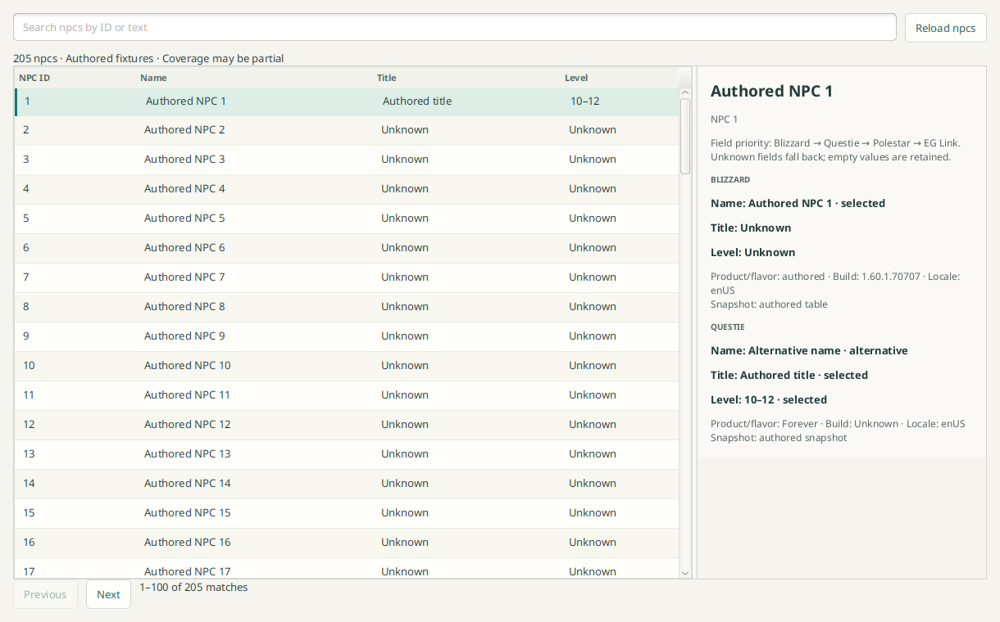
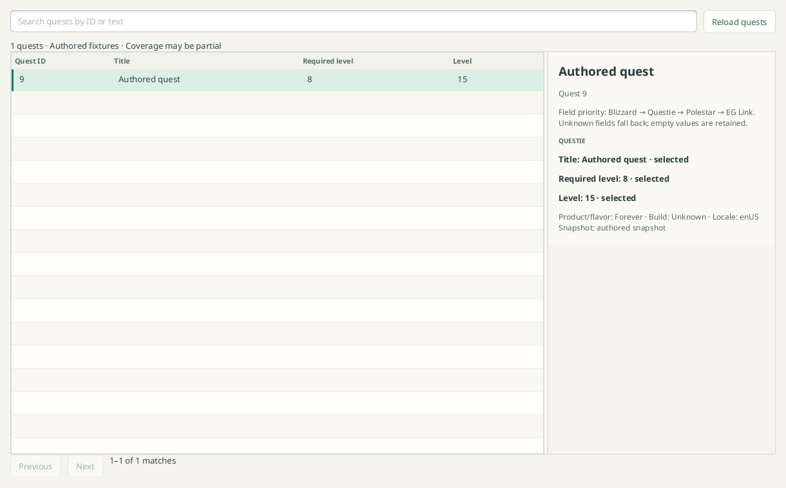

# NPC and quest catalogues

The selected-build workspace has NPCs and Quests areas. Both union IDs and resolve
individual fields in this order: Blizzard build tables, the build's selected
Questie flavor/version, Polestar, then EG Link. Each record retains all supplied
observations, including conflicting alternatives, for the detail panel. A null
field means unknown; an empty string is an explicit empty value and stops fallback.
NPC levels are a source-supplied minimum/maximum pair. Quest required level and
quest level are separate facts; negative source values remain raw values.

## Component boundaries

`:concepts-npcs` and `:concepts-quests` own immutable contracts, provider adapters,
field precedence and bounded catalogue construction. They read providers through
existing public APIs; no GUI or provider SQL crosses those boundaries. They borrow
build tables/repositories and close only their own Questie version handles.
`ProviderBrowser` shares JavaFX search, paging and request lifetime mechanics.
The two area adapters supply their own columns and evidence presentation.

Blizzard reads `Creature` for NPC IDs/names/titles, and `QuestV2` plus
`QuestV2CliTask` for quest IDs/task titles. Verified localized schema columns and
per-field text issues govern readable text. PARTIAL tables retain readable rows.
Blizzard's NPC level ranges and general quest descriptions are not guessed from
unrelated fields. Questie supplies its mapped prepared NPC/quest records;
Polestar uses NPC/QUEST records; EG Link uses creature_details/npcs and quests.
Only the `npcs` collection is read from EG Link's mixed npcs dataset: game objects
and approached objects must not become NPC records.

## Source selection and freshness

Browsing performs no source downloads or preparation. Use Refresh sources or
Data Sources to prepare snapshots. Disabled providers are excluded. Questie honors
the existing per-build flavor mapping and preferred prepared version. Polestar is
limited to automatically recognized Forever products. Polestar/EG Link choose one
latest prepared snapshot at or before the selected build within the same numeric
major.minor.patch branch; EG Link additionally requires the exact product and an
applicable dataset. No beta/live product substitution occurs. Original source
build/version/locale remains visible; eligibility is a fallback policy, not proof
of identical server data. Source coverage may be sparse, so records do not imply
that an NPC or quest is available to players in the selected build.

## NPC model display

The NPC preview resolves one display per NPC (`NpcDisplays`, `NpcPreviews`), in
order:

1. the client `Creature` record's declared displays;
2. EG Link `creature_details` from every prepared downloaded snapshot of the same
   product and x.y.z not after the opened build, newest build first and the newest
   commit of a build first (the first that records the NPC with a usable display
   wins);
3. the bundled EG Link NPC history, when its entry is of the same product and x.y.z.
   It keeps one build per NPC (the newest that recorded it), so the entry may be
   newer than the opened build.

A display the opened build's `CreatureDisplayInfo` proves absent is never used, and
its source falls through to the next one. A display that cannot be checked (a
partial table) is kept. The shown provenance names the source, build, commit and
collection date, and ends with "(bundled)" for the bundled history. The NPC catalog
list still reads one snapshot per provider as above.

Catalogues load lazily off the JavaFX thread, retain at most 200,000 observations
per provider, and show 100 records per page. Search applies to the entire merged
catalogue, not only the current page. Settings/source revisions and workspace
replacement invalidate the view; cancellation and stale-result guards prevent
retired work from publishing. A provider failure retains other providers' rows
and appears in the catalogue diagnostics. No catalogue payload or game asset is
committed to the repository.

## Verification

```sh
./gradlew :concepts-npcs:check :concepts-quests:check :gui:dataSourcesTest
# Requires a working JavaFX display:
./gradlew :gui:providerBrowserUiTest
```

The authored JavaFX fixture verifies paging, ID/title search, per-field winners
and alternative evidence. It optionally exports screenshots using
`-PproviderScreenshots=/absolute/output/directory`. The screenshots below contain
only authored samples, not live game records.



