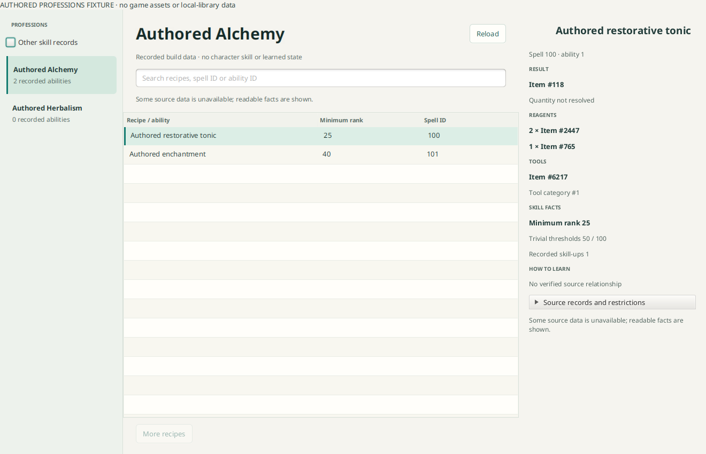

# Professions and recipe facts

`:concepts-professions` borrows one selected build/locale `BuildTables` handle.
Construction is cold. `catalog`, bounded `abilities` pages and `detail` execute
asynchronously on a bounded component worker. `closeAsync` cancels/drains its own
work; the workspace must close this handle before closing the borrowed tables.
The component never opens SQLite or provider-specific stores.

The standalone `ProfessionsView` supplies a profession sidebar, searched ability
pages and a compact detail rail; a Details drawer preserves room at narrow widths.
Item names and icons use optional asynchronous callbacks so existing item/asset
boundaries can enrich references. Missing names retain IDs. Workspace navigation
and handle ownership are wired separately by the integration change.

## Reviewed first adapter

The initial layouts match the cached Forever 1.60.1.70707 inventory:

| Table | Reviewed layout | Readable / declared snapshot rows |
|---|---|---:|
| SkillLine | 6763217C | 154 / 154 |
| SkillLineCategory | 67B4FE22 | 9 / 9 |
| SkillLineAbility | 224F7EA0 | 7843 / 7851 |
| TradeSkillCategory | 7F2B6CD0 | 216 / 216 |
| SpellName | 782EE721 | 32007 / 32986 |
| SpellMisc | 434B3607 | 31987 / 32963 |
| SpellReagents | FF40D202 | 3300 / 3338 |
| SpellTotems | 03B23619 | 1121 / 1123 |
| SpellEffect | 5362E3D4 | 42830 / 44168 |

These are a recorded snapshot, not hard-coded expected counts. Other layouts
return explicit unsupported outcomes. Optional unsupported tables do not discard
profession/skill facts or other readable relationships. PARTIAL rows are usable;
reagent, tool and result readiness are independent. Bounds cover core rows,
related detail reads, pages, queued work and displayed diagnostics. Shared
`RelationIndexes` build each spell relationship once per handle, then fetch
matching rows with identity checks rather than repeatedly scanning whole tables.

Primary/secondary skill categories use the reviewed Classic constants 11/9;
weapon/language lines are excluded, gathering professions retained. The default
sidebar shows the twelve reviewed Classic profession skill IDs; Other skill
records exposes all readable records in these categories, including internal
tiers and riding skills. Nothing is selected by matching localized names. Abilities
retain `SkillLineAbility` row identity: two rows referencing one spell may have
different restrictions. The two `RaceMasks` words retain slot identities.
Categories, names, spell icons and minimum ranks come from declared source fields.
See [SkillLine](https://github.com/wowdev/WoWDBDefs/blob/master/definitions/SkillLine.dbd),
[SkillLineAbility](https://github.com/wowdev/WoWDBDefs/blob/master/definitions/SkillLineAbility.dbd)
and the [Classic category enum](https://github.com/TrinityCore/TrinityCore/blob/3.3.5/src/server/shared/SharedDefines.h).

Reagent item/count pairs preserve their eight source slots and exact cell
provenance; duplicate ingredient IDs remain separate. Unknown or invalid counts
remain unknown. Tool item/category references are separate. Missing or partial
relationships never become a claim that no reagents/tools are required.
See [SpellReagents](https://github.com/wowdev/WoWDBDefs/blob/master/definitions/SpellReagents.dbd)
and [SpellTotems](https://github.com/wowdev/WoWDBDefs/blob/master/definitions/SpellTotems.dbd).

Supported output candidates are direct create-item effects (24), enchantments
(53/54/92), and explicitly random/scripted effects (59/77/157). Base difficulty is
selected; duplicate effect indices are ambiguous. Other forms remain unresolved.
No inventory item is invented for an enchantment. The recorded `EffectBasePointsF`
is retained as evidence, **not** presented as guaranteed output quantity. No legacy
“base points + 1” arithmetic is applied. Random loot, specialization and contextual
spell calculations require further reviewed adapters. See [SpellEffect](https://github.com/wowdev/WoWDBDefs/blob/master/definitions/SpellEffect.dbd)
and [creation handlers](https://github.com/TrinityCore/TrinityCore/blob/master/src/server/game/Spells/SpellEffects.cpp).

Low/high trivial thresholds, minimum rank, skill-ups, acquisition method and masks
are source facts. The screen does not personalize difficulty to a player skill,
interpret all restrictions, or infer vendor/trainer/drop NPCs from acquisition
method. No verified acquisition relationship is displayed when none is supplied.

## Selected-build verification

A separate read-only proof reopened the actual physical table headers and existing
saved rows for Forever 1.60.1.70707. It projected 51 primary/secondary skill records,
including all twelve standard Classic professions. Alchemy ability row 1378 links
to spell 2329, Elixir of Minor Strength, and created item 2454. Its readable reagent
slots reference items 2449, 765 and 3371 with count 1 each; recorded thresholds are
55/95. Effect row 681401 has base amount 1, retained without claiming a guaranteed
yield. An adjacent protected spell remains an inspectable ID fallback. Original
library files were read only; any probe downloads/cache writes went to a separate
temporary store. No client payloads or private local paths are committed.

## Remaining decisions and enrichment

- Review fixed-yield calculation and conditional/triggered output forms before
  showing quantities. Current output quantity remains explicitly unresolved.
- Add recipe teaching-item and external vendor/trainer/drop relationships with
  provider/build provenance; no source is inferred by matching names.
- Add source-backed category/result filters and item-name search across the full
  catalogue. Initial search covers ability name, ability ID and spell ID.
- Retail qualities, currencies, optional reagents and profession traits need a
  separate adapter. Current Forever CraftingData tables are empty.

## Checks

```sh
./gradlew :concepts-professions:check
# Requires a graphical display; authored fixtures only:
./gradlew :gui:professionsUiTest
```

The component's 14 authored tests cover catalogue inclusion, duplicate-spell ability
identity, paging/search, raw thresholds, reagent slots/counts, tools, enchantments,
unknown yields, random/ambiguous results, missing labels, partial sources,
unsupported layouts, cancellation and borrowed lifetime. The UI fixture checks
partial facts, stale details, workspace revisions, resizing and ownership.



The image contains invented fixture records and no game assets or local-library data.

The build workspace opens Professions beside Mounts. Icons use the existing
build-owned asset decoder; selected recipe item names use prepared data-only item
lookups with ID fallback. No recipe-list scan downloads item assets. The cold
profession handle shares workspace revision and drains before tables close.
