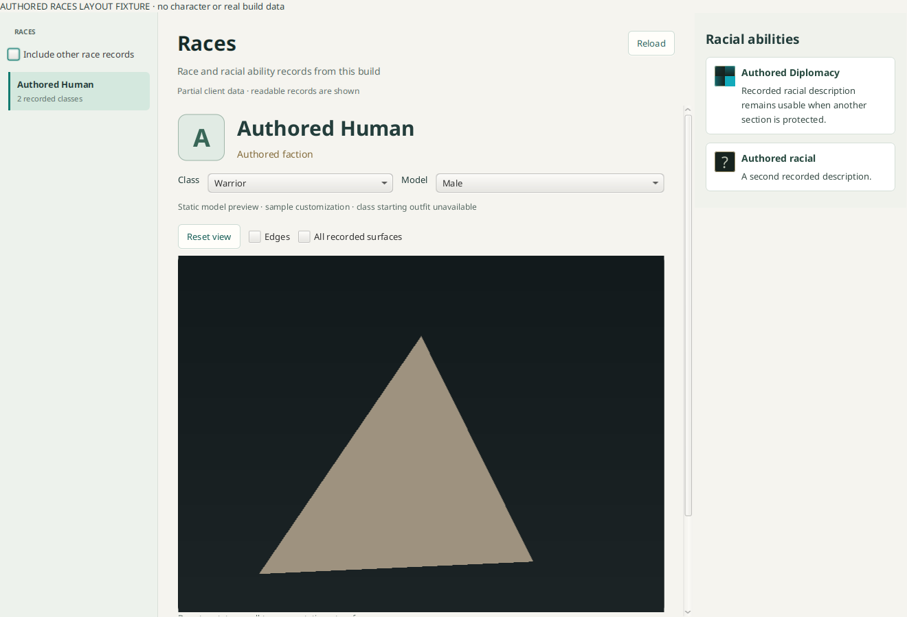

# Races browser

The Races area appears after Talents in an open build. A sidebar lists race records
with recorded class combinations; **Include other race records** exposes internal
or unlinked `ChrRaces` records. If no class-linked rows are readable, the browser
shows the available race records instead of guessing which are playable.

The overview presents names, lore, a verified faction-name relationship when
available, recorded class names and racial ability cards with icons. Initials are
used for the race badge: character-creation portrait references are texture-atlas
elements and are not treated as image FileDataIDs. Missing icons remain placeholders.
Source IDs and partial-data diagnostics are in a collapsed Source details section.

Static client combinations do not establish current realm/account unlocks. Racial
cards are not matched to spells by name. Race mask relationships, if added later,
must use the reviewed `PlayableRaceBit` rather than `raceID − 1`.

## Component and lifetime

`:concepts-races` owns typed asynchronous projections over the workspace's borrowed
build/locale table handle. The GUI does not query SQLite or enumerate tables itself.
The domain handle is created cold, loaded when Races is opened, and drained before
borrowed tables close. The view rejects stale selections, workspace changes and
late image results. Readable PARTIAL rows remain usable.

All names and relationships come from the selected pinned WoWDBDefs schema. The
reviewed racial-card layouts are `B6115535` and `0FC0F0D5`; unsupported optional
shapes do not discard race/class facts. Older layouts without lore or racial-card
tables keep the available metadata.

## Static model preview

Races keeps the recorded race menu on the left and compact racial cards on the right.
The center shows a rotatable, zoomable static surface for a recorded model variant.
The exact build-local chain is `ChrRaceXChrModel → ChrModel → CreatureDisplayInfo →
CreatureModelData → FileDataID`. No models are chosen by name or guessed path.

The separate `M2RestSkinReader` validates SKIN topology against native M2 positions
without claiming that external bones, animations or draw materials were evaluated.
Existing strict static-geometry and appearance APIs retain their external-rig refusals.
A versioned, content-bound compact derivative is persisted through `GeneratedStore`;
restores verify both M2 and SKIN content keys against the current build root.

`:rendering-models` renders bounded positions/triangles on the CPU. This also works
on Linux ARM systems where the installed JavaFX pipeline reports no SCENE3D support.
Frame size, vertices, indices, surface count and raster work are capped. Cancellation
and latest-camera replacement keep stale frames out of the UI.

Sample customization uses the lowest recorded choice ID whose reviewed player/class/race
requirements are known to pass, plus related-choice gates and recorded geoset joins.
NPC-only options are excluded. Unknown account, region, archive, visibility or
prerequisite requirements are omitted rather than guessed. Race masks contain two
32-bit words and use `PlayableRaceBit`; class masks use the recorded class bit.
This follows the reviewed
[WoW Model Viewer character requirements/geoset convention](https://github.com/wowmodelviewer/wowmodelviewer/blob/develop/Source/games/wow/CharDetails.cpp).
The reviewed current layouts include option `DCC2A86E`, choice `9559C358`, element
`6483C37E`, geoset `BF55F2FB`, requirement `CA154412` and prerequisite `F925BC6F`.
The sample is not a claim about an account's eligibility or the client's default
choice. All recorded surfaces can be inspected explicitly, including mutually
exclusive alternatives.

## Reviewed diffuse textures and starting clothing

The reviewed character-composition profiles support current Human male/female
models 1/2, Orc male/female models 3/4, Dwarf male/female models 5/6,
Night Elf male/female models 7/8, and isolated Tauren male/female models 11/12. The [Dwarf profile](races-dwarf-profile-proposal.md)
and [Tauren profile](races-tauren-profile-proposal.md) record their narrow source
contracts. The [Night Elf source checkpoint](night-elf-undead-static-appearance-proposal.md)
records its opaque body/hair policy and the separate unresolved Undead archive context.
Orc, Dwarf, Night Elf and Tauren admissions additionally require their exact recorded
model/sex/layout predicates. Night Elf also requires a selected, decoded full base skin;
missing skin refuses the textured result instead of presenting an incomplete body.
Other races/layouts retain the available static surface and report that their texture profile is unsupported. The GUI shows geometry first,
then loads the textured sample asynchronously; rotation/zoom remain usable.

The selected choices join `ChrCustomizationElement → ChrCustomizationMaterial →
TextureFileData` diffuse resources. `ChrModelMaterial`, `ChrModelTextureLayer` and
`CharComponentTextureSections` provide actual canvas sizes, ordering and atlas
rectangles. The profile supports recorded copy and straight-alpha source-over
operations; unreviewed layer operations are omitted with diagnostics. No fixed
legacy atlas dimensions or guessed texture filenames are used.

Class selection resolves the unique `CharacterLoadout` of purpose **9** for the
recorded class and playable-race bit, then `CharacterLoadoutItem`. TrinityCore
explicitly identifies this purpose as new-character equipment; purpose1 preview
loadouts are not substituted. [Structure](https://github.com/TrinityCore/TrinityCore/blob/master/src/server/game/DataStores/DB2Structure.h),
[loader](https://github.com/TrinityCore/TrinityCore/blob/master/src/server/game/Globals/ObjectMgr.cpp).
Default modifier0 appearances join `ItemModifiedAppearance → ItemAppearance →
ItemDisplayInfo → ItemDisplayInfoMaterialRes`. Diffuse candidates match recorded
`ComponentTextureFileData` sex/class/race qualifiers; the most specific matching sex/class/race candidate is used only when its best rank
is unique. Ties preserve the remaining layers and a source diagnostic. Simple body geoset
overrides follow the recorded clothing groups: robes select their closed skirt and
sleeves over pants defaults, suppress boot shafts and retain the recorded boot feet.
Separate collection meshes and unreviewed group overrides remain explicit limitations.

`M2RestDrawSkinReader` validates raw draw references independently of skeletal
admission. The renderer uses actual UVs/native normals and a narrow one-stage diffuse
profile, including constant-opacity proof and no UV transform. Unsupported surfaces
keep neutral shading. Existing strict rig/material APIs retain their refusals.
The preview remains a static rest pose: animation, full lighting/material shaders,
weapon/shield attachments and runtime appearance overrides are not evaluated.
It is not a full character editor.

The composed geometry, UVs, normals and atlases persist as a bounded derivative,
bound to build, locale, source content keys, the exact recipe and reader/renderer
policy revisions. Restores verify the SKIN root content key. Incomplete texture
fetches are not frozen into the composition cache. The table projection worker
prepares immutable metadata; a separate bounded worker owns file/decode/composition
work, so voice/race queries do not wait on texture CDN acquisition. Closing cancels
and drains both workers before borrowed workspace handles close.

Separate actual-data probes verified Human Warrior male/female clothing38/39/40
and differing Mage clothing through real same-build joins while retaining PARTIAL
source tables. Warm derivative restoration was approximately74–75ms in the probe;
this is not a full application startup benchmark. No live library writes occurred.

Read-only current Forever 1.60.1.70707 proof follows Human models 1/2 through displays
57899/56658 and model records 7661/7599 to M2 files 1011653/1000764 and SKIN files
1012983/1000778. Both produce complete-body sample surfaces from recorded geosets.
No live library changes or installation are needed for this validation. Client model
assets are not checked into the repository; the screenshot below uses an authored
geometric fixture.

## Recorded voice previews

The voice selector uses the recorded model sex and class plus the workspace locale.
`EmotesText.Name` explicitly identifies `JOKE`, `FLIRT`, `CHARGE` and `HEALME`;
`EmotesTextSound` selects the exact race/sex and generic-or-selected-class rows.
The reviewed modern `3ECA1BE0` adapter joins `SoundID` to `SoundKitEntry.SoundKitID`
(the definition retains the historical `SoundEntries` label). This adapter is not
silently applied to older layouts. Entry reads are filtered by kit and bounded;
readable PARTIAL rows are accepted. Runtime player conditions, mixing and randomized
selection are not simulated: each recorded clip can be inspected independently.

Play is explicit; changing selection or closing the workspace stops playback.
Original voice assets use the normal build-local file/CDN pipeline. Derived signed
16-bit big-endian PCM is cached by build, locale, source content key and decoder
revision. Bounds are 2 MiB encoded, mono/stereo, 8–48 kHz and 30 seconds per preview.

`:formats-audio` uses the standalone pure-Java J-Ogg Vorbis decoder. Since its
internal codebook allocations are not heap bounded by the encoded size, decoding
runs in a short-lived Java worker with a 64 MiB heap, bounded output and an eight
second deadline; cancellation terminates that worker. The worker uses the installed
Java runtime, without FFmpeg or a separately installed codec. Repeated previews
restore PCM without decoding again. JavaSound releases the output line on stop;
a machine without supported audio output reports that state in the view.

This software is based on or using the J-Ogg library available from http://www.j-ogg.de and copyrighted by Tor-Einar Jarnbjo.

License and dependency notices ship under `formats-audio/src/main/resources/META-INF`.
Tests use an authored tone, not game audio. Separate read-only validation against
current Forever source rows found 16 Human male and 14 female clips across these
four actions. Actual Joke/Charge assets decoded at 22,050 Hz mono; no live library
was modified and no sound automatically played during the probe.

## Validation

```sh
./gradlew :formats-audio:check :rendering-models:check :formats-assets:check :concepts-races:check :gui:check
# Requires a graphical display; authored data only:
./gradlew :gui:racesUiTest
python3 -m unittest discover -s scripts/ci -p '*_test.py'
```

Focused tests cover recorded/internal race distinctions, real foreign-key joins,
readable partial data, missing race/class names, optional-table failure, unsupported
racial-card layouts, cancellation, borrowed lifetime, displayed icons, filtering
and stale selection. The component is included in Linux/macOS/Windows CI tasks.

A separate read-only probe exercised the actual component against existing
Forever 1.60.1.70707 row graphs and matching pinned schemas: 58 race records,
10 with class links, 56 unique race/class combinations and 4 racial cards per linked
race. All 10 overviews resolved with faction names. No live library writes occurred.
These are records in that build, not proof of server character-creation availability.



## Texture format observation

Current Forever starting-clothing textures include BLP2 indexed-color encoding1,
alpha depth8 and alpha encoding8. This specific additional tuple uses palette
indices plus an appended eight-bit alpha plane; the alpha encoding selector does
not select a block codec for indexed color. The observed tuple is supported with
existing palette/span/allocation checks. Other unreviewed profile tuples remain
explicitly unsupported. Existing admitted image outputs and version2 persisted
payloads/identities remain byte compatible; unsupported outcomes were never cached.
The primary [js-blp palette reader](https://github.com/Kruithne/js-blp/blob/master/js-blp.js)
reads alpha from the plane by alpha depth independently of the block-codec selector.

## Partial qualifier and prerequisite safety

A missing texture qualifier is untagged only when the table boundary explicitly
returns `ABSENT` for the same source identity/layout. `UNKNOWN`, `PROTECTED` or
changed-source results are omitted; other proven texture layers remain usable.
An absent prerequisite relationship is treated as no prerequisite only with complete
`READY` coverage and no excluded records. A partial prerequisite table keeps that
requirement unknown, while unrestricted readable choices can still be selected.
Unsupported garment metadata does not activate robe suppression. Recorded default
geometry variants do not overwrite an already selected specific clothing variant.

Sample selection does not interpret `ChrCustomizationChoice.UiOrderIndex`: current
layout `9559C358` exposes that unverified candidate 16-bit field as a preserved raw
physical 32-bit column. Stable row-ID ordering avoids narrowing or granting raw
columns semantic admission. The original raw value remains available in Tables.

The reviewed `ChrCustomizationGeoset.GeosetType` adapter is narrower: only layout
BF55F2FB with the observed raw unsigned 32-bit physical/signed 8-bit candidate metadata tuple
is admitted. It retains the full physical integer; the geoset consumer still
checks the group range before arithmetic. Other raw fields/widths remain refused.
Read-only appearance verification now uses actual `Db2Reader` physical headers,
including interpretation metadata, rather than columns reconstructed from DBD.

A `GeosetID` of -1 empties the row's group (rows 213-221, 232-240, 6710, 12028
and 12039 on 70862; choice 28271, Breechcloth on model 89, uses 12028). It is never
read as variant 99 of the group below. A type or ID outside 0..99 (a few rows hold
text-like garbage) is ignored with a diagnostic.

Default geosets are section 0 and every group's 01 part, except groups 12, 17 and 35,
which show only when chosen. Group 32 (head swap) holds alternatives, so exactly one
part is drawn: the lowest variant from 02 upward, or 01 when the model has nothing
else. On 70862, 57 of 125 character skins have several 32xx parts: 3201 is a small
cap set behind the face and 3202 the full face, with 3203/3204 coincident full-size
alternatives on some models. Every face customization (Face Shape, Eyes, Nose) picks
from 3202 upward, and a selected choice replaces the group.

`ItemDisplayInfo.GeosetGroup` -1 means "do not set this group": it stays as the body
or another item left it. 0 already names a part, so hiding instead would cut holes in
base geometry. On 70862, 54 displays carry -1 (no other negative value appears) and
they used to refuse 36 NPCs whole.


## Orc static appearance profile

The narrow Orc profile was checked against selected-build Forever
`1.60.1.70707` source DB2 rows and actual physical column metadata, with pinned
WoWDBDefs revision `b9a63096cdd99b26967f17f9515377ae62cadfd7`.

| Variant | ChrModel | Display / model record | M2 / SKIN FileDataID | Texture layout |
| --- | --- | --- | --- | --- |
| Orc male | 3 | 51894 / 6838 | 917116 / 917168 | 105 |
| Orc female | 4 | 53762 / 7200 | 949470 / 949521 | 106 |

Both layouts record a 2048×1024 body, 512×256 hair and 256×128 eye canvas.
The known-eligible sampled choices use only the existing copy/source-over
operations (blend 1/15), with flags 0, second target 0 and second section mask −1.
Other optional Orc layers include unsupported blend 4/6/9; their presence does
not admit those operations. Requirements 141/146 and their complete prerequisite
coverage support the sampled Warrior/Warlock choices; NPC-only Eye Style
requirement 12 stays excluded. These are deterministic eligible samples, not
claims about client defaults or account unlocks.

Read-only source validation exercised male and female Warrior 1 and Warlock 9,
both recorded in `CharBaseInfo`. Warrior clothing resolved items 6125/139/140;
Warlock clothing resolved robe 6129 (display 10073), pants 1396 and boots 59.
Every selected diffuse image decoded through the existing bounded image pipeline.
The model SKIN lookups contain 46,799/44,003 vertices, within the current preview
limits. Actual composed frames retained the recorded shirt/pants/boots or closed
robe while leaving separate held items unsupported. All four second requests
restored the generated appearance in 32–72 ms in the local proof; these measurements
exclude the initial table acquisition and do not establish universal performance.
Original and derived game images remain outside the repository.

The proof also exposed a shared geometry-selection defect: an unselected bald
alternative could remove base body section 0. Customization now overrides only
active groups, always preserving section 0 as the base body/scalp. Hair variants
1–99 remain mutually exclusive; bald selects no hair without deleting the body.
This follows the explicit
[WoW Model Viewer rule](https://github.com/wowmodelviewer/wowmodelviewer/blob/develop/Source/games/wow/CharDetails.cpp).
The content-bound appearance identity uses the updated Human/Orc geometry policy;
neutral-shading diagnostics are reconstructed from cached draw bindings so restored
previews retain the same limitation warning.

Focused deterministic tests cover both admitted Orc variants, exact model/sex/layout
refusals, recorded atlas sections, sex-qualified clothing, unsupported blend retention
of other layers, and body preservation for bald/non-bald samples. Existing partial
qualifier, requirement, cancellation and borrowed-lifetime tests remain applicable.
Animation, full shaders, separate attachments and additional race profiles remain
outside this static profile.

## Dwarf static appearance profile

The Dwarf pair uses race3, ChrModel5/6, sex0/1 and component layouts107/108.
The exact ChrModel03FAB755 compatibility slots must retain their recorded signed32
literal zeros; this contextual gate does not enable fallback traversal.
The existing eligible-choice, purpose9 clothing, source-qualified texture and
atlas composition rules remain unchanged.

Dwarf draw admission is separate from the existing race policies. Body draws use
shader0/type1, opaque material0. Male hair/beard uses the recorded shader16/type6,
material4 alpha-key draw; female hair remains shader0/type6 opaque material4.
Each admitted section must have a single batch, the reviewed flags/selectors,
identity UV transform and full-opacity evidence from the identical parsed model.
Other passes retain neutral shading and diagnostics, including the sampled eye
and glow layers. Native normals, UVs, source geoset IDs and render budgets are
unchanged. The generated composition policy is versioned so old incomplete Dwarf
bindings cannot restore as the new profile.


## Night Elf static appearance profile

Race4 uses its recorded ChrModel7/8, sex0/1 and component layouts109/110, with
layout03FAB755 literal-zero fallback guards. Its contextual draw profile admits only
version272 one-batch body shader0/type1 and opaque hair shader0/type6. Exact batch,
texture/material flags, implicitUV0, identity transforms and same-model full-opacity
facts are required. Dwarf cutout admission and the general static model shader reader
are unchanged. Native normals, UVs and SKIN-driven compact topology are retained.

The existing opaque diffuse renderer is reused, with no new shader formula or higher
mesh/texture limits. Auxiliary/multi-pass materials remain neutral with partial
warnings. The appearance recipe is versioned6. Unknown unlock, archive and prerequisite
conditions remain omitted; this is a static client-data sample, not account eligibility.

Actual selected-build70755 male/female Warrior and Priest proofs checked current file
keys,43k-or-fewer compact vertices,93/76 bound body/hair surfaces, complete consumed
textures and byte-identical cold/warm/fresh-owner codec/warnings. Priest clothing
selects the recorded robe geoset while preserving source rest poses. Private images
show both coherent purple skin and recorded clothing. See the source checkpoint for
exact provenance and execution limits.

Undead raw geometry and opaque material tuples are readable, but its skin color depends
on Skin Type choices gated by explicit archive0/1 and prerequisite rows. The current
preview does not possess that context and does not ignore those guards. Undead texture
composition therefore remains unsupported; a black/blank skin prototype is not counted
as model support.

The same four Night Elf appearances also passed24 actual800×600 Vulkan child frames
across two cameras and qualified/raw/textures-off modes. CPU/native silhouette IoU was
at least0.99990829 and intersecting RGB mean error at most0.710152 byte units; four
children closed normally without per-scene camera restarts. This verifies the existing
model renderer with these source payloads, not frame rate or other hardware/backends.
