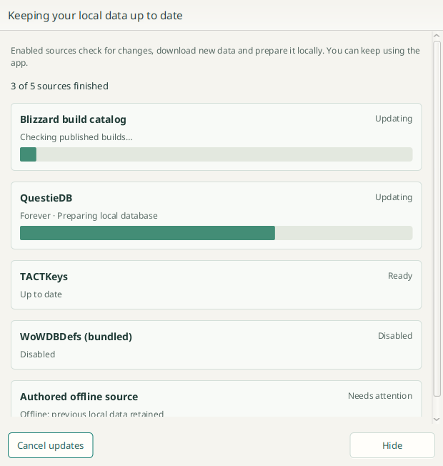

# Source refresh

The app starts a source refresh after its local library opens. **Refresh sources**
in the Builds toolbar starts the same workflow. Local build history renders
independently; this is not a modal startup gate.

Every enabled provider owns a complete check → download changed data → prepare or
reuse local data operation. Providers run concurrently, with at most one full sync
per provider and one global run. Startup, repeated button clicks, periodic checks,
and individual provider jobs coalesce or wait for the narrower work before finishing
the full sync. A failed provider does not stop the other providers.

- Blizzard checks the published catalog for enabled products. This does not enable
  Download all or acquire every CDN object in a build.
- Questie checks the latest stable release and processes its advertised supported
  flavor packages. It does not acquire historical releases. Existing archives and
  valid prepared databases are reused. Missing defaults initialize after preparation
  and follow later prepared releases; explicit user-selected and legacy defaults
  stay pinned.
- The community listfile checks and prepares its name index.
- TACTKeys validates and retains the public list.
- WoWDBDefs validates the bundled provider; new definition releases arrive with app
  updates rather than from an invented runtime updater.
- EG Link syncs its latest advertised build per product and already-installed build
  selections still advertised by the current revision.
- Polestar checks, downloads and prepares its latest published dataset, retaining
  its actual client-build provenance.

## Progress and cancellation

The popup shows each provider's current phase and progress where a count is known.
Hide keeps updates running and leaves the rest of the app usable. Refresh sources
reopens the active run instead of starting duplicate work. Cancel updates requests
cancellation from every active provider and retains completed local data. Blizzard
catalog cancellation leaves the local catalog service usable for later requests.

An untouched successful startup popup closes after a brief completion state.
Failures remain visible and offer Retry refresh. A manually requested popup stays
available to inspect its results. Shutdown cancels source operations; their owning
services drain accepted work before closing files or the library.

All enabled sources participate in startup and the global action. The source-page
**Additional scheduled updates** setting controls optional checks between those
refreshes. Older Manual and Startup policy values remain readable; they do not
suppress the global startup workflow.

Open build workspaces retain their existing provider snapshot. Reopen a build to
use newly prepared source versions or encryption keys. Updating source data does
not silently change a user's explicit version mapping.

## Validation

```sh
./gradlew :questie:check :gui:check
./gradlew :gui:sourceRefreshUiTest # requires a display
```

Deterministic contracts cover parallel admission, coalescing, disabled providers,
per-provider failures, progress, cancellation and shutdown; narrower-job overlap
and canceled continuations; canceling a catalog refresh without closing the
service; and a loopback Questie check/download/prepare/reuse cycle. The authored UI
fixture tests nonmodal use, hide/reopen, retry and successful-startup auto-close.
It does not contact public servers or open the application library.


