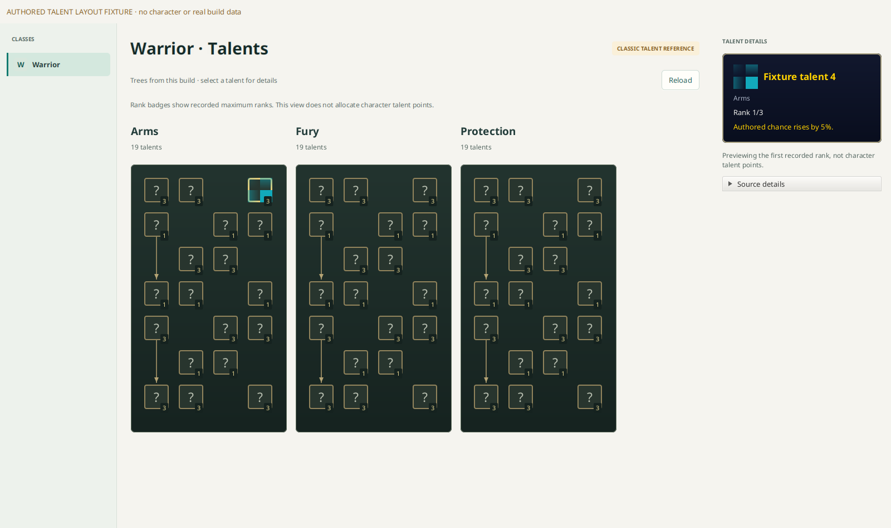

# Talents browser

Open a prepared Classic-style build and select **Talents** after **Creatures**.
Choose a class on the left; the main area displays its ordered trees. Partial
client tables show all readable classes, trees and talents with an incomplete
data warning; protected records do not hide the readable records. A missing
prerequisite keeps its source ID in details and omits the unresolved connector.
Select a talent to inspect rank spell IDs, prerequisites and any readable spell
text in a fixed right-hand WoW-style tooltip. Its rank label previews the first
recorded rank's spell text; it does not represent learned character points.
Unreadable descriptions and prerequisite names stay explicitly unavailable.
Technical source details remain collapsed outside the tooltip. Arrow keys move
focus to the nearest node along a row or column; Enter selects it. The tree strip
scrolls horizontally when the detail rail leaves less room.

Class names, trees, positions and ranks come from the selected build's verified
client tables. Rank badges show recorded maximum ranks. The browser does not
allocate points, load character builds or calculate level/point gates. It does
not replace unavailable data with another game's or build's talents.

Icons load on demand through the build's existing file/image services. Missing
icons use neutral placeholders; unresolved background art uses a plain dark tree
surface. Unsupported models (including Retail and Mists) explain that their
layout is not implemented, instead of showing fabricated Classic trees.

Component contract and checks: [concepts-talents](../concepts-talents/README.md).

## Layout preview

This screenshot uses authored fixture nodes and placeholder icons to review the
layout. It does not represent a real build's talent data or a character's points.

## Spell value previews

The selected first rank resolves reviewed `$s1`–`$s3` fixed percentage amounts
through same-build SpellEffect rows. Unsupported values show `?`; complex client
expressions show an unavailable message. Raw templates and exact substitution
provenance remain in collapsed Source details, not the styled tooltip.

The initial numeric profile is deliberately limited to Forever 1.60, layout
`5362E3D4`, APPLY_AURA effects with percentage modifier/critical chance aura IDs
108/290. It uses integral `EffectBasePointsF` directly, with no legacy `+1`;
random, level, resource and scaling coefficients must be zero, and the reviewed
bonus/group/PvP defaults must equal one. The unverified field name at raw integer
column 24 has no assigned semantics; the reviewed layout conservatively requires
its value to be zero. Other profiles and formulas remain unresolved.

Read-only verification against the cached 1.60.1.70707 build matched spell 16942,
EffectIndex 0, SpellEffect row 693970 and base amount 2, yielding `2%`. Spells
16858 and 16998 also matched base previews 8%/3% and 20%. No game data payloads or
local cache paths are included in the repository.

Relevant primary implementations are the
[WoWTools effect formatter](https://github.com/Marlamin/WoWTools.SpellDescParser/blob/master/WoWTools.SpellDescParser/Nodes/Property.cs),
[SpellEffect definitions](https://github.com/wowdev/WoWDBDefs/blob/master/definitions/SpellEffect.dbd),
and [aura constants](https://github.com/TrinityCore/TrinityCore/blob/master/src/server/game/Spells/Auras/SpellAuraDefines.h).

This image uses authored text/pixels to test numeric preview presentation.

## Missing image and description explanations

The selected talent's collapsed **Source details** section includes separate image
and description status. Image results retain the actual decoder/file outcome,
reported code/message, FileDataID and bounded missing-key identifiers. Unsupported
formats, required downloads, protected bytes and validation failures remain
distinct. Expanding this section uses already requested evidence; it does not
start an additional source query.

A missing icon reference or null description does not establish why it is missing.
These cases explicitly say the cause was not reported. Class-level source notices
are labelled as context rather than attributed to every selected talent. Raw
client text and spell substitution sources remain available in the same section.
