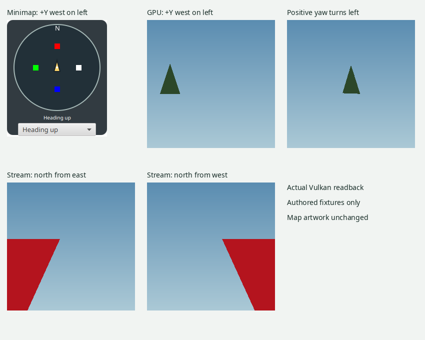

# Correct World camera handedness

The Explorer camera previously reflected geographic left and right relative to
its minimap. At yaw zero, native +Y (west) appeared right in the 3D view and left
in recorded-map coordinates. Turning and strafing therefore disagreed with the
map, even though the heading-up map correctly kept the forward direction above
the player. The camera now agrees with the geographic map; the minimap artwork,
rotation, tile axes and native source positions are unchanged.

## Independent coordinate evidence

TrinityCore's own [World Position documentation](https://trinitycore.info/how-to/worldposition)
defines +X north, +Y west, +Z up and positive orientation counterclockwise, with
zero north and pi/2 west. Its [AreaBoundary implementation](https://github.com/TrinityCore/TrinityCore/blob/master/src/server/game/Maps/AreaBoundary.h)
independently identifies larger X/Y as northwest. Reviewed 2026-11-04.
These primary implementation/documentation oracles establish geographic
orientation independently of Vimi's camera fixtures. Vimi retains MCNK px/py
coordinates directly, decreasing native X for terrain rows and native Y for
columns; its tile inventory and geographic texture coordinates follow the same
convention. No artwork reflection or model-portrait camera change is involved.

## Change

World camera right is now `(sin(yaw), -cos(yaw))`. Positive strafe follows that
right vector, while forward remains `(cos(yaw), sin(yaw))`. Positive yaw turns
left geographically. RIGHT and mouse-drag right now subtract yaw; LEFT adds yaw.
The shared GPU eye matrix and CPU fallback agree, including the CPU's inverse
texture-sampling ray. Pitch, forward movement, native altitude and wheel zoom
keep their coordinate meaning.

The GPU terrain, persistent streaming terrain and WMO passes use the shared
camera matrix. Their current draw states have no face culling. Native winding,
world-space normals, texture coordinates/materials and placement transforms are
unchanged. Depth/fog still use the unchanged forward component. Independent
native texture, hot-stream precision and WMO acceptance tests cover these paths.



## Regression evidence

- Four geographic cardinals have independently authored forward/right vectors.
  Unit checks cover actual movement, eye projection, GPU matrix and software
  camera movement; the minimap fixture checks actual camera forward and positive
  strafe against distinct authored cardinal artwork.
- Actual viewport key events/timer verify LEFT/RIGHT yaw and A/D/W native motion;
  actual mouse press/drag/release verifies both turning directions.
- Actual Vulkan terrain readback checks a native +Y landmark on the left,
  positive yaw centering it, and four independently placed forward/right panels.
- Actual production persistent streaming readback looks north from the east and
  west of a known authored native tile. Its terrain must appear exclusively on
  the corresponding left/right screen half. This is a mapped-frame production
  owner test, not inferred shader equivalence.
- Existing CPU height/fog/clipping image hashes remain unchanged after reflecting
  the corrected output back to the old handedness. This preserves the original
  golden oracle instead of replacing it with newly observed hashes.
- CPU and actual Vulkan texture ray oracles use the corrected geographic right
  vector. Native UVs and source atlas data remain unchanged.

## Acquired geometry diagnostic

Twelve additional actual Vulkan frames render three explicitly provided acquired
ROOT ADT copies at four cardinal cameras. All frames show substantial visible
terrain, and all source SHA-256 hashes remain unchanged. This is a raw-geometry
visual diagnostic only: no fresh Source qualification, texture-source acceptance,
new acquisition, private library scan or interaction with an existing application
process is claimed. Private outputs and exact paths remain outside Git.

## Validation

Java 25, Linux JavaFX desktop and Vulkan. Relevant commands (with a full Java 25
JDK, a desktop DISPLAY/XAUTHORITY and java.io.tmpdir under persistent HOME):

```
./gradlew :rendering-world:check :rendering-bgfx:check :gui:check \
  :gui:worldNavigationUiTest :gui:worldMinimapUiTest :gui:worldMinimapInputUiTest \
  :rendering-bgfx:nativeGpuTerrainProductionAcceptance \
  :rendering-bgfx:nativeGpuTerrainTextureProof \
  :rendering-bgfx:nativeGpuWorldStreamOwnerProof \
  :rendering-bgfx:nativeGpuWorldWmoProof \
  :rendering-bgfx:nativeGpuWorldStreamAcceptance --offline
```

Native gates cover 36 production terrain frames, 12 authored texture frames plus
five child sessions/nine mapped frames, 99 hot-stream precision frames with
2,085,944 analytic samples, 25 WMO frames, and the production persistent owner
lifecycle with 104 replacements. The private raw-geometry diagnostic adds 12
frames. No cross-platform runtime claim or public release is made.

The initial rotation-only sign inversion fails the forward-landmark regression.
A separate old-camera negative control restores the three original production
camera/input files while retaining the new tests, then checks actual key input,
cardinal movement and persistent streaming geography. The corrected production
files are restored before the final passing run. The old basis fails all three
checks: expected eastward strafe Y=-4 but observed +4, LEFT input has the wrong
yaw sign, and streaming terrain viewed from the east appears entirely on the
wrong half (`left=0 right=10505`).

Final combined run: **BUILD SUCCESSFUL**, 158 tasks (58 executed, three from cache,
97 up to date). Formatting, style and unit checks pass.
