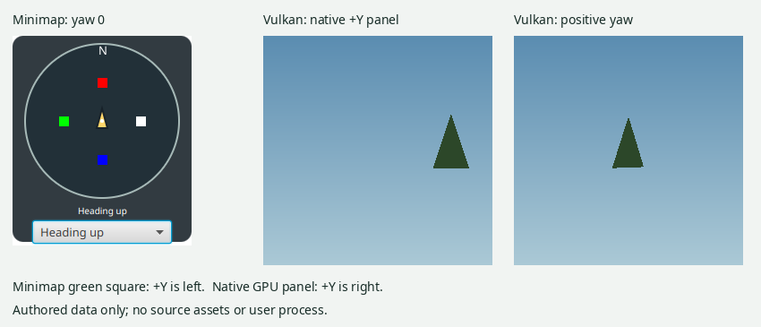

# Minimap and actual camera orientation review — 2026-11-04

Reviewed main `dc7c5a4`. No application behavior is changed by this review.

## Findings

The current heading-up rotation sign is necessary for forward movement. An authored
four-cardinal fixture calls the actual `TerrainCamera.look` and `move` methods,
locates the landmark reached by forward movement in independently drawn artwork,
and checks that this landmark appears above the fixed player arrow at all four
headings. Reversing only `WorldMinimap` rotation fails this check at the west
landmark. A map normally counter-rotates relative to geographic heading; opposite
map motion alone does not establish a defect.

There is nevertheless a confirmed lateral mismatch between the camera and the
geographic minimap convention. At yaw zero, native +X is forward. Native +Y
appears left in the minimap artwork, but right in actual Vulkan terrain readback.
The new native test places an asymmetric triangle at X=10, Y=3..5; pixel (210,128)
contains terrain while the symmetric left pixel (46,128) remains sky. Positive
camera yaw centers this right-side triangle. This uses the production terrain
renderer and real shaders/readback, with no call to the camera's `eye` or
`screenX` helpers to generate expected pixels.

The persistent Explorer renderer (`BgfxWorldStreamRenderer.draw`) uploads the
same `TerrainCamera.modelToEye` and `reversedProjection` matrices, and its vertex
shader multiplies these matrices in the same order as the tested terrain shader.
The new native fixture directly executes the production terrain renderer, rather
than the persistent streaming renderer; equivalence for the latter is established
by inspected code here, not a new streaming readback fixture.

Actual input signs are also pinned by inspection: RIGHT and mouse-drag right add
yaw; LEFT subtracts yaw; D adds positive camera strafe. Thus a right turn from yaw
zero points toward native +Y, which the geographic minimap calls west. This is a
camera/geographic handedness discrepancy, not an independently established
minimap rotation-sign bug. A rotation sign change alone cannot fix it: forward
movement would then appear behind the heading-up arrow at quarter-turn headings.



The minimap north label follows the same rotation as its artwork. Its player
marker stays centered, and its heading-up arrow stays above the center. There are
no additional minimap markers or minimap click-to-navigate handlers. The separate
inventory grid draws filename Y horizontally and X vertically; its click handler
uses the inverse mapping, and selected/area outlines use the same drawing mapping.
No separate hit-coordinate discrepancy was found.

## Scope and next decision

Preserve the current minimap rotation pending a camera-coordinate review. This
review does not establish physical game north from private source data, and does
not justify reflecting source artwork or changing camera/input handedness across
terrain, buildings, software projection and GPU projection. Those changes need an
independent native/source orientation oracle and coordinated renderer acceptance.
All new fixtures and the screenshot use authored data; no private library reads,
downloads, or interaction with an existing user process were performed.

## Validation

Java 25, Linux JavaFX display, actual Vulkan production terrain:

```
JAVA_HOME=/home/aircan/.gradle/jdks/eclipse_adoptium-25-amd64-linux.2 \
JAVA_TOOL_OPTIONS=-Djava.io.tmpdir=/home/aircan/.cache/vimi-tmp \
DISPLAY=:0 XAUTHORITY=/run/user/1000/.mutter-Xwaylandauth.8PT7X3 \
./gradlew :gui:worldMinimapUiTest :gui:worldMinimapInputUiTest \
  :rendering-bgfx:nativeGpuTerrainProductionAcceptance --offline
```

The native acceptance passes 32 actual Vulkan frames, including the two new
horizontal-orientation frames. The UI fixtures pass artwork placement, four
actual-camera forward directions, fixed arrow, asynchronous ownership/lifetime,
and actual mouse/key/scroll/popup isolation. A temporary opposite-rotation
negative control fails `actual camera forward landmark stays ahead: west`; the
production sign is restored before the final passing run.
