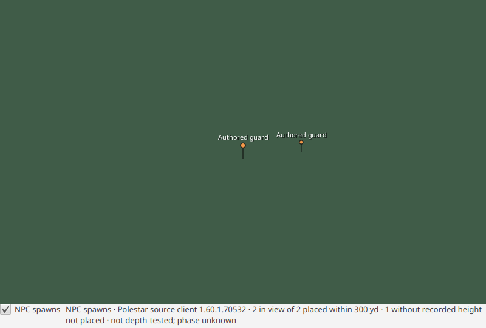

# World NPC spawn placement: markers and static creature models checkpoint

Issue #175, first slice. The World explorer can show declared NPC and monster spawn
points as static markers over the presented terrain frame. This is placement evidence,
not creature rendering: no models, animation, AI, patrols or interaction are added.

## Which sources qualify

| Source | Spatial shape | Admitted to World |
|---|---|---|
| Polestar `spawn` (`kind=npc`) | client Map ID, world yards `x` north / `y` west, optional `z` | Yes |
| Questie NPC `spawns` | AreaID plus 0–100 percent, optional phase | No: area percentages are not world positions |
| EG Link `npcs` positions | where a player stood when interacting | No: interaction observations, not spawns |
| Creature/NPC definitions | no position | No: a definition alone does not prove a spawn |

Polestar's spawn schema defines the native axes used by terrain (`TerrainCamera`:
+X north, +Y west, +Z up), so admitted points are not transformed. Points without a
recorded `z` keep planar evidence only: they are counted and disclosed, never snapped
to a guessed terrain floor. Polestar records no phase, so phase stays unknown. Coordinates
are rounded source values (0.5 yd planar, 0.1 yd height).

Source selection is the existing NPC/quest/location policy: Polestar enabled, Forever
product, the latest prepared snapshot at or before the opened build within the same
`major.minor.patch`. The source client build stays visible in the status line; this is
provenance, not a claim that the opened build's server places creatures there. Questie and EG
are not consulted, and no other build or product is substituted.

## Components

- `concepts-locations/WorldSpawns`: reviewed Polestar `spawn`/`npc` wire shapes, a bounded
  immutable index per client Map ID (128 yd cells) and `near(map, x, y, radius, limit)`.
  Results are nearest-first by horizontal distance with an NPC/point tie-break, and report
  height-less points and points beyond the limit. Identical duplicate declarations merge;
  conflicting duplicates for one `npc:id:map:n` are omitted with a diagnostic. Malformed rows,
  unknown kinds and points outside the 64-tile grid never hide neighbouring points. Bounds:
  262,144 spawn rows, 65,536 NPC rows, radius ≤ 2,000 yd, at most 512 results per query.
- `DataSourcesService.worldSpawns(build, token)`: local prepared reads only; no download,
  preparation or network call. It returns an explicit unavailable reason when Polestar is
  disabled, the product has no reviewed source, or no compatible snapshot is prepared.
- `gui/WorldSpawnOverlay`: an **NPC spawns** footer toggle (off by default) and a
  mouse-transparent canvas above the frame. One daemon worker runs at most one index load;
  the latest request wins, so a newer source selection cancels the running load and starts
  after it drains. Results from a retired selection, or after close, never publish. The index
  is keyed on Polestar enablement, the selected snapshot ID and the workspace revision, not
  on unrelated source refreshes. Polling runs only while the toggle is on and the explorer is
  showing frames; leaving the explorer or the World area suspends it. Redraws happen only
  when the view, the index or the viewport size changes. Up to 512 points within 300 yd are
  culled to the frame first, and then the nearest 256 visible points are drawn, with any
  excess disclosed. Labels go to the 16 nearest markers with eye depth up to 120 yd. Marker
  colour shows the published rank (normal, elite, rare elite, boss, rare, unknown).

Markers use the explorer's current camera and the same eye transform and 0.8-width focal
length as the CPU and GPU terrain paths. The frame is fitted to the viewport exactly as
`ImageView` preserve-ratio does. A short two-yard stem rises from the recorded point.
`WorldView` changes are limited to mounting the overlay, supplying the view, adding the
footer row and closing it.

## Creature model policy (second slice)

Each drawn marker's NPC is resolved to a creature model choice, but **no model is drawn yet**.
Polestar's `npc` table records no display, so the chain is read from the **opened build's**
client tables with the existing data-only creature lookup (`BuildCreatures.getData`, no asset
I/O): `Creature` display slots → `CreatureDisplayInfo.ModelID` → `CreatureModelData.FileDataID`.
The Polestar NPC ID is the client creature ID. The opened build can differ from the Polestar
source client within the same `major.minor.patch`; both are shown.

`concepts-creatures/CreatureModelPolicy` (`single-declared-display-v1`, pure) decides:

| Outcome | When |
|---|---|
| QUALIFIED | exactly one distinct display ID is declared and its chain resolves to a nonzero model FileDataID |
| AMBIGUOUS | several distinct display IDs are declared (count shown); the client picks one per spawn by probability, so none is claimed |
| UNRESOLVED | no display is declared, the single reference is invalid, or its chain stops (display/model record absent, encrypted, unreadable, no model, no model file) |
| UNKNOWN | the `Creature` record is absent, encrypted or unreadable, creature data is not open, or the lookup failed |

Repeated slots of one display ID count as one display. Any invalid (negative) display reference makes the outcome UNRESOLVED, even beside valid displays, because the record's display set is then not fully known. Display probabilities are not used to pick
a winner. Every outcome has a stable reason code and a readable detail.

`gui/WorldSpawnModels` resolves on one daemon worker, one NPC at a time, nearest drawn markers
first and a clicked marker ahead of the queue. FX owns the queue (≤ 512, replaced by the currently drawn NPCs on
each redraw so off-screen NPCs are dropped) and an LRU cache (≤ 4,096 NPCs). A workspace revision change cancels the running lookup, empties queue and cache,
and drops late results. A qualified model's name is a metadata-only listfile lookup
(`BuildFiles.listMetadata`, no payload read); without a listfile name, or if that lookup
fails, it says "name unknown" and the choice is kept.

- The **inspect panel** for a clicked marker adds the outcome: for QUALIFIED the FileDataID, its
  listfile path, the display and CreatureModelData IDs and the source (tables, opened build,
  policy); otherwise the state, reason and why. While pending it says "model: resolving…" and
  updates when the outcome arrives, unless another pick happened.
- The **status line** adds per-state counts over drawn markers, with per-reason counts for
  UNRESOLVED and UNKNOWN and the number still resolving, for example
  `models (not drawn yet): 12 qualified, 5 ambiguous, 2 unresolved (2 no display), 3 resolving`.

## Static creature models (third slice)

The terrain child now draws a creature model at a spawn point, in the same depth buffer as
terrain and buildings. It uses no new protocol: a tile's creatures are appended to that tile's
late BASIC_EXTERIOR objects file (`gui/WorldTileCreatures`, called from
`WorldStreamSourceBridge.prepareExterior` after the buildings). They share the tile's
OFFER/COMMIT/retirement lifetime and the existing object pass and shaders (fixed light,
terrain-matching fog, opaque texture). A spawn is drawn only when all of these hold:

| Step | Rule | Otherwise counted as |
|---|---|---|
| Point | recorded height, and the point's filename tile index is this tile (each point belongs to exactly one tile) | not considered |
| Choice | `single-declared-display-v1` is QUALIFIED | no single qualified model |
| Preview | the display's static rest-pose preview (`DisplayModelService`, the models lane) is available | model unavailable / lookup failed |
| Appearance | `ExtendedDisplayInfoID` is 0 (character appearance is not evaluated) | character appearance not evaluated |
| Visibility | `CreatureGeosetDataID` is 0 and every section is geoset 0 | surface visibility unresolved |
| Surfaces | at least one section with an opaque diffuse material and a texture. Alpha-keyed, additive, environment-mapped, unbound and rigid-card sections are left out | no opaque textured surface |
| Budget | at most 256 placements, 48 preview loads and 64 models per tile, with the models' textures within 12 MiB per tile and all resident tiles' creature models within a 40 MiB share of the objects budget, at most 32,768 vertices per model, and the shared objects file profile left over after buildings (64 placements, 24 models, 64 images, 1 Mi pixels, 4,096 draws per tile) | over the tile budget |

Selection goes nearest to the tile centre first, so it never depends on the camera. Models
are added whole or not at all. Once a tile has no placement or draw room left, the remaining
spawns are counted as over budget without any lookup. Buildings keep their budget first.
Which models are over budget depends on what is cached: a model converted on an earlier tile
is added without a preview load, so a warm pass can draw models a cold pass counted as over
the preview budget.

Creatures share each tile's objects set with its buildings. So that they never push buildings
out of the session's objects budget (212 MiB; the densest Far window reserves about 161 MiB
for buildings), all resident tiles' creature models together stay within a 40 MiB share
(`WorldTileCreatures.AREA_BYTES`): each tile gets what the resident tiles' creatures leave,
nearest tiles first, and a retired tile gives its share back. A tile prepared while the share
was used up keeps fewer creatures until it streams in again. A set that carries creatures and
is refused for budget anyway is offered again at once without them.

A creature problem never costs a tile its buildings or terrain:

- a thrown failure, a closed or retired creature source, or a canceled component future (any
  cancellation that is not the tile's own) is reported as a creature failure;
- a creature set that fails the objects file checks at build time is dropped, and the buildings
  are rebuilt alone.

Only the tile's own cancellation (terrain preemption) propagates. Each placement uses the recorded point as the
model origin. Its scale is `CreatureDisplayInfo.CreatureModelScale × CreatureModelData.ModelScale`
when both are recorded once (`CreatureModelPolicy.scale`), and 1 otherwise. A server-side
creature scale is not client data and is not applied. The source records no facing, so every
model faces native north (M2 +X to native +X, the identity heading). Textures are box-filtered
to power-of-two sides of at most 256 px (128 px for humanoid NPCs' pre-baked textures). Vertices are compacted to the drawn
triangles. A vertex value outside the objects file profile refuses that model, not the tile.
Without recorded normals the model is lit as if facing up.

The World status line adds, for example, `; 7 static creature models on 2 tiles (rest pose,
facing north); spawns not drawn: 12 no single qualified model, 3 character appearance not
evaluated`. The spawn index, choices (≤ 4,096) and converted models (≤ 128 MiB of vertices,
indices and textures) are cached per
source revision (Polestar selection plus workspace revision). The index loads once, on its
own daemon thread, and preempted object work waits for it without cancelling it. A failed load
is reused for one minute within its revision, so a broken source does not cost one load per
tile. Creatures are independent of the **NPC spawns** marker toggle.

## Idle animation (#384)

Creature models play their idle (Stand) loop near the camera. The model carries the
display's World Stand sequence; a humanoid NPC carries its race's Stand fitted to its
appearance, with attached items following their bones. Each one is serialized over
just the rest vertices the model draws (a character's surface holds every geoset,
some 43,000 vertices, of which its sections draw about a tenth). It travels in the
tile's objects file, version 10, which adds an animation section after the portal
tables: at most 64 models and 16 MiB per tile, 6 MiB per model. The baked copy stays
as before (the Stand pose at 0 ms, or a humanoid's rest pose) and is what draws
wherever a placement does not animate.

The child skins on the CPU, as it does the walking body. Each animated model gets up
to four poses, one per phase of its loop, each a dynamic vertex buffer re-skinned when
the clock advances a 40 ms step. Every placement plays the phase a hash of its
position chooses, so a crowd of one model does not move in lockstep, while skinning
stays bounded by models times phases, not placements. Only placements within 100 yd
of the camera animate, at most 384 a frame. Skinning is bounded at 100,000 vertices a
frame (about 4 ms), and pose buffers at 24 MiB inside the object budget. A placement
outside these bounds draws its baked pose; a pose over the skin budget is drawn one
step late. Models with a blended or additive range stay static, because the sorted
pass is not animated. Nothing is specific to a creature, model or map.

While a frame drew anything animated, the child redraws an unchanged camera every
80 ms, the walking body's idle cadence, so the idle keeps playing without input.
A still scene without animation costs no frames. Streaming stops when the World view
is not active, and so does the animation. The child reuses one parsed animation for
the same model on several resident tiles. `-Dvimi.world.creatureAnimation=false`
keeps every model in its baked pose. The status line adds, for example, `447 playing
their idle near the camera`.

Measured on build 70862 around Goldshire (Elwynn, 3 x 3, camera at -9530, 40), with
`probe.camera`, probe stage timings and `-Pvimi.world.creatures=true`, animation on
against off:

| | on | off |
|---|---|---|
| placements drawn animated per frame (p50 / p95 / max) | 3 / 10 / 11 | 0 |
| animatable placements beyond 100 yd per frame (p50) | 58 | |
| child draw submit CPU, ms (p50 / p95) | 0.59 / 1.04 | 0.46 / 0.87 |
| poses re-skinned per frame (p95), vertices (p95 / max) | 6, 3,285 / 5,676 | 0 |
| re-skin cost | 41 ns a vertex | |
| pose GPU bytes (max) | 457 KB | 0 |
| frames with a still camera, 10 s | 125 (every 80 ms) | 0 |
| objects files for the 9 tiles | 147.8 MB | 143.8 MB |
| object set packing in the child, ms (mean) | 14.7 | 8.9 |

Around Stormwind's centre, a cold creature pass over the 3 x 3 took 96 s instead of
73 s, because humanoid NPCs now also evaluate their race idle. A warm pass took 30 s,
with the model cache raised to 256 MiB for the animations' 0.4 MB a model (at most
0.8 MB). Of 362 drawn spawns, 248 carry their idle (all non-humanoid creatures with a
Stand, and humanoids whose surfaces are opaque or alpha-keyed).

Creatures are **on by default** since #175 measured them on real data (they need exteriors
on); start the GUI with `-Dvimi.world.creatures=false` to turn them off. A tile's buildings
are delivered first, without creatures, and its creatures follow in a later pass that replaces
the drawn set (#734), so buildings never wait for creature work.

## Limitations

- Markers are drawn **over** the frame and are not depth-tested, so terrain does not hide
  them. Streaming frames can trail the camera by a frame, so markers may move ahead of the
  terrain slightly during fast motion.
- Only the idle plays, and only near the camera; far placements stand in their baked pose,
  and models with blended or additive surfaces do not animate. Facing is unknown. A
  placement crossing the 100 yd radius switches between its baked pose and its phase of
  the loop, which can be a small jump. Lighting is the BASIC
  object approximation, not client parity. Alpha-keyed parts (fur cards, leaves, hair) are left
  out, so some models show holes. Ambiguous creatures stay undrawn until a source records the
  per-spawn display, and character-model NPCs stay undrawn until their appearance is evaluated.
- A tile's objects are prepared once per residency. A tile that was already resident when the
  spawn source or creature data changed keeps its objects until it streams out and back in.
- The marker overlay and the creature source each load their own copy of the spawn index.
- With creatures on, building delivery waits for each tile's creature work, including up to
  48 conversions on a cold tile. On build 70862 with every NPC given a display, buildings
  settled in 89 s instead of 26 s on a cold Far fill around Stormwind. There is no time or
  lookup budget per tile yet; drawing creatures in a separate late step after the buildings is
  a follow-up.
- How many spawns qualify, and how long preparation takes, on a real client is **not yet
  measured**.
- Game objects (`kind=object`) are not shown. Phase, patrol paths, respawn and faction
  visibility are not evaluated.

## Validation

```sh
./gradlew :concepts-locations:check :gui:worldSpawnsTest :gui:dataSourcesTest
./gradlew :concepts-creatures:test --tests '*CreatureModelPolicyTest' :gui:worldSpawnModelsTest
./gradlew :gui:worldTileCreaturesTest :gui:worldStreamSourceBridgeTest :gui:worldStreamSourceControllerTest
./gradlew :rendering-bgfx:test --tests '*WorldStreamObjectsFileTest' --tests '*WorldObjectAnimationTest'
# Actual GPU (Vulkan by default): animated poses, phases, the clock and the redraw cadence.
./gradlew :rendering-bgfx:nativeGpuWorldStreamObjectAnimationProof
# Requires a working JavaFX display:
./gradlew :gui:worldSpawnsUiTest -PworldSpawnsScreenshot=/absolute/path.png
```

Authored tests cover axis and map separation, height provenance, nearest-first bounded
queries across negative cells, duplicates, malformed and out-of-grid rows, cancellation, the
same-snapshot labels, local-only source selection, analytic screen positions (centre, east is
right when facing north, positive yaw turns left), consistency with `TerrainCamera.screenX/Y`,
culling, off-FX indexing, stale revision retirement and close.

A private, offline proof used a scratch copy of the prepared Polestar 2026.11.1 snapshot
(client 1.60.1.70532). The copy was read only, with an offline client. It indexed 52,312 NPC
points (14,481 without height; Map 0: 24,749, Map 1: 24,230) in about 2.8 s with no issues.
A 300 yd query at Valley of Trials took about 4 ms: 96 placed and 31 height-less, nearest
`npc:3143:1:1` Gornek at (−600.5, −4186.5, 41.3). Comparing source heights with the actual ADT
terrain under the same point is **not yet verified**. No game data or private output is
committed. The image below is authored only.


