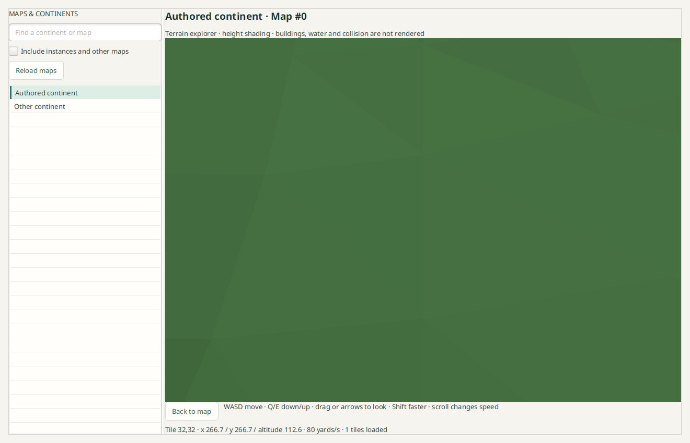
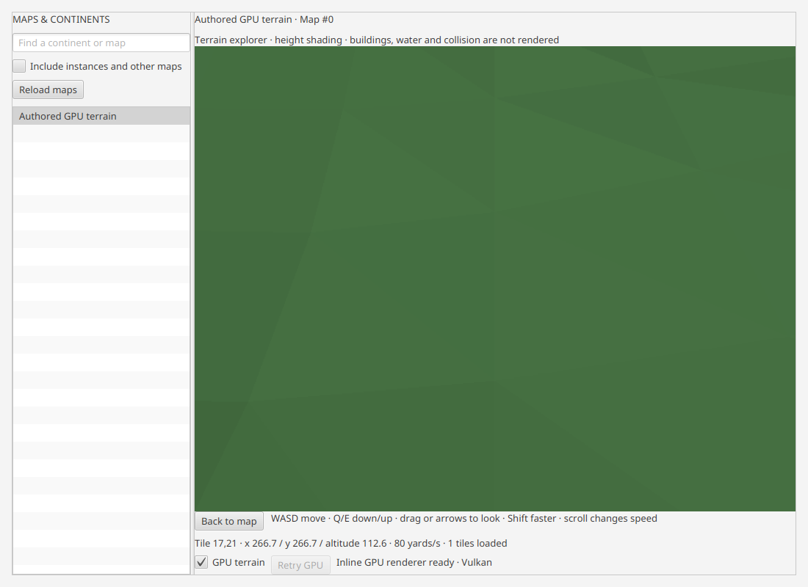
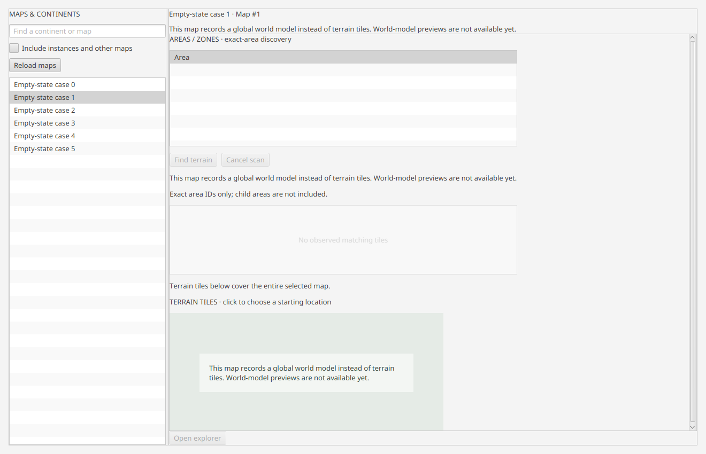
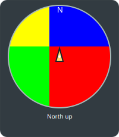

# World terrain explorer

Open a prepared build and choose **World**. The sidebar starts with continent
records (`Map.InstanceType=0`); include other maps to inspect instances/internal
records too. Search uses recorded map names and IDs. Select a map, inspect its
readable areas, choose a tile in its 64×64 terrain inventory, then Open explorer.
Selecting an area alone does not acquire terrain. **Find terrain** explicitly
checks the map's terrain files for that exact recorded area ID. Missing files may
be downloaded by the existing source service. Checked/total, matches, unavailable
files and Cancel remain visible. Child areas are not implicitly included.

Matching tiles receive blue outlines and appear in a result list while the full
continent remains visible. Choose a match, then **Open explorer**. Its source
content key and chunk evidence are revalidated before the initial camera uses an
actual retained terrain sample plus the normal altitude offset. A tile may contain
multiple areas; a fully holed match has no rendered entry. Changed sources require
finding terrain again. Canceled/failed scans retain explicit partial coverage;
no observed match does not prove that an entire zone has no terrain.

The screen grid uses filename-coordinate Y horizontally and X vertically. Drawing,
highlighting and hit testing share that mapping. WDT tuple/file identities and
3D terrain coordinates are retained. A correction fixes the transposed continent
outline: a read-only Eastern Kingdoms inventory spans42rows by23columns.
An authored asymmetric-grid test verifies orientation and exact clicked fileID. Zone-map artwork and spawn/pickup markers are tracked separately in #116.

Click the viewport to focus it. WASD moves horizontally, Space or E ascends and Q or X descends,
mouse drag or arrow keys changes view direction, Shift increases movement speed,
and the wheel moves along the view direction (Shift+wheel changes speed).
**Walk with collision** (or F) and **Fly with collision** (or G) move a body
that the camera follows: walking runs at 7 yards/s with gravity, Space to jump, a
slope limit and step-up; flying goes at least the 32 yards/s taxi speed. The
wheel or C zooms down to first person. Collision covers terrain so far, not yet
buildings or objects. **Smooth motion** eases the free camera only. See
[walk and fly movement](world-walk-fly-movement-checkpoint.md).
**Bookmark this view** saves the camera with its map identity and tile. Below the
tile inventory, **Bookmarks & travel** searches saved bookmarks and accepts typed
native coordinates; jumps are validated against the current build first. See
[travel and bookmarks](world-travel-bookmarks-checkpoint.md).
Back to map returns to tile selection. Leaving the
World area cancels background requests and pauses movement/rendering; returning
resumes the explorer. Closing/replacing a build drains its world service before
borrowed tables/files are retired.

## Current terrain zone and subzone

The explorer footer shows the recorded terrain area under the camera, including
its complete verified parent chain, for example **Elwynn Forest · Northshire
Valley · Northshire Abbey**. Moving or changing height does not trigger another
lookup or file request. The name comes from the unique loaded MCNK native XY
rectangle and AreaTable parent records, independent of camera altitude. Exact
shared boundaries use one half-open ownership rule; overlapping rectangles,
unloaded coverage, missing parents, cycles and map mismatches show **Terrain area
unavailable**. This does not identify WMO interior volumes.

Geometry and area facts are parsed together from the same authenticated root ADT.
The existing 12-tile service cache retains at most 3,072 chunk-area records, and
the viewport reuses its bounded loaded neighborhood. The catalog builds one
immutable ID index on its worker, limited to 100,000 area records; frame updates
perform bounded metadata lookup without table/file I/O or full catalog scans.

## Sky and fog lights

`WorldSky` works out sky colours and distance fog for a map position and time of
day from the Light, LightParams, LightData and Map tables. The renderer doesn't
use it yet; until it does, the explorer keeps its fixed sky and fog colours.

The reader accepts only the reviewed layouts of these tables, and only fields
whose names the definitions mark as verified:

- Light: `GameCoords`, `GameFalloffStart`, `GameFalloffEnd`, `ContinentID` and
  `LightParamsID[0]`.
- LightData: `LightParamID`, `Time`, the six `Sky*Color` channels, `FogEnd` and
  `FogScaler`.
- Map: `TimeOfDayOverride`.

Reviewed layouts: Light 5F16BC84; LightParams A7F31923 and 51C96BAD; LightData 360DA016
and 70C6CD80; Map D43AFAC3 and B47C6F05. The second of each pair is the classic layout
(2.5.6 for LightParams and LightData, 1.15.4 for Map). Each was checked against the
definitions for the fields read here: the same verified names, kinds, signedness and
array lengths. They differ only in fields this reader doesn't use and in whether the
record ID is stored inline. Any other layout is refused with the table's name. A Map
refusal only loses the fixed times.

Rows that can't be read are counted and skipped. A partial table is reported on
every result.

These rules come from the tables:

- A light belongs to the map named by its `ContinentID`.
- `GameCoords` share the native axes of terrain chunk origins: `[0]` is native X
  and `[1]` is native Y, in the same units. A check of every positioned light
  against its own map's terrain tiles supports this; other axis orders and
  scales fit far fewer lights.
- A light with zero coordinates and zero radii is the map-wide light.
- Times count half-minutes over a 2880-step day.
- A non-negative `Map.TimeOfDayOverride` fixes that map's time. Its unit is
  assumed to be the same half-minute step as `LightData.Time`; the tables don't
  record it.
- Colour cells have an empty top byte and are read as `0xRRGGBB`. Under this
  reading, sky colours in the recorded data are mostly blue-dominant.

The falloff follows established reference behaviour rather than the tables:

- **Falloff:** a light is a sphere. Its weight is 1 within its inner radius and
  drops linearly to 0 at its outer radius, over 3D distance. The wowdev wiki's
  Light page describes the sphere; Noggit's `Skies::findSkyWeights` uses the same
  3D distance and linear falloff. Six recorded lights sit deeper below the
  terrain than their outer radius, which only makes sense in 3D, as underground
  volumes.

These rules are this module's model, not recorded rules:

- **Overlap:** if overlapping positioned lights add up to more than 1, they are
  scaled to sum to 1. Otherwise the map's single map-wide light takes the
  remaining weight. Noggit differs here: the smaller light takes precedence and
  the larger ones are scaled down within its falloff band.
- **Time:** channels interpolate linearly between the two keys around the
  requested time, wrapping at midnight.
- **Parameter slot:** only parameter slot 0 is read. The tables don't record what
  the other slots mean.

A map with no map-wide light falls back to Light 1, as the client's documented
rule says: "If there is no (0,0,0) entry for a continent, use m_ID == 1 as
fallback" (the wowdev wiki's Light structure).

Some cases have no answer in the tables:

- A map with several map-wide lights. Which one applies may depend on zone
  lights or player conditions, which are not read here.
- A map with no map-wide light when Light 1 isn't recorded either.
- A parameter set without LightData rows.

In these cases the result names the gap and blends only the lights that remain.
It doesn't hide the gap by renormalising: `coverage` says how much of the
position the recorded lights cover. Callers mix their own fallback in by
`1 - coverage`, so the sky never snaps at a light's outer radius. If no light
remains, the result is unavailable (coverage 0).

`FogEnd` 0 means the row records no distance fog (3,362 of 6,008 rows in
70790). Fog distance and scaler are averaged only over keys and lights that
record fog. `fogShare` is how much of the value had recorded fog, so a key
without fog never pulls the distance toward 0. A share of 0 means no recorded
fog, and callers keep their own.

## Click to inspect

A still primary click in the explorer reports what lies under the pointer in the
footer (#180). A drawn NPC spawn marker takes priority: the footer shows the NPC
name, subname, level and rank from the same Polestar snapshot, the native
position, and the declared source record (`spawn` record `npc:<id>:<map>:<n>`,
recorded fields, client build and snapshot). An NPC without a record in that
snapshot is reported as "name unknown". Hidden markers are never picked.

Elsewhere, a CPU ray through the pixel is cast against the retained
rendered-surface heights (`TerrainGround`) up to 2,200 yards. A hit reports the map,
tile, native x/y/z, distance and the recorded terrain area at the hit point. The
area uses the same lookup as the footer. In GPU streaming mode, the controller's
retained resident area metadata answers the lookup, so a pick never borrows a
payload. Unresolved areas report the reason and the recorded area ID. Holes, sky
and unloaded tiles report that nothing was picked. Picks run on one worker, the
latest click wins, and results from a closed or changed selection are dropped.
Water and live creatures are not picked, and no identity is inferred.

### Drawn objects

In GPU streaming mode the same ray is also tested against the BASIC exterior
objects the hot child draws: buildings, MDDF doodads, WMO set doodads and the
opt-in static creature models (`-Dvimi.world.creatures=true`). The nearer of
the terrain hit and the object hit wins, as under the depth test.

- **Exact geometry.** When a tile's late objects attach, the GUI compiles
  `WorldObjectPicking.Tile` from the same validated tables it uploaded:
  - each placement's recorded position, scale and row-major rotation;
  - the drawn index ranges of its model;
  - the alpha of cutout and blended images.

  The ray is moved into each placement's model space. A model's drawn local
  bounds only reject rays early; a hit is always a drawn triangle, and both faces
  count because the pass does not cull. Cutout surfaces count where the bilinear,
  repeat-wrapped alpha of their uploaded image is at least the shader's 0.5
  reference, and blended surfaces where it is above zero. Eye depths beyond the
  shader's 2,200-yard discard do not count. When terrain misses, only that
  per-hit eye depth clips, never the ray distance, so off-axis objects near the
  frame corners stay pickable.
- **Source records.** Each file placement has the source record it was built
  from, recorded in file order, so the bridge's own draw-budget drops stay
  aligned:
  - a building shows its WMO FileDataID, the clicked group's ordinal and
    FileDataID, MODF record, unique ID, doodad set, name set and flags;
  - a doodad shows its M2 and SKIN FileDataIDs, MDDF record, unique ID and flags;
  - a set doodad shows its MODD entry, the doodad set it came from and its
    building's WMO and unique ID;
  - a creature shows its NPC record, display ID, CreatureModelData, model
    FileDataID and spawn record.

  Listfile paths come from file metadata only. A missing path reads "(name
  unknown)". Each source carries its placement's uploaded key: the file model
  index, position and scale. If the count or any key disagrees with the uploaded
  placements, for example after a reorder, every placement of that tile is
  reported as "source record unknown".
- **Highlight.** The selected placement's drawn local bounds, through its
  transform, are drawn as a wireframe box on an FX overlay. No GPU pass or
  shader is involved, and the box is not occluded by terrain. Clicking terrain,
  sky or a spawn marker clears the selection. When the tile stops being
  resident, the selection is retired.
- **Cost and lifetime.** Picks run on the existing pick worker, never on the FX
  thread or the frame loop, and never borrow a payload. Pick geometry is one
  bounded array copy on the exterior worker, after the objects copy, and it
  lives only as long as its resident: the controller republishes the drawn
  residents' tiles. A tile keeps positions, UVs and indices (20 bytes per vertex
  and 2 per index) plus one alpha byte per pixel of its cutout and blended
  images. For the version 2 maximum profile that is at most about 6.9 MB per
  tile (5.1 MB of geometry and 1.8 MB of alpha). With the hot child's 10 slots
  plus transient presented and committing entries, the worst case is about 70
  to 90 MB of heap. The measured real tiles (3,478 to 18,582 vertices) stay
  under 0.5 MB each.

## First-stage scope

This is a free-fly **terrain preview with BASIC diffuse textures**. It renders
source terrain heights, holes and qualified texture layers on GPU and in the
software fallback. The bounded atlas composition includes source tint and fog;
client height blending and nonlinear sharpening remain unsupported. Missing or
unsupported materials retain explicit partial/height fallback and a retry action.
Static water (lakes, sloped rivers and open sea) renders on the GPU path as an untextured
diagnostic teal overlay where the Source qualifies it (see
[visible water checkpoint](world-visible-water-checkpoint.md)); the CPU fallback shows terrain
only. Buildings, doodads, collision and creature models are not rendered yet; declared NPC spawn points can be shown as static markers (see [NPC spawn placement](world-npc-placement.md)). Global-WMO-only maps have no
terrain tiles and remain visible with that limitation. The default application viewport now uses inline bgfx GPU rendering on a
capable backend, with the bounded CPU renderer as fallback. No JavaFX3D pipeline
is required. **GPU terrain** selects the renderer; **Retry GPU** explicitly retries
a failed scene. Backend/activity feedback stays beside the controls. Unsupported
or failed native rendering retains the current camera/data and uses software.
Actual hardware qualification covers Linux Vulkan; Metal/D3D remain pending.

Readable PARTIAL Map/AreaTable rows remain usable. Unavailable tables, protected
terrain files and failed tiles report independent outcomes. Existing CDN/file
services authenticate, own, retain and account for original content; World does
not create another cache directory or contact a third-party service. A service
instance retains at most 12 parsed tiles; the viewport retains a 3×3 neighborhood.
Returning to retained files reparses a small terrain payload, avoiding a second
persistent representation of this geometry in the initial stage.

## Preparing visible terrain

Geometry and a terminal material outcome prepare together before a neighborhood
replaces the visible scene. The current scene remains available during source
work; activity continues through the accepted target frame or explicit fallback.
Initial display waits for the available nearby neighborhood. Work is coalesced
and canceled candidates release their geometry and atlas ownership before another
candidate is admitted.

Each neighborhood change still requires a cold native renderer handoff, which can
pause new camera frames. Persistent incremental GPU streaming remains a separate
prototype. The current3×3 view window is unchanged; fast movement may outrun loaded
coverage. This delivery does not promise game-like continuous movement yet.

## Data and format boundaries

`:concepts-world` exposes BuildWorld over borrowed BuildTables/BuildFiles. It
reads verified Map/AreaTable fields, then WdtFileDataID or a recorded map directory.
Map D43AFAC3 has a narrowly reviewed WdtFileDataID field-name admission: signed32,
FileData.ID foreign key, no raw physical interpretation. Other unverified fields
remain unavailable. Definitions do not grant blanket interpretation to raw fields.
A Map layout with no WdtFileDataID field at all binds its WDT through
`world/maps/<Directory>/<Directory>.wdt`, resolved by the build's file names, but only
when the layout is reviewed for it: B47C6F05 (classic clients since 1.15.4), whose
ID (non-inline 32-bit record ID) and Directory (plain verified string) match the
definitions. Other layouts without the field are refused with that reason. The Map
proof's source stamp and binding identity record which binding was used, and a
revalidation re-resolves the path, so a cached proof never switches binding or file.

`:formats-world` admits bounded WDT18 MAIN/MAID inventories and split-root ADT18
MCNK/MCVT heights. MAID supplies actual root ADT IDs; its mapTexture overview ID is
retained separately from terrain texture ADT data. Native world coordinates,
145-sample chunk grids, triangle fans and low/high-resolution hole masks follow
reviewed source layouts. Input is limited to 32 MiB and 256 terrain chunks.
Legacy monolithic ADTs with padding outside declared normal chunks are not an
admitted profile yet. The map inventory can remain useful when a terrain profile
is unsupported.

`:rendering-world` owns perspective camera transforms, near-plane clipping,
depth testing, height/slope shading, fog, cancellation and a per-frame raster
budget. Frames are bounded to 1200×800; the GUI requests at most 800×500. Camera
motion and neighborhood acquisition do not run on the JavaFX thread. Queued
results carry selection/frame generations and cannot overwrite a newer explorer.

Primary format references:
[WDT reader](https://github.com/Kruithne/wow.export/blob/main/src/js/3D/loaders/WDTLoader.js),
[ADT reader](https://github.com/Kruithne/wow.export/blob/main/src/js/3D/loaders/ADTLoader.js),
[terrain coordinate export](https://github.com/Kruithne/wow.export/blob/main/src/js/3D/exporters/ADTExporter.js).
No source/game assets were copied into the repository.

## Verification

```sh
./gradlew :formats-world:check :concepts-world:check :rendering-world:check :gui:check
# Requires a working JavaFX display:
./gradlew :gui:worldUiTest :gui:worldTravelUiTest :gui:worldSpawnsUiTest
```

`:gui:worldPickTest` (part of `:gui:check`) covers ray inversion of the terrain
projection, surface hits against authored planar heights, holes, sky and
underground cameras, marker hit order and the disclosure text.
`:rendering-world:test --tests '*WorldObjectPickingTest'` and `:gui:worldObjectPicksTest`
cover exact object hits against authored quads (recorded transforms, triangles
not bounds, nearest placement, depth discard, cutout and blended alpha), source
records, unknown names and the highlight projection.
`WorldStreamObjectsPickTest` pins the pick transform to the renderer's own model
matrices. `nativeGpuWorldStreamObjectsProof` checks on the real child that the
CPU pick agrees with the drawn pixels. A transparent cutout and a gap inside a
model's bounds pick nothing; the opaque and blended quads pick their ranges.

The authored UI fixture exercises selection, stale requests across map and
explorer sessions, background cancellation, rendering and borrowed lifetimes.
It can export an authored screenshot with
`-PworldScreenshot=/absolute/path/world-authored.png`.

A read-only Forever 1.60.1.70707 source proof resolved Map 0 → WDT FileDataID 775971,
736 terrain tiles, and tile32,32 → root ADT777947. The authenticated actual ADT
contained 256 chunks, 37,120 vertices and 65,488 triangles. A single 800×500 frame
rendered in approximately 24–28 ms on the development machine; this is a sample,
not a multi-tile frame-rate guarantee. Actual game payloads/proof images remain
outside the repository. The image below contains authored geometry only.



## Verified area discovery

The metadata path shares ADT18 chunk/header/MCVT validation with geometry, checks
all source-derived coordinates, and reads unsigned MCNK areaID at offset52.
It retains source-order chunk identities and chooses the first nonholed cell
center as an entry reference. Raw MCNK origin Z is a height base; the entry Z
includes the recorded MCVT sample. Fully holed chunks remain area evidence but
cannot supply an automatic terrain entry.

Discovery has one active worker and one latest pending request. It reads one
bounded32MiB source at a time, checks at most4096 unique inventory tiles, retains
at most4096 tile matches and32 diagnostic samples, and publishes counts at most
10Hz. It creates no persistent area index. Close drains reads without closing
borrowed file/table handles; stale area/map/workspace results cannot overwrite
newer activity or matching tiles.

Read-only/scratch Forever1.60.1.70755 acceptance resolved Eastern Kingdoms'736
inventory tiles and root ADT777947 at32,32. Its256 chunks recorded seven distinct
area IDs. An exact-area279 lookup matched one chunk, revalidated its source,
and used an entry point equal to an actual native mesh vertex. The original
application library stayed read-only; one missing tile was acquired into a
private scratch store. This is a one-tile source proof, not a completed continent
or zone-coverage scan. No game assets or screenshots enter Git.

## Inline GPU terrain

Terrain and model previews share one application-owned offscreen GPU child.
Height geometry is uploaded once per immutable tile snapshot as bounded48-byte
triangle instances. Camera updates carry free-flight coordinates without geometry
reupload or process restart. Tile-set replacement drains the old child serially,
keeps the previous readable image and shows activity until a current frame is
accepted by JavaFX. Hidden/iconified/inactive views retire their native owner.
An empty loaded neighborhood retires stale GPU output and renders software sky.

The GPU uses native coordinates, existing flat height/slope colors, original
triangle-depth fog, holes and near/far behavior. Qualified reversed D32F depth
preserves the tested close-surface ordering; homogeneous-depth backends fall back
to CPU. GPU camera controls may update faster while nearby-file checks stay near
10Hz. Requested frames preserve aspect ratio within800×500. Readback, parent copy
and final FX upload remain costs; this is not zero-copy or a universal speedup.

Independent acceptance includes27 feasibility and30 production Vulkan frames,
maximum nine-tile upload, source index37119, close/far overlap, opaque sky, typed
child IPC, camera/resize persistence and actual inline FX lifecycle/fallback.
All24 packaged shader blobs are hash-verified across four offline profiles.
See [terrain review](gpu-terrain-review.md) for exact scope and platform limits.

```sh
./gradlew :rendering-bgfx:nativeGpuTerrainProductionAcceptance
# Linux Vulkan and a working JavaFX display required:
./gradlew :gui:worldGpuUiProof
```



Streaming follows filename X along native world X and filename Y along native
world Y. Camera lookup uses the loaded origin tile’s native maximum on each
matching axis. This differs from the continent grid’s screen layout (filename Y
horizontally, X vertically). Keeping these mappings separate prevents walking
toward a tile from loading its transposed neighbor and evicting visible terrain.

Maps with no recorded terrain show an explanation directly over the tile panel.
A recorded global-world-model map explains the current model-preview limitation;
unavailable inventory is reported separately. These states disable actions that
require terrain tiles. This screenshot uses authored map records only.



The navigation regression uses an asymmetric origin and physically positioned
fixture tiles. Thirteen moves cover both directions on both native axes, returns
and all four diagonals, asserting both actual requested tiles and the retained
3×3 neighborhood. Actual viewport key events and deterministic timer steps verify
Space/E ascent, no doubled Space+E or Q+X speed, Q/X descent, opposing-key cancellation and key release. Independent
negative controls fail for the previous swapped lookup and previous E-only input.
Run it with `./gradlew :gui:worldNavigationUiTest` on a JavaFX-capable display.

## Explorer minimap

The top-right minimap offers **North up** and **Heading up** orientations. North
up keeps north fixed while the player arrow turns. Heading up keeps the arrow
pointed upward while artwork and the north marker rotate around the player.
Changing orientation redraws cached artwork without additional source reads.
The orientation selector is local to the viewer; it does not change game settings. Its regional coverage uses at most nine recorded MAID minimap IDs;
there are no guessed paths or invented markers. A local activity indicator covers
artwork loading, and missing/protected/unsupported sources remain visibly partial
or unavailable. The arrow tracks facing even when artwork is missing.

File acquisition and image decoding run off the JavaFX thread. Bounded detached
pixels are uploaded on FX; hidden views, changed sources and closed builds retire
requests and ignore late results. A resize cannot revive retired source artwork.
The dedicated authored proof is `./gradlew :gui:worldMinimapUiTest` on a desktop
display. These quadrant colors are authored orientation fixtures, not game art.



The service/component and final lifecycle hook received independent review.
Integrated World navigation/inventory/minimap and comparison FX checks pass,
along with the affected source/service/GUI checks. Actual game artwork and private
source proofs stay outside Git.

A read-only Forever70755 proof decoded recorded minimap IDs204477,204478,204517,
204476 and204437 for the five neighboring source tiles used in the native-axis
proof. All produced detached256×256 pixels with identical cold/warm output.
The first artwork was visually inspected locally. These sources have single
larger mip levels: the minimap consumer explicitly downsamples a declared mip
within512 pixels, while the generic decoder never invents or resizes mip levels.
Larger-only unsupported sources retain the visible fallback. Actual game pixels
remain private under `/tmp/vimi-live-mount79-proof`; none enter this repository.

## View wheel controls

The mouse wheel moves the free-fly camera forward or backward along its full
view direction, including pitch. This is a bounded camera dolly, so nearby
terrain grows or shrinks in view without changing the lens or orbiting a target.
Shift+wheel changes flight speed. Fine trackpad input stays proportional, and
large wheel events are capped. Terrain collision is not evaluated.
