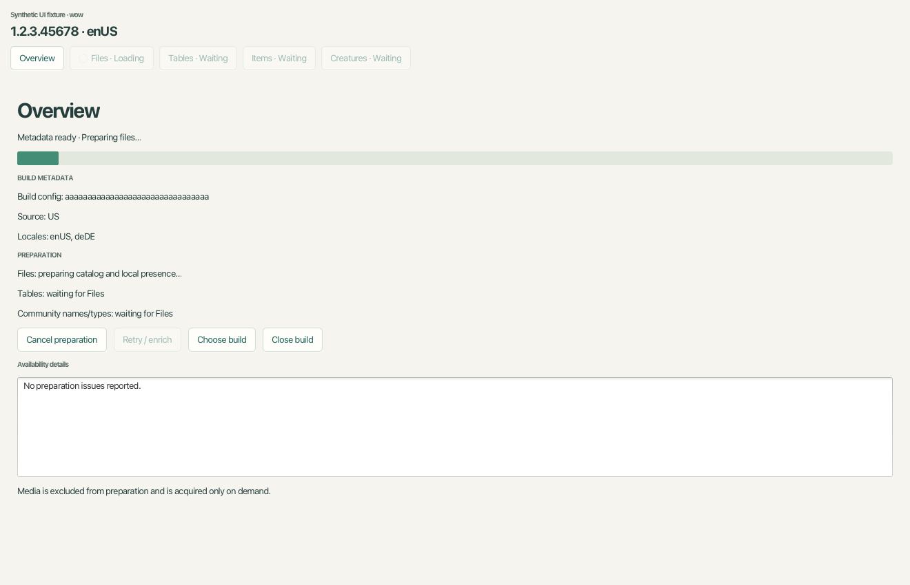
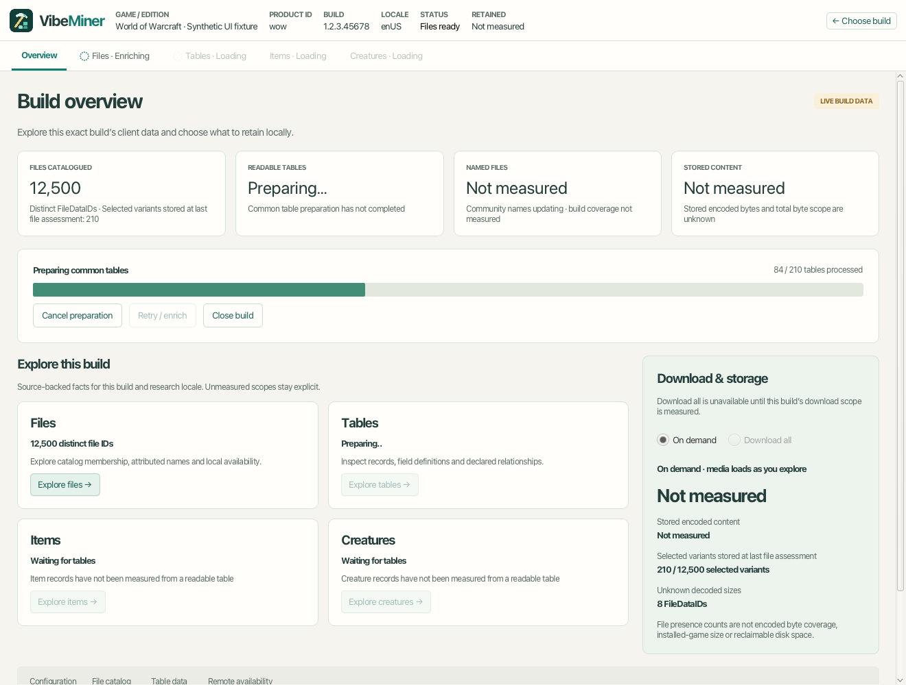

# Vimi JavaFX application

Builds now has product navigation on the left. **Settings → Products** persists
which channels appear; **Data Sources** manages real QuestieDB versions, filename
listfile updates and bundled-definition policy. See [source management](../docs/data-sources.md)
and [product settings](../docs/product-settings.md). Build Overview includes a
persisted Questie flavor mapping; this does not yet enrich Items results.

Default mode uses real build data. Opening a selected build/region/locale now follows
three preparation milestones:

1. **Metadata ready:** authenticated configurations, ENCODING and ROOT publish
   Overview before archive indexes finish.
2. **Files ready:** resolution indexes and locale-scoped FileDataIDs, available sizes
   and local presence are assessed without reading file payloads or requiring names.
3. **Tables ready:** key-table bootstrap, known-table processing and no-media lookup
   warmup complete. Every known table has an explicit outcome; protected, partial,
   missing or unsupported data does not masquerade as readable data.

Original and derived objects share the pack library and its SQLite ownership
catalog. Preparation readiness persists in `builds_preparation_*` tables alongside
build statuses; relational query-index bytes are excluded from build object sizes.
Cache hits update ownership and accounting even when no new bytes are stored.

Files becomes usable at its milestone. Tables, Items and Creatures share one initial
gate until the first table pass finishes. Overview and all four research areas now
use the approved light/teal grid-and-inspector design with live data. Files has
28px rows; Items has 36px quality-colored rows and a WoW-style tooltip. Tables
supports schema-named, cursor-paged record grids. Creatures exposes classification,
display/model references and source-table navigation.

Search runs against the catalog asynchronously. File substring searches scan up
to 2,000 records per request; an empty window can still offer Next page. Dropdown
filters and sorting apply to the current result page, explicitly labeled. Class
selection narrows the current page's subclass filter. Selection outside the current
page remains in the inspector with a notice; an enrichment revision invalidates
old details. Late replies cannot replace a newer search or mutate a closed view.

Item attribute semantics live in Layer 6, not GUI controls. Direct flat base stats
produce lines such as +20 Stamina with source provenance. Allocation-based Retail
stats remain unresolved pending the build-specific calculator described in
[Item attributes](../docs/item-attributes.md). Direct values do not include scaling,
bonus lists, enchantments or a player context. Selected item icons decode through
the image/file layers asynchronously; media failure does not replace local data.
Icon memory is bounded to 100 entries per browser. Model/appearance metadata can
be loaded independently; 3D rendering remains future work.

Files shows the selected locale/variant's decoded size and local presence. The
file-list contract does not expose encoded download size or every locale variant;
the real screen does not reuse the mock's illustrative encoded/variant values.

Community names/type hints enrich independently after Files/key bootstrap and never
block table readiness. Readiness and activity are separate: phases have measured
file/table counters when known, otherwise indeterminate activity. Menu indicators,
Overview and the persistent View entry remain informative when the popup is hidden.
Later enrichment retains the previous complete table/concept workspace until the
replacement commits atomically. Failed/canceled passes preserve that snapshot.

The original approved design remains available with `--mock`, including preparation,
Overview, Files, Tables, Items and Creatures. Mock mode uses authored fixtures and
performs no backend I/O. See [handoff.md](handoff.md) for the design decisions.

## Build and run

Requires a full JDK 25 and the native SQLite setup documented in the root README.
JavaFX 25.0.1 and backend dependencies are pinned/locked. From the repository root:

```sh
./gradlew :gui:check :gui:installDist
./gradlew :gui:run
# Design preview; no local store or network requests:
./gradlew :gui:run --args='--mock'
# Optional local paths on Apple Silicon:
./gradlew :gui:run -PsqliteLibrary=/opt/homebrew/opt/sqlite/lib/libsqlite3.dylib -PdataDirectory=/absolute/path/to/vimi-data
```

Use `gradlew.bat` on Windows. The GUI is now a root subproject; JavaFX remains
confined to layer 7. The prior `gui/settings.gradle` has been removed.
`installDist` produces `gui/build/install/vimi-gui-prototype/`; its launcher uses
the native artifacts for the build machine's OS/architecture. For a direct launcher
use `JAVA_OPTS` to supply `-Dvibeminer.sqlite.library=/path/to/library` and
`-Dvimi.dataDirectory=/path/to/data` when needed.

Default data lives under `~/Library/Application Support/vimi` on macOS,
`%LOCALAPPDATA%/vimi` on Windows and `$XDG_DATA_HOME/vimi` (or
`~/.local/share/vimi`) on Linux. It contains `objects/`, a separate `generated/` derived store and the disposable
`catalog.sqlite` projection. No existing C# data is imported automatically.
Startup reads saved history without network requests; **Refresh builds** observes
published metadata and persists it through the existing backend. This does not
download game content, establish content availability or measure retention.
Refresh issues remain inspectable without discarding readable history.
An indeterminate activity indicator and a “Refreshing builds…” button label stay
visible while refresh is running. Loading saved history also shows activity; no
percentage or transfer progress is inferred from the catalog API.

Application startup, refresh and resource closure run off the JavaFX thread;
refreshes coalesce and shutdown cancels/drains work before exiting. The check task
runs the original fixture harness and deterministic backend adapter checks. Native
Windows/Linux GUI execution, responsive/accessibility certification and native
release packaging remain separate work.

The interactions below describe **design preview** mode.

## Interaction review

- Search product/version, filter All/Prepared/Current, and select rows using
  the mouse or arrow keys. Columns can be sorted.
- A filtered-out selection stays visible in the inspector with an explanation.
- Open the selected build; Choose build restores the list and filters.
- Compare a measured Retail overview with Beta's unknown-size overview.
- Switch download mode, leave the overview and reopen it: the choice stays
  with that exact mock build for the current process.
- Resize down to 1000×680. The overview and inspector scroll independently.

## Layout and future adapters

- `src/main/java/com/vimi/gui/VimiApp.java`: JavaFX screens and session state.
- `BuildInfo.java`: immutable presentation facts; null size means unknown.
- `BuildService.java`: asynchronous catalog/open seam. A real adapter must keep
  I/O off the JavaFX thread; completion dispatch already uses `Platform.runLater`.
- `MockBuildService.java`: deterministic in-memory fixtures, no persistence.
- `src/main/resources/vimi.css`: shared light/teal desktop styling.
- `src/test/java/com/vimi/gui/PrototypeTest.java`: dependency-free checks of
  opening identity, fixture immutability, and unknown versus unopened sizes.

`check` runs the mock-boundary checks and compiles with compiler warnings treated
as errors. Automated UI coverage, actual preparation, download activity, Settings,
production Files, Tables, Items and Creatures services remain outside this design pass. New real
services should adapt to presentation models rather than expose store types to
controls. Download mode is deliberately local UI state until its command boundary
is designed.

Build source distinguishes Current (advertised at the last check), Saved
(previously observed by VibeMiner), and Community (third-party history, never
observed by VibeMiner). The Community fixture uses an explicitly fictional
provider, unknown availability, and no verified source route; Open is disabled
with an explanation. Source filters include all three states.

## Build area navigation

The build shell has Overview, Files, Tables, Items and Creatures. The exact build
identity stays above the menu; Choose build returns to discovery. Tables and Creatures use `MockResearchData`; Files and Items have dedicated
fixture catalogs and virtualized grids with selected-record inspectors. Views preserve search and selection per build during the session.
Items/Creatures source links select the corresponding mock table. All names,
IDs and field values are authored samples; no game data is decoded or fetched.

## Overview landing page

`BuildOverviewView` renders the landing page independently of the application
shell. `MockOverviewSnapshot` owns full-scale illustrative research counts for
the Retail fixture, distinct from the curated browser sample lists. Other
fixtures retain unmeasured scope as null. Counts are not claims about real builds.

Headline metrics show distinct FileDataIDs, readable tables versus definitions,
community-name coverage over the same catalog, and encoded content stored locally.
Research cards navigate into Tables, Files, Items and Creatures. Identity and
measurement scope expand beneath the readiness strip.

Download mode lives only in Overview’s Download & storage panel. On demand and
Download all are mutually exclusive, session-only mock settings. With unknown
encoded scope, Download all is disabled with an explanation and no percentage or
remaining-byte calculation is shown. No mode change starts a transfer.

## Compact file browser

`FilesView` uses a virtualized JavaFX TableView with fixed 28px single-line rows:
FileDataID, Name, Type, Size, Downloaded. Twenty authored fixtures live in
`MockFileCatalog`; filenames are community-attributed examples and types are
inferred from extensions, never claimed as content-verified. Search matches IDs,
names and full paths. Type and download-state filters combine with search.

The inspector shows full path/provenance and individual locale variants with
encoded/decoded lengths and local status. Grid sizes summarize encoded bytes
using a range when variants differ; unknown sizes/status remain explicit.
Size-summary sorting is disabled because ranges and unknown values do not have
a single natural ordering. Other columns are sortable, and filters respect it.
Selections and filters persist when navigating away and back. No real files,
folder trees, payload reads or backend connections are introduced.

## Simulated first-open preparation

Open a **Not prepared** build (for example PTR), or choose **Preview first-open
preparation** in a prepared build’s inspector. A popup over Builds shows four
stages: configuration verification, published download-size preparation, retained
content assessment, and Overview publication. The mock service advances every
3.5 seconds. Its spinner is indeterminate: stage ordinals are never percentages.
No real network, disk or backend work takes place.

- **Hide** or Escape leaves preparation running. Grid status and a header entry
  remain available. Hidden completion says **Ready to open** and never navigates.
- **View preparation** reattaches the existing job; successful completion while
  attached enters Overview. No duplicate operation is started.
- **Cancel opening** shows **Stopping…** before **Opening canceled**.
- **Simulate failure** latches a recoverable outcome; **Retry opening** starts a
  new generation. **Next stage** advances the mock without waiting for its clock.
- Prepared builds normally open directly. Preview explicitly replays preparation.
- One simulated preparation runs at a time. Other builds stay selectable, and
  already prepared builds can open while hidden work continues.

`MockPreparationService` owns jobs keyed by product, version, configuration and
source, independent of popup lifetime. `PreparationPopup` retains stable controls
while progress changes. Background content is disabled while the popup is shown;
Tab stays within it, Escape hides, and Hide restores invoking focus. No state is
persisted across app restarts. The deterministic lifecycle checks use manual
advancement with no timers, sleeps, credentials or backend dependencies.

Preparation gates only the Overview context. File catalog materialization,
research records, community names and Download all are separate future jobs, not
prerequisites represented by this popup. The Overview’s catalog statistics remain
authored illustrations; this mock does not implement those background workers.

## Items browser and tooltip

`ItemsView` renders ten authored items from `MockItemCatalog`. Each 36px
single-line row has a bundled 28px icon, quality-colored name, class, subclass,
quality, equipment slot and base item level. Name search is case-insensitive;
exact numeric Item ID search is also supported. Class, subclass, quality and
slot filters combine. Class changes reset and narrow the subclass choices.
An item hidden by filtering stays in the inspector with a notice.

The inspector uses a WoW-style dark tooltip with quality-colored name, item
level, binding, slot, stats, effect text and flavor text. Every displayed number
and effect is authored sample content, not computed gameplay values. Source
buttons open the mock Item and ItemSparse tables. Search and selection persist
when switching areas. Production tooltip fidelity requires the future semantic
item/facts/effects services; missing calculations must not be guessed.

Eight unmodified Blizzard sample icon JPEGs are bundled for offline display;
provenance is in `src/main/resources/items/README.md`. No runtime icon downloads,
game-byte decoding, external APIs or backend connections are introduced.

## Preparation and enrichment behavior

The source selector defaults to an observed US entry, preferring current US evidence.
Locale is selected separately (default enUS); unsupported build/locale choices are
reported explicitly. Hide continues the complete pipeline without surprise navigation.
Cancel preparation stops current work, retaining its last completed milestone.

**Retry / enrich** starts a new generation using valid local data. Reopening the app
restores metadata/index state from stored inputs and rechecks generated artifacts;
it does not trust a persisted boolean or require CDN reads when local inputs suffice.
The current configured table catalog/definitions are the pinned bundled WoWDBDefs
snapshot. Community names refresh through the existing cache/update policy; keys
come from that build's readable Tact tables. Additional community key/catalog
providers remain future adapters, not an implemented remote update service.

The preparation table ledger covers known nonzero FileDataIDs and excludes unknown
tables from scope. Absent build/locale tables are recorded separately. Readable
generated rows persist locally; prepared table queries use an isolated local-only
source with pinned build/key/definition context. Missing local artifacts produce
explicit unavailable/repair results instead of silently downloading in a detail view.
Media operations keep the online Files path.

Up to four build/locale contexts are retained; one initial preparation/enrichment
pipeline runs at a time. Previously prepared contexts remain browsable. Close build
releases its context asynchronously; app shutdown cancels and drains all contexts
and optional enrichment before closing storage.

Headless checks include lifecycle/generation/publication contracts, the readiness
activity matrix and isolated local-only reads. Native authored-fixture checks verify
early metadata before indexes, protected table outcomes, zero media acquisition or
header inspection, atomic retained workspaces and offline reopen. Broader interactive
UI/platform/accessibility and native release packaging qualification remain separate.

Preparation UI captures below use authored fixtures, not live build measurements:





## Live browser UI verification

`./gradlew :gui:researchBrowserDataTest` runs deterministic metadata-only search,
paging, cursor-close and cancellation checks without JavaFX startup. It is included
in `check` and hosted unit checks. Item attribute semantics have module JUnit tests.

`./gradlew :gui:researchBrowserUiTest` requires a graphical environment and is run
explicitly. It renders authored Files/Tables/Items/Creatures fixtures to
`gui/build/ui-review/`, checks the layer-projected tooltip and row navigation, and
verifies stale/closed request retirement. It is not part of headless hosted checks.
Committed screenshots in `docs/images/research-*.png` show fixtures, not live data.

Items and Creatures use 100-row browser pages; both Java concept services accept up to 500. Query factories are checked against the service validators so a limit mismatch cannot silently empty the grid. Request failures and empty availability states appear inside the grid, as well as in the footer.

## Durable reopen

Prepared immutable file records now live in the generated RecordFile store, keyed
by exact build/configuration/ROOT/ENCODING/locale and format version. A compatible
reopen validates the saved graph and restores counters without walking every
FileDataID or checking all local objects. Names/types stay independent. Presence
is checked when browsing; the Overview never restores an old stored count as current.
Initial catalog creation also avoids a full presence/name pass.

Decoded tables already persisted. The completed known-table outcome ledger now
persists too, keyed by source, pinned definitions/catalog, decoder policy, locale
and key fingerprints. A matching ledger restores with one inventory read, without
opening every readable table. Stale or missing/corrupt inventories fall back to
preparation; each requested table retains normal graph validation and repair.
Explicit enrichment reassesses the ledger. Key bootstrap and in-memory concept handles still
initialize on reopen; this is not a permanent ready flag.

Native integration checks reopen both stores and forbid repeated full file-ID
enumeration. Phase timing logs separate resolution-index opening and catalog work.

Items uses a persisted derived SQLite grid: search, dropdown filters and sorting
cover the complete prepared readable item set, and only the current 100-row page
crosses the GUI boundary. Item details/attributes are requested independently when
focused. Visible row icons load asynchronously without requiring focus. Class and
subclass use labels from the selected build locale. Other browser grids retain
their existing page-scoped dropdown/sort behavior for now.

The Builds list persists the last assessed milestone and locale in a bounded
application-history record in generated storage. These are historical assessments,
not live workspace readiness; a new workspace still verifies local artifacts.
History starts with assessments made by this version. An unassessed cache is shown
as such, rather than implying the build was never opened. Cached table verification
has a distinct restoration phase/counter; logs distinguish restored inventories
from fresh preparation and include elapsed times.

`./gradlew :gui:preparationHistoryTest` verifies history across reload, build/locale
isolation and restoration presentation. The native pipeline integration also
checks the historical assessment survives reopening the generated store.

## Background Download all

The live Overview now persists **Download all** independently of the selected
build. One build downloads at a time; others queue. Pause/resume, retry and
switching back to On demand retain stored content. Active policies resume when
the application restarts. See [Download all](../docs/download-all.md) for scope,
lifecycle and focused validation commands.

## Classic talents

Prepared Classic-style builds expose **Talents** after **Creatures**. A class menu
opens three trees derived from the selected build's verified client tables. Rank
badges mean recorded maximum ranks; this is a reference view, not a character
planner. Missing/protected data and unsupported Retail/Mists layouts are explicit.
No talent-domain projection or media fetch is added to initial preparation.
See [Talents](../docs/talents.md) for scope and checks.
